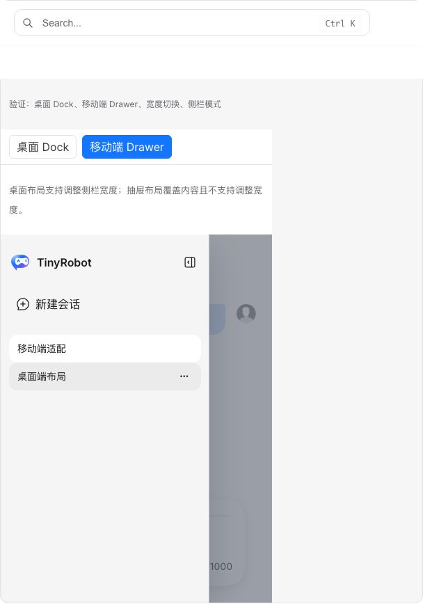
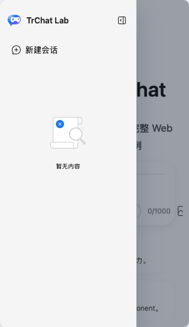

# TrChat 可访问性与键盘导航验收报告

- 验收日期：2026-10-29
- 浏览器：Chromium
- 原版基线：`docs/demos/chat/responsive-layout.vue`，`/suites/chat` 中“响应式布局”
- Web Component：`responsive-layout`，`/experiments/chat-web-component`
- 最终宿主：`packages/angular20-chat-experimental`
- 当前状态：**通过**

## 结论

本轮在原生 `TrLayout`、`LayoutAsideToggle` 和 `ChatMessages` 上补齐公共契约，Web Component 与 Angular 通过复用原生组件自动继承，不在适配层复制交互逻辑。原版 TrChat、Web Component 和 Angular 的移动端 Drawer 视觉与业务内容一致，抽屉语义、键盘关闭、焦点生命周期和流式消息日志状态均通过浏览器验证。

本轮采用以下最小契约：

- 移动端 Drawer 是带遮罩的模态 `dialog`，具有稳定 ID、`aria-modal` 和业务可访问名称；背景区域在打开期间使用 `inert`。
- 开关按钮通过 `aria-controls` 关联 Drawer，并通过 `aria-expanded` 反映状态。
- 打开后在 CSS 过渡结束时将焦点移入首个可见可操作元素；没有可操作元素时聚焦 Drawer 本身。Tab / Shift+Tab 约束在 Drawer 内，Escape 关闭并把焦点还给 opener。
- 非空消息区使用 `role="log"`、`aria-live="polite"`、`aria-relevant="additions text"`；发送或回答处理中 `aria-busy="true"`，完成后恢复为 `false`。空欢迎态不误标为消息日志。

## 三端浏览器对照

| 检查项            | 原版 TrChat                                       | Web Component | Angular 20                     | 结果     |
| ----------------- | ------------------------------------------------- | ------------- | ------------------------------ | -------- |
| Drawer 角色与名称 | `dialog`、`aria-modal=true`、业务名称             | 相同          | 相同                           | 一致     |
| Toggle 关系       | `aria-controls` 指向 Drawer，`aria-expanded` 同步 | 相同          | 相同                           | 一致     |
| 打开后的焦点      | 进入 Drawer 内首个可见控件                        | 相同          | 无可见控件时进入 Drawer 容器   | 符合契约 |
| Tab / Shift+Tab   | 在 Drawer 内循环                                  | 相同          | 继承同一原生实现               | 一致     |
| Escape            | 关闭 Drawer 并返回 opener                         | 相同          | 相同                           | 一致     |
| 背景区域          | 打开期间 `inert`                                  | 相同          | 相同                           | 一致     |
| 消息日志          | polite log，处理状态映射到 `aria-busy`            | 相同          | streaming `true`，完成 `false` | 一致     |
| 欢迎态            | 不创建空 `log`                                    | 相同          | 相同                           | 一致     |

浏览器人工操作同时确认：三端 Drawer 都完整覆盖主内容，遮罩范围正确，侧栏品牌、会话入口和空状态没有视觉回归；Web Component 与原版响应式 Demo 的布局尺寸和内容保持一致。Angular 390 × 844 视口下 Drawer 高度为 643.5px、宽度为 269px，未出现零高度或横向溢出。

## 截图证据

### 原版 TrChat

### Web Component

### Angular 20 最终宿主

截图证明三端关键视觉状态；ARIA 属性、焦点位置和 Escape 结果由浏览器 DOM 审计及自动化断言补充，不能只由像素截图证明。

## 实现位置

- `packages/components/src/layout/Layout.vue`：稳定 Drawer ID、模态背景 `inert`、Escape、焦点约束和关闭后焦点恢复。
- `packages/components/src/layout/LayoutAsideToggle.vue`：`aria-controls`、`aria-expanded` 和 opener 注册。
- `packages/components/src/layout/components/AsideContent.vue`：dialog 语义、业务名称、隐藏状态 `inert`，并在实际 CSS 过渡结束后进入焦点。
- `packages/components/src/layout/index.type.ts`：公共 `ariaLabel` 配置。
- `packages/chat/src/ChatUI.vue`：使用现有 labels / 右侧面板标题提供名称，并把 loading / processing 映射到消息日志 busy 状态。
- `packages/chat/src/ui/messages/ChatMessages.vue`：消息日志 live-region 契约。

## 自动化证据

- 原生组件专项：`LayoutAccessibility.spec.ts` 覆盖关系属性、焦点进入、Tab 循环、Escape 和焦点恢复；`ChatMessages.spec.ts` 覆盖 idle、streaming 和空欢迎态。
- Web Component：`responsive-layout` 专项覆盖 `aria-controls` / `aria-expanded`、dialog、焦点进入、Escape 和消息 log。
- Angular：390px 应用验收覆盖 Drawer 关系、焦点进入、Escape 返回；真实 Composer 发送覆盖 `aria-busy=true → false`。
- 本轮聚焦组件测试：9 / 9 通过，其中包含 Drawer 在开场过渡期间关闭后不得再次抢焦点的回归用例。
- 浏览器截图任务：原版 / Web Component 1 / 1 通过，Angular 1 / 1 通过；截图任务为一次性验收脚本，截图落盘后已移除脚本。

## 范围边界

- 本轮验证了标准 ARIA live-region DOM 契约及状态变化，没有代替 VoiceOver、NVDA、JAWS 的真实语音节奏测试。不同屏幕阅读器对连续 token 更新的合并和重复朗读可能不同，后续可在真实 streaming 服务验收时追加节流 announcer 评估。
- Drawer 当前按模态交互处理；未来若出现明确的非模态 Drawer 产品场景，应新增显式模式，而不是削弱现有默认契约。
- Chromium 已完成完整视觉和业务验收；Firefox / WebKit 的全量可访问性矩阵仍归入跨浏览器发布门槛。
