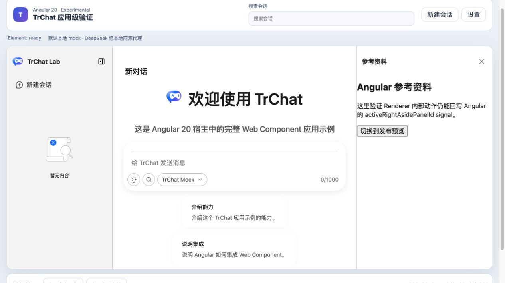
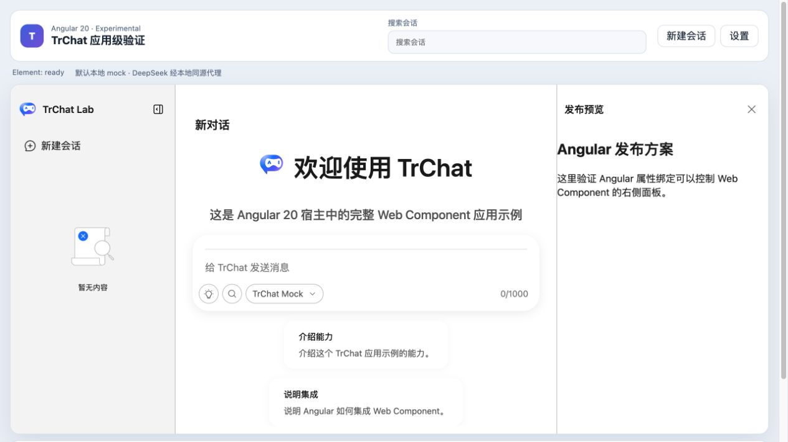

# Angular 右侧活动面板受控状态验证报告

- 验证日期：2026-10-28
- 浏览器：Chromium
- 截图视口：1265 × 835
- 原版 / Web Component 基线：[右侧业务面板验证报告](../right-aside-panel/report.md)
- Angular 消费者：`packages/angular20-chat-experimental`

## 结论

验收通过。Angular signal 可以通过 `activeRightAsidePanelId` property 选择 `preview` / `sources`；DOM Renderer 调用 `activateRightAsidePanel('preview')` 后，组件派发 `active-right-aside-panel-id-update`，Angular 从 `event.detail` 回写 signal。面板标题、Renderer 内容、宿主状态文案和公开 property 保持一致。

## 浏览器业务对照

| 场景            | 原版 / 原生 Web Component                         | Angular 20                                         | 结果 |
| --------------- | ------------------------------------------------- | -------------------------------------------------- | ---- |
| 外部选择资料    | `activeRightAsidePanelId = 'sources'`             | 点击“打开参考资料”后显示 `Angular 参考资料`        | 一致 |
| Renderer 内切换 | context 调用 `activateRightAsidePanel('preview')` | 点击“切换到发布预览”后显示 `Angular 发布方案`      | 一致 |
| 状态回写        | update event 后整体写回 property                  | signal 文案和 property 依次为 `sources`、`preview` | 一致 |
| 控制台          | 无相关 error / warning                            | 无相关 error / warning                             | 一致 |

## 截图证据

### Angular 选择参考资料

### Renderer 内切换回发布预览

## 自动化覆盖

Playwright 用例 `writes active right-aside panel updates back into the Angular signal` 覆盖 Angular 外部选择 `sources`、资料 Renderer 可见、公开 property 回写，以及 Renderer context 切换 `preview` 后的 UI、signal 和 property 一致性。

## 范围边界

- 面板内容使用 DOM Renderer，不跨 Web Component 边界传递 Vue VNode。
- 更多 panel id 复用同一 string property / CustomEvent 契约，不在本报告重复枚举。
