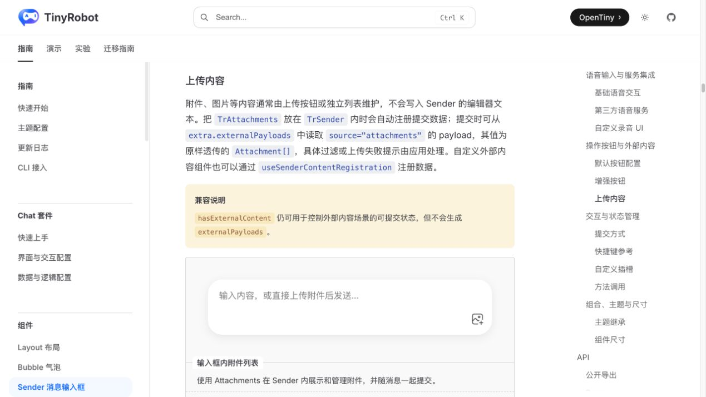
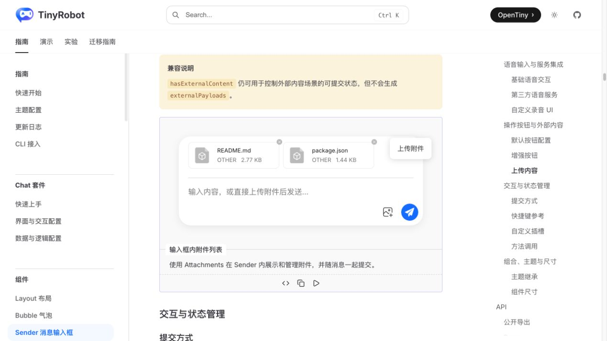
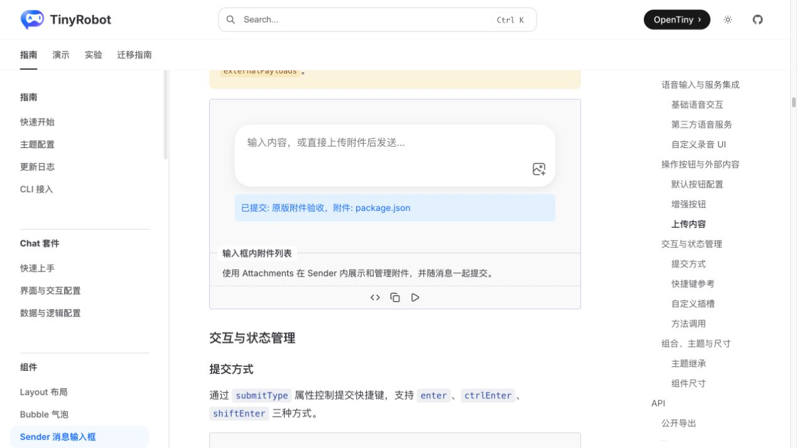
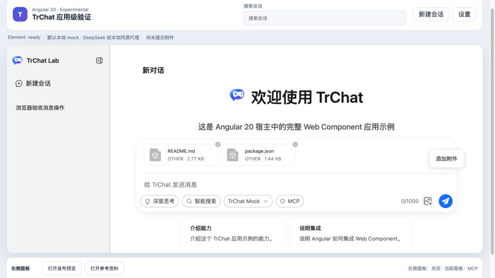
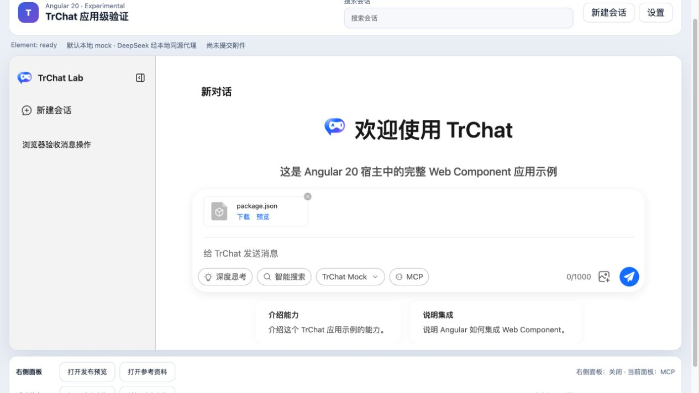
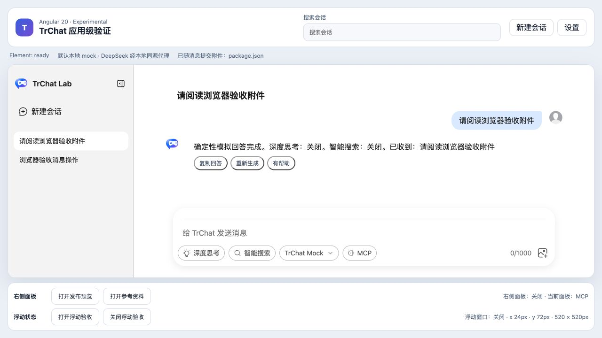

# Angular Sender 附件流程验证报告

- 验证日期：2026-10-28
- 浏览器：Chromium
- Angular 消费者：`packages/angular20-chat-experimental`
- 原版基线：`docs/demos/sender/attachments-in-sender.vue`

## 结论

验收通过。原版 `TrAttachments` 和 `UploadButton` 已下沉到 TrChat 原生 `ChatSender`；Custom Element 公开受控 `attachments` property，并以 `attachments-select`、`attachments-update` 和 `attachment-error` DOM 事件连接 Angular。选择、移除、随消息提交和成功后清空均保持原版 Sender UI 与业务顺序。

Angular 只管理附件数组和后端边界，没有在宿主重画附件卡片。`ChatSendPayload.attachments` 把最终附件随文本送入 Runtime；本地演示回显文件名，用于证明协议透传，不代表文件已上传或解析。

## 浏览器业务对照

| 场景   | 原版 Sender                                            | Angular 20 + Web Component                | 结果         |
| ------ | ------------------------------------------------------ | ----------------------------------------- | ------------ |
| 选择   | 文件选择器一次选择 README 与 package.json              | 同样选择两个真实文件                      | 一致         |
| 展示   | 原版 `TrAttachments` 显示两张附件卡                    | Web Component 内同一原版组件显示两张卡    | 一致         |
| 移除   | 删除 README，仅保留 package.json                       | 删除 README，仅保留 package.json          | 一致         |
| 提交   | 文本与 package.json 同时提交                           | `ChatSendPayload` 包含文本与 package.json | 一致         |
| 清空   | 成功提交后附件卡清空                                   | 成功提交后受控 property 与 UI 清空        | 一致         |
| 控制台 | 切页时出现既有 VitePress Demo 渲染告警，目标流程仍完成 | Angular 无 error / warning                | 目标流程通过 |

## 截图证据

### 原版

### Angular

## 自动化覆盖

Playwright 用例 `selects, removes, submits, and clears Sender attachments` 使用真实 file chooser 覆盖多选、原版附件卡、单项移除、消息 payload、宿主状态回显和成功后清空。

## 范围边界

- 已通过：选择、受控列表、移除、消息协议透传、成功后清空。
- 未验证：上传鉴权、对象存储、病毒扫描、内容解析、进度、取消、失败重试和恢复。
- `File` 只通过 DOM 事件交给 Angular；生产系统必须由宿主决定上传和数据安全策略。
