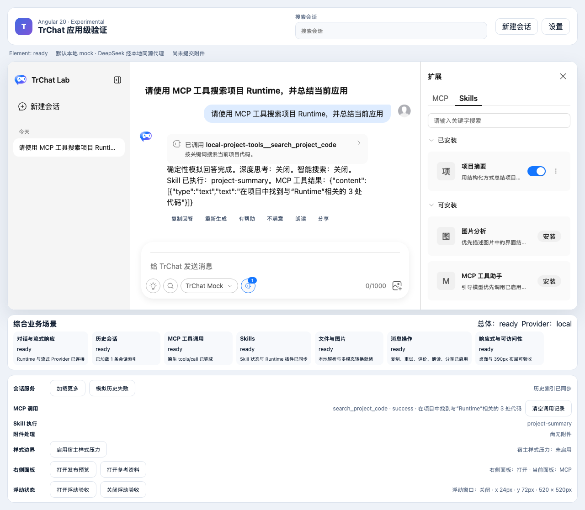
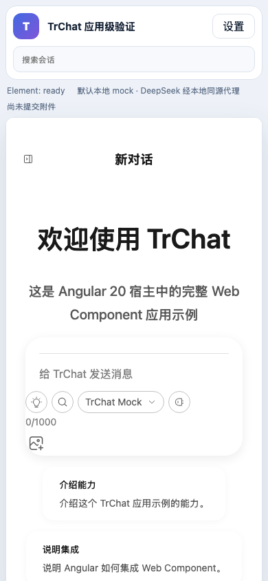
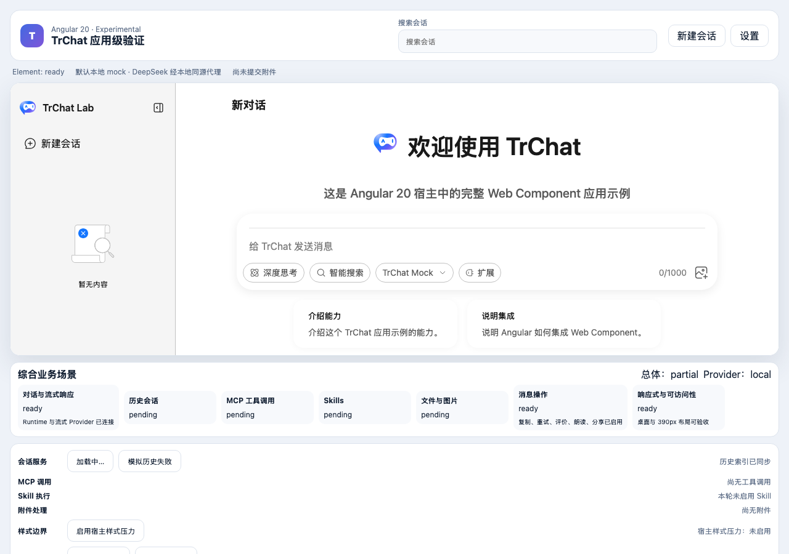
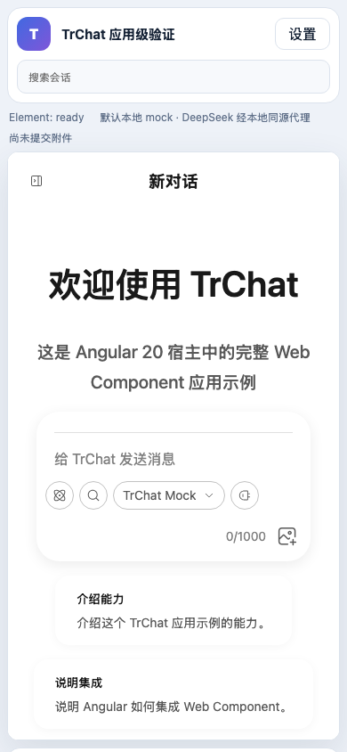

# Angular 20 × TrChat Web Component 综合应用验收报告

## 结论

综合测试应用已覆盖 7 类业务场景，直接消费 npm 已发布的 `@opentiny/tiny-robot-chat@1.0.0-alpha.0` 与 `@opentiny/tiny-robot-kit@1.0.0-alpha.0`，不再通过 `workspace:*` 或本地 Chat 构建取巧。默认使用确定性本地 Provider，可在没有密钥和外部服务的情况下完整验收；DeepSeek 通过同源开发代理按需启用。当前结论为：**已发布 alpha 的应用级综合验证通过，真实外部服务仍需提供凭据和端点后单独验收。**

项目目录：`packages/angular20-chat-experimental/`

发布包来源契约：`scripts/verify-published-alpha-consumers.test.js` 会校验 manifest 固定版本、实际 package manifest 版本和 pnpm registry store 实路径，并拒绝解析到 `packages/chat` / `packages/kit`。

DeepSeek 本地配置：`packages/angular20-chat-experimental/.env.local`

```dotenv
DEEPSEEK_API_KEY=sk-your-deepseek-api-key
DEEPSEEK_API_BASE_URL=https://api.deepseek.com
```

修改 `.env.local` 后需要重启 Angular 开发服务器。

## 场景矩阵

| 场景             | 组件 / Runtime 能力                              | Angular 宿主能力                                                 | 结果 |
| ---------------- | ------------------------------------------------ | ---------------------------------------------------------------- | ---- |
| 对话与流式响应   | `TrChat`、Sender、Bubble、模型能力、停止生成     | 本地 SSE Provider、DeepSeek 同源代理                             | 通过 |
| 历史会话         | History、Runtime 会话动作、状态事件              | 分页仓库、分组、搜索、失败与重试、持久化                         | 通过 |
| MCP 工具调用     | Extension Manager、MCP Runtime adapter、工具消息 | `initialize`、`tools/list`、真实 `tools/call` 模拟服务与调用记录 | 通过 |
| Skills           | Skills 页签、扩展详情、Runtime plugin            | TinyRobot Kit `skillPlugin`、安装/启用/本轮选择/恢复             | 通过 |
| 文件与图片       | Sender 附件、受控附件 property                   | 文本解析、PNG/JPEG 预览、多模态 payload、重试/取消/清理          | 通过 |
| 消息操作         | Bubble DOM Renderer                              | 复制、重试、评价、朗读、分享及能力降级                           | 通过 |
| 响应式与可访问性 | Drawer、消息日志、Sender                         | Angular 页面外壳、390px 布局、焦点与 Escape                      | 通过 |

## 关键实现边界

- `CreateChatRuntimeOptions.plugins` 允许 Angular 把 Kit Skill 插件交给原生 Runtime，不需要复制 Vue 组件状态机。
- `transformSendPayload` 在 Runtime 边界把 Angular 的附件记录转换成文本和 `image_url` 消息内容，结构化-only 发送也可用。
- 历史服务由 Angular 仓库模拟，Runtime snapshot 是唯一会话事实来源；刷新请求被统一串行和合并，避免消息流结束后的并发刷新覆盖错误态或搜索结果。
- MCP 场景不是只展示卡片：模型先返回 `tool_calls`，Runtime 发起 JSON-RPC `tools/call`，再把工具结果交给模型生成最终流式回答。
- 默认本地 Provider 不发出外部网络请求。真实 DeepSeek key 只由开发代理读取，不进入浏览器 bundle 或 Runtime options。

## 浏览器视觉验收

桌面综合态已完成历史、Skill、图片附件和 MCP 工具调用，场景面板显示 `总体：ready`：



390px 视口验证页面无横向滚动，移动 Drawer 可操作；本轮浏览器复核还发现 Sender 的附件按钮在窄容器下越出输入器，已在原生 Sender footer 中改为分行布局，并增加附件按钮边界断言：



切换到已发布 alpha 后重新执行浏览器视觉复核。桌面初始态结构与原验收一致；直接以 390px 打开应用时曾发现 `defaultOpen: true` 让 Drawer 覆盖主内容，Angular 宿主现按 TrChat 的 `960px` 移动断点设置初始开合，并增加直接窄屏入口回归：





浏览器控制台错误：0。

## 自动化证据

| 范围                                  |                                                                           结果 |
| ------------------------------------- | -----------------------------------------------------------------------------: |
| 发布包消费者契约                      |                                                                   2 / 2 passed |
| Angular unit                          |                                                                 20 / 20 passed |
| Angular Chromium E2E                  |                                                                 26 / 26 passed |
| React Chromium E2E                    |                                                                   3 / 3 passed |
| 历史失败 + 消息复制稳定性复验         |                                                    6 / 6 passed（各重复 3 次） |
| TrChat Runtime unit                   |                                                                 23 / 23 passed |
| Web Component Elements component test |                                                                 17 / 17 passed |
| Chat type-check                       |                                                                         passed |
| Components production build           |                                                                         passed |
| Chat stable / experimental build      |                                                                         passed |
| Angular production build              | passed；Node 22.23.4，initial bundle 2.24 MB，保留 2.20 MB warning budget 提示 |

本机默认 Node 26.11.1 不在 Angular 20 支持范围，并会在 esbuild 服务阶段 `SIGABRT`；同一工作树切换到 Node 22.23.4 后 unit、build 和 E2E 均通过，因此验收与 CI 应固定使用受支持的 Node LTS。

## DeepSeek 模型依据

2026-10-30 依据官方文档配置：

- `deepseek-flash`：应用中显示为 DeepSeek V4.1 Flash，支持文本和图片输入。
- `deepseek-v4-pro`：文本输入。
- 两者提供 `low`、`high`、`max` 思考强度选择。

来源：[DeepSeek 模型列表](https://api-docs.deepseek.com/api/list-models/)、[Agent 集成快速开始](https://api-docs.deepseek.com/quick_start/agent_integrations/)、[更新记录](https://api-docs.deepseek.com/updates/)。

## 未覆盖与下一步

- 没有使用真实 DeepSeek key，因此不能把本地代理契约测试记为真实模型通过。
- 外部 MCP 的鉴权、跨域、超时、断线和资源释放仍需真实 endpoint。
- 附件上传鉴权、远端存储、OCR/文档解析和病毒扫描属于生产服务，不由本地 Demo 代替。
- 后台评价、渠道分享和原位替换式重试仍需产品服务协议。

这些限制不阻塞综合测试应用本身，但继续阻塞“稳定生产发布”的结论。
