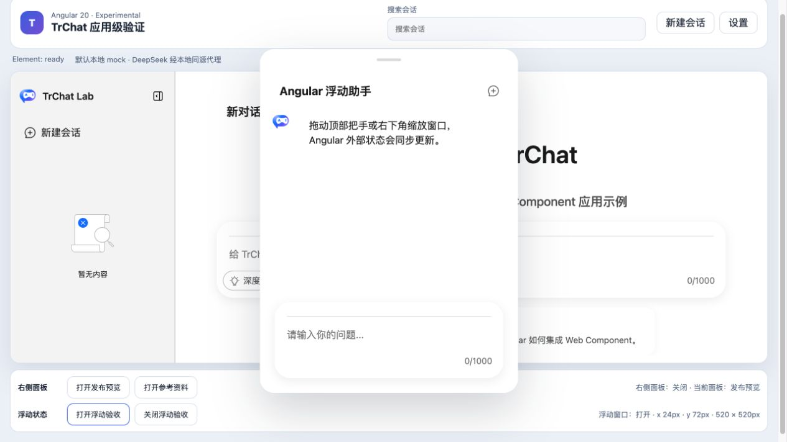
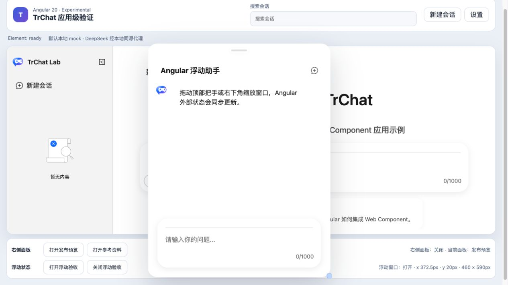

# Angular 浮动窗口受控状态验证报告

- 验证日期：2026-10-28
- 浏览器：Chromium
- 截图视口：1265 × 835
- 原版 / Web Component 基线：[浮动布局验证报告](../floating-layout/report.md)
- Angular 消费者：`packages/angular20-chat-experimental`

## 结论

验收通过。Angular 使用 `floatingState` property 传入完整几何对象；拖动和缩放触发 `floating-state-update` 后，宿主从 `event.detail` 创建新对象并整体写回 signal。浮动 surface、状态文案和元素公开 property 同步更新，符合既定 shallow property 契约。

## 浏览器业务对照

| 场景     | 原版 / 原生 Web Component              | Angular 20                                       | 结果 |
| -------- | -------------------------------------- | ------------------------------------------------ | ---- |
| 初始状态 | top-right，x 24px，y 72px，520 × 520px | 打开前后状态文案与 property 相同                 | 一致 |
| 打开窗口 | 原生 `TrChatUI` 浮动 surface           | 显示“Angular 浮动助手”和消息内容                 | 一致 |
| 拖动     | 坐标通过 update event 回写             | 浏览器操作后状态变为 x 372.5px、y 20px           | 一致 |
| 缩放     | 宽高受 min/max 与视口边界约束          | 最终状态为 460 × 590px，状态文案与 property 相同 | 一致 |
| 控制台   | 无相关 error / warning                 | 无相关 error / warning                           | 一致 |

最终几何受当前浏览器视口边界约束，因此验收判断是“拖动后的坐标发生有效变化、缩放后的宽高相对拖动状态增加并完成回写”，而不是强制要求宽度大于初始 520px。

## 截图证据

### 初始浮动窗口

### 拖动并缩放后

## 自动化覆盖

Playwright 用例 `writes floating drag and resize updates back into an Angular-owned state object` 覆盖初始完整几何对象、打开状态、拖动后的外部状态变化、东南角缩放后的宽高增加、公开 property 与 Angular 状态文案一致。

## 范围边界

- 本轮使用鼠标拖动与缩放；触摸手势和跨屏窗口不在范围内。
- `floatingState` 必须整体重新赋值，嵌套原地修改仍不属于支持契约。
