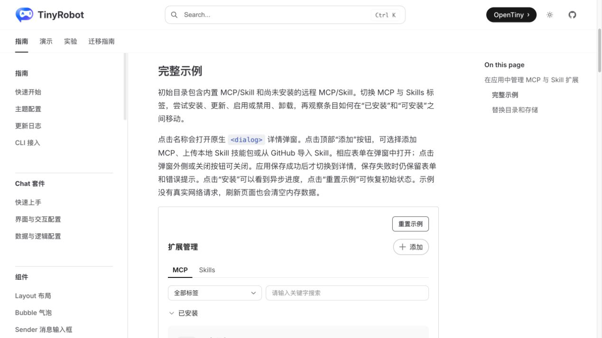
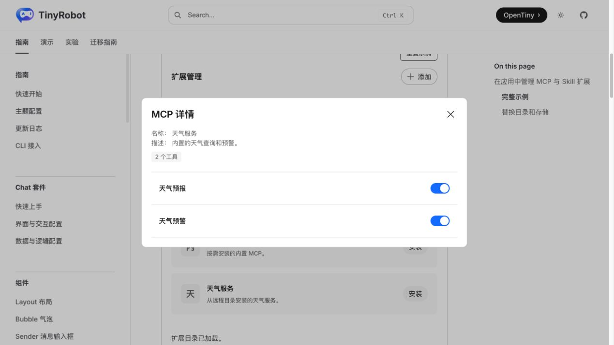
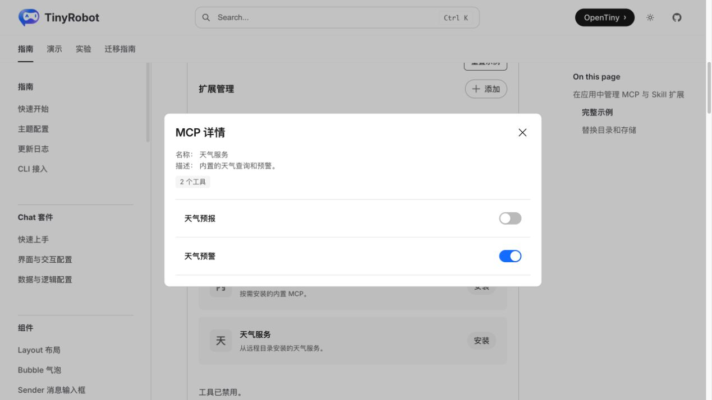
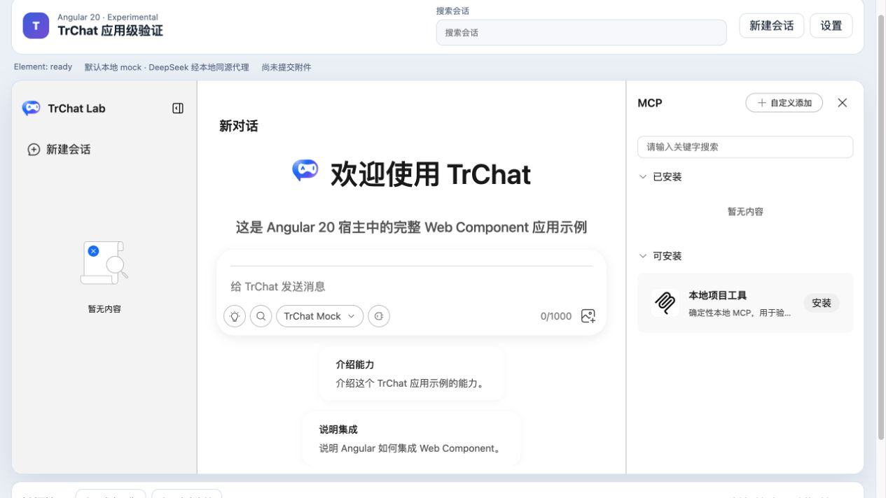
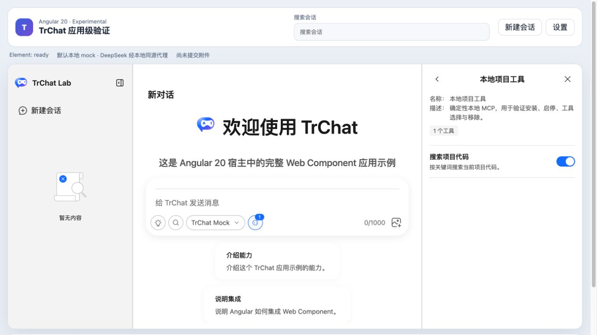
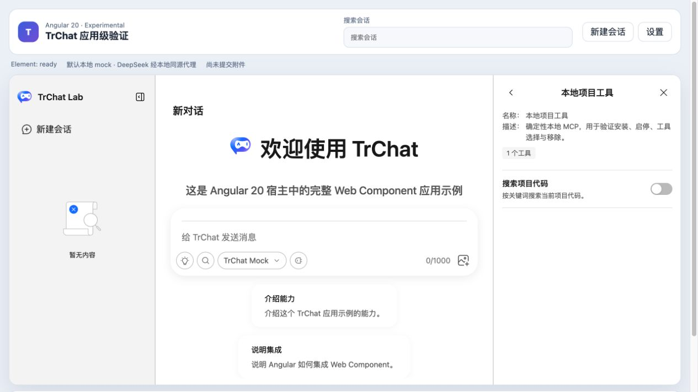

# Angular MCP 管理流程验证报告

- 验证日期：2026-10-28
- 浏览器：Chromium
- Angular 消费者：`packages/angular20-chat-experimental`
- 原版基线：`docs/demos/best-practices/extension-manager-integration/integrated.vue`

## 结论

验收通过。Angular 通过 `<tr-chat>` owned Runtime 和公开右侧面板完成 MCP 服务安装、服务详情、工具列表、工具启停与卸载；Web Component 内仍使用原版 `ExtensionManager`、MCP 详情和工具开关，不在 Angular 重写 Vue UI。

本次端点是同源确定性 JSON-RPC `/mock-mcp`，覆盖 `initialize`、`notifications/initialized` 和 `tools/list`。它证明 Runtime、管理界面和 MCP 传输发现链路可用，不等同于真实外部 MCP 服务兼容性验收。

## 浏览器业务对照

| 场景     | 原版 TrChat / ExtensionManager | Angular 20 + Web Component         | 结果 |
| -------- | ------------------------------ | ---------------------------------- | ---- |
| 服务列表 | 显示已安装和可安装服务         | 显示“本地项目工具”，支持安装与卸载 | 一致 |
| 服务详情 | 打开“天气服务”并显示两个工具   | 打开“本地项目工具”并显示发现的工具 | 一致 |
| 工具开关 | “天气预报”由启用切为禁用       | “搜索项目代码”由启用切为禁用       | 一致 |
| 状态回写 | 原版 manager 状态即时更新      | Runtime snapshot 与界面同步更新    | 一致 |
| 控制台   | 业务操作完成                   | Angular 无 error / warning         | 通过 |

## 截图证据

### 原版

### Angular

## 自动化覆盖

Playwright 用例 `manages an MCP server and its tools through the Runtime-backed panel` 覆盖安装、详情、工具发现、工具禁用、面板返回和卸载，并检查最终服务状态。

## 范围边界

- 已通过：管理 UI、Runtime 状态、JSON-RPC 初始化和工具发现。
- 未验证：真实远端鉴权、跨域、断线重连、超时、服务端错误、工具执行和资源释放。
- 真实 endpoint 仍属于 P0 服务验证，不因本地确定性端点而判定完成。
