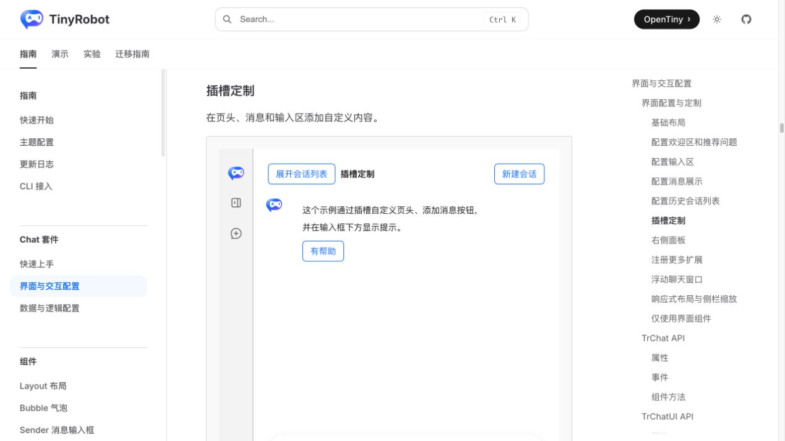
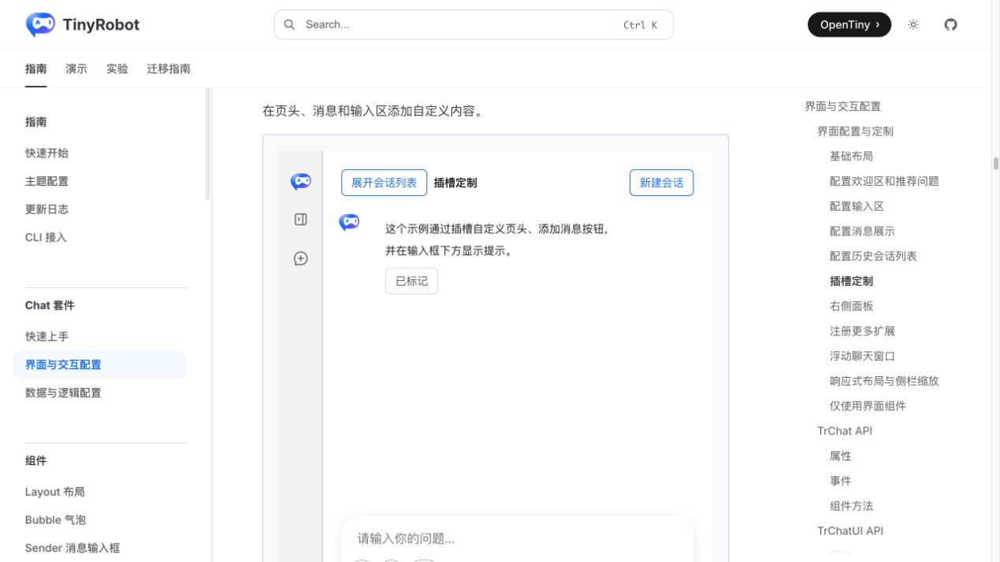
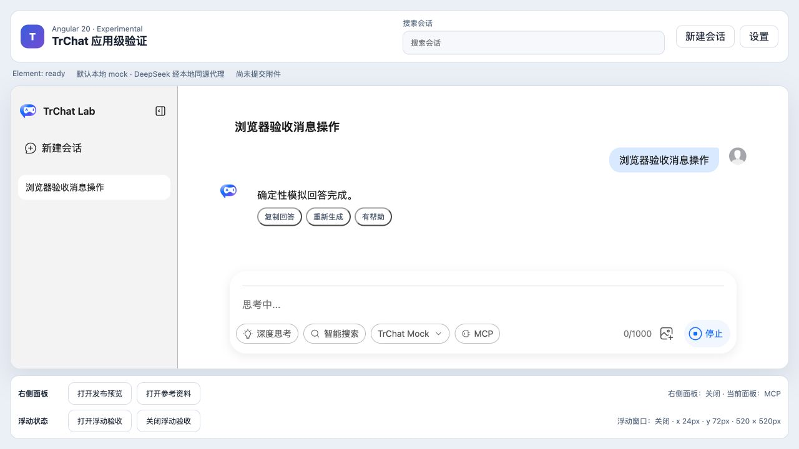
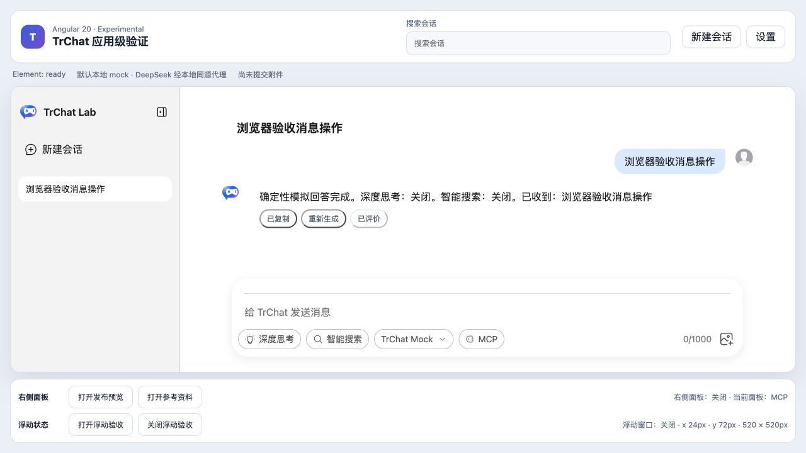
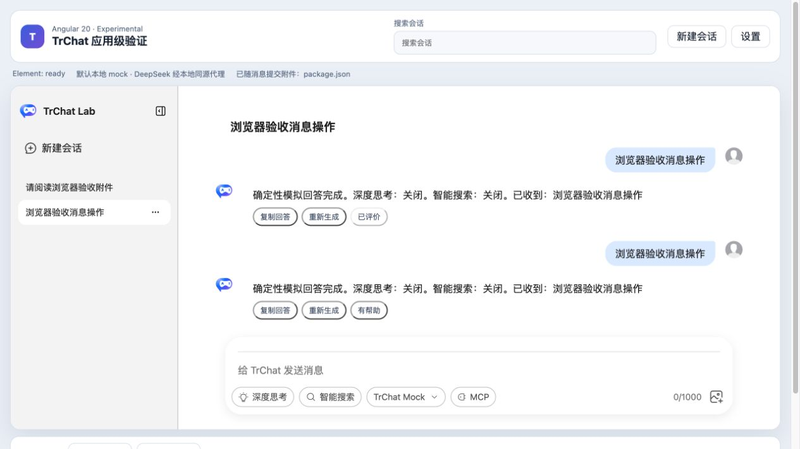

# Angular Bubble 消息操作验证报告

- 验证日期：2026-10-28
- 浏览器：Chromium
- Angular 消费者：`packages/angular20-chat-experimental`
- 原版基线：`docs/demos/chat/slots-basic.vue`

## 结论

本批验收范围通过：Angular 使用 `bubble-content-footer` DOM Renderer 为助手消息提供“复制回答”“有帮助”“重新生成”，不把 Angular 模板或 Vue VNode 跨 Custom Element 边界传递。

“有帮助”与原版 TrChat slot 示例的“有帮助 → 已标记”行为一致；复制通过浏览器 Clipboard API 返回完整回答；重新生成通过元素公开 `send()` 重新发送对应用户问题。Runtime 当前没有原位替换回答的 regenerate 命令，因此重新生成会追加一组用户和助手消息，这是明确的宿主适配语义，不冒充原位重试。

## 浏览器业务对照

| 场景     | 原版 TrChat                                            | Angular 20 + Web Component                  | 结果               |
| -------- | ------------------------------------------------------ | ------------------------------------------- | ------------------ |
| 反馈     | `bubble-content-footer` 显示“有帮助”，点击后为“已标记” | DOM Renderer 显示“有帮助”，点击后为“已评价” | 主要业务一致       |
| 复制     | 原版基线未提供内置复制业务                             | Clipboard API 写入当前助手完整文本          | 宿主扩展通过       |
| 重新生成 | 原版基线未提供 Runtime 原位重试                        | 通过公开 `send()` 重新发送匹配的用户问题    | 宿主适配，语义不同 |
| 生命周期 | Vue slot 随 Bubble 生命周期管理                        | Renderer 使用 `AbortSignal` 清理监听        | 一致               |
| 控制台   | 原版反馈操作成功                                       | Angular 无 error / warning                  | 通过               |

## 截图证据

### 原版

### Angular

## 自动化覆盖

Playwright 用例 `copies, rates, and retries the matching assistant response` 覆盖 Clipboard 精确文本、评价状态和对应问题重发；重发完成后断言两条用户消息与两条助手消息。

## 范围边界

- 本批通过：复制、正向反馈、宿主重发式重新生成。
- 未覆盖：负向反馈原因、朗读、分享、后台评价服务和原位替换回答。
- 因剩余操作尚未验收，应用矩阵中的“消息操作完整语义”仍为 `partial`，不能计作全部完成。
