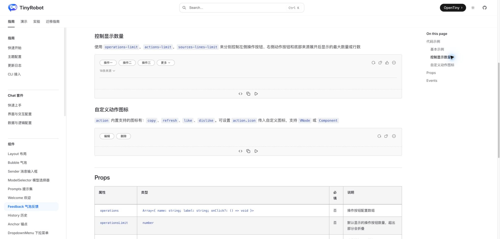
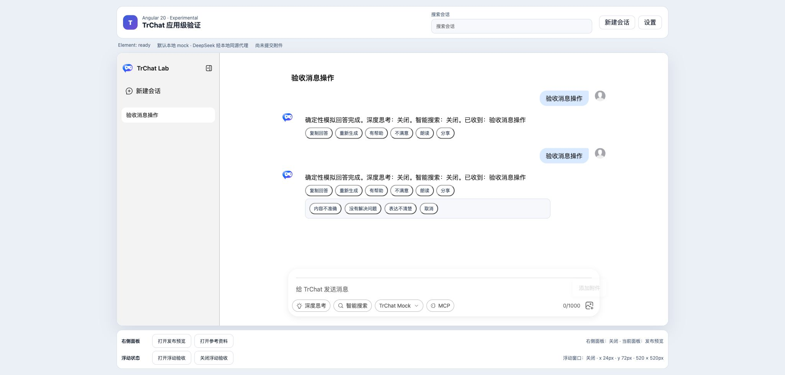
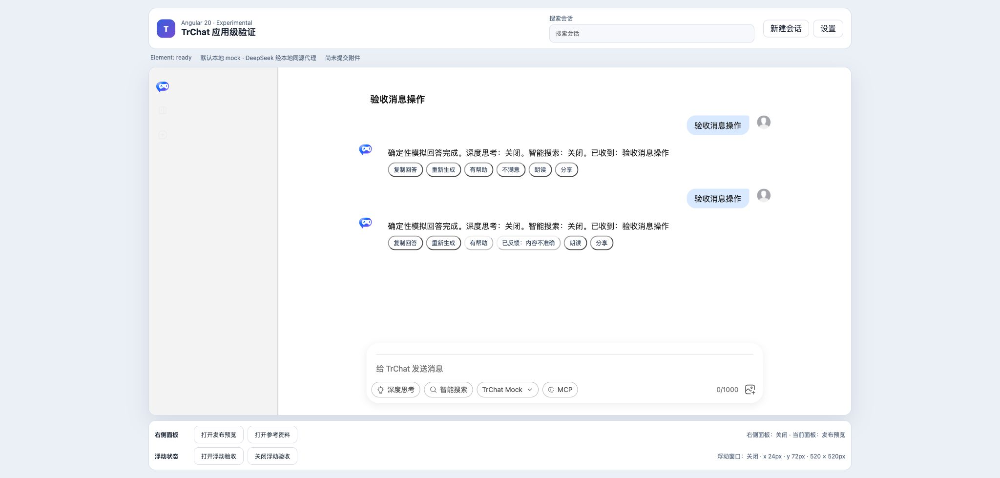

# Angular 负向反馈验收报告

## 结论

**通过。** Angular 20 应用通过 `bubble-content-footer` DOM Renderer 在原版 Bubble 下方提供“不满意”入口、原因选择和已记录状态。原因写入 Angular 宿主状态；同一回答的正向与负向反馈互斥。流式回答期间消息操作统一禁用，回答完成后恢复，避免 Renderer 重建导致原因面板闪退。

## 原版边界与实现方式

- 原版 `TrFeedback` 支持 `copy`、`refresh`、`like`、`dislike` 等动作配置及事件回调，负责承载动作栏，不内置“不满意原因”产品流程。
- Angular 不复制 Bubble 或 Feedback 的 Vue 实现，而是使用 Web Component 公开 DOM Renderer 上下文和 `AbortSignal` 生命周期。
- 反馈原因按会话与消息索引记录在宿主 `Map`；Renderer 重建后会恢复“已反馈：内容不准确”，并禁用“有帮助”。

## Demo 与自动化

- Angular Demo：`packages/angular20-chat-experimental/src/app/app.ts`
- 样式：`packages/angular20-chat-experimental/src/app/app.css`
- Playwright：`packages/angular20-chat-experimental/e2e/chat-experimental.spec.ts`
- 回归覆盖：打开原因面板、选择“内容不准确”、正负反馈互斥、流式期间禁用、完成后恢复。

## 浏览器业务核对

1. 原版 Feedback 页面可见动作数量控制及 like/dislike 图标，证明原版组件提供动作承载能力。
2. Angular 完整回答后点击“不满意”，出现“内容不准确 / 没有解决问题 / 表达不清楚 / 取消”。
3. 选择“内容不准确”后按钮显示“已反馈：内容不准确”，“有帮助”同步禁用。
4. 人工验收发现流式阶段打开面板会被 Renderer 更新清理；最终实现改为流式阶段禁用所有消息操作，并增加永久回归测试。

## 截图

## 控制台与限制

- Angular 页面业务交互未产生应用控制台错误。
- 原版文档的“自定义动作图标”示例在当前开发环境出现 `TrIconButton` 未解析的 Vue warning；本报告改用同页可正常渲染的“控制显示数量”示例作为原版动作栏截图，不把文档示例 warning 归因于 Web Component。
- 当前反馈只保存在本次 Angular 应用进程，不代表后台评价服务已完成。
