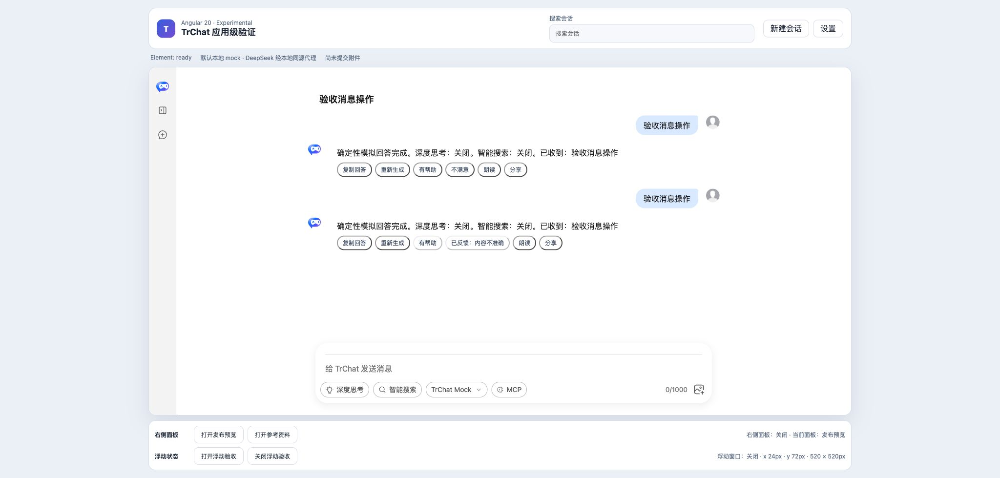

# Angular 回答朗读验收报告

## 结论

**通过，受浏览器与操作系统语音能力约束。** Angular 通过 `bubble-content-footer` DOM Renderer 取得选中 assistant 回答的精确文本，并使用 Web Speech API 启动、停止和恢复朗读状态。Renderer 释放时会取消其拥有的活动语音。

## 原版边界与实现方式

- 原版 Bubble / Feedback 可以承载动作按钮，但没有内置产品级“朗读回答”语义。
- 朗读属于 Angular 宿主能力：使用 `SpeechSynthesisUtterance`，语言来自应用语言设置，语速来自朗读音色设置。
- 支持“准备朗读…”、`start` 后“停止朗读”、`end` 后恢复“朗读”；API 不可用时显示“朗读不可用”，错误通过应用状态暴露。
- 同一时间只允许一个活动 utterance；点击“停止朗读”或 Renderer `AbortSignal` 触发时调用 `speechSynthesis.cancel()`。

## Demo 与自动化

- Angular Demo：`packages/angular20-chat-experimental/src/app/app.ts`
- Playwright：`packages/angular20-chat-experimental/e2e/chat-experimental.spec.ts`
- 自动化在浏览器边界注入确定性 `SpeechSynthesisUtterance` / `speechSynthesis`，验证 `朗读 → 停止朗读 → 朗读` 状态及停止行为；另覆盖 API 属性存在但不可调用时显示“朗读不可用”且无控制台错误。这不是音频文件或外部语音服务模拟。

## 浏览器业务核对

1. 完整回答的动作栏显示“朗读”。
2. 当前 macOS Chrome 验收环境接受调用但立即结束，按钮安全恢复为“朗读”，无悬挂状态。
3. 使用更长回答复验仍立即结束，说明持续时长由本机语音服务决定；因此人工截图不宣称实际可听质量。
4. 持续“停止朗读”状态和显式停止由确定性 Playwright 浏览器边界覆盖。

## 截图

## 限制

- 本轮未评价音色自然度、发音质量、系统 voice 包或无障碍屏幕阅读器协同。
- Web Speech API 是浏览器/操作系统能力，不属于 TrChat 原生组件职责，也不代表后台 TTS 服务。
