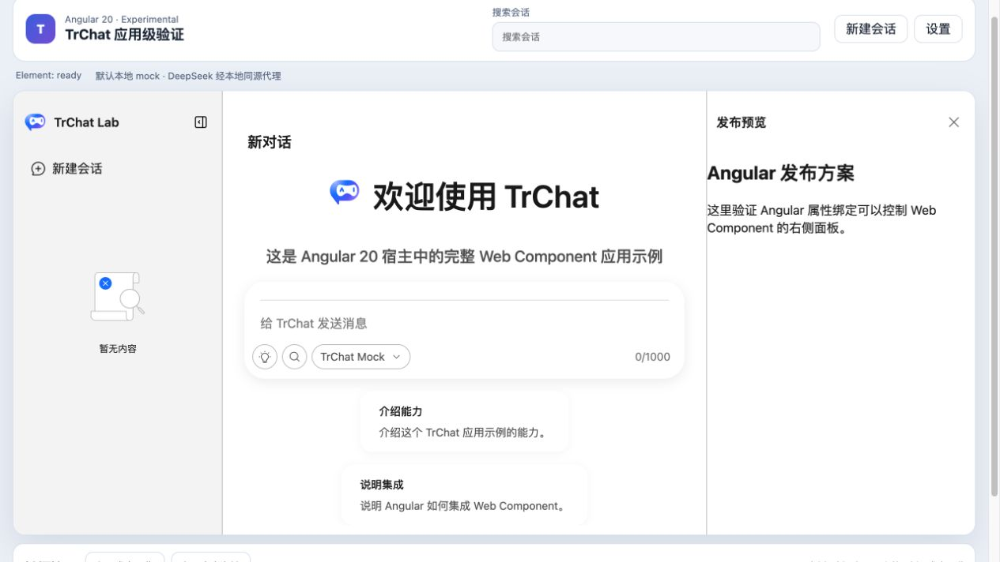
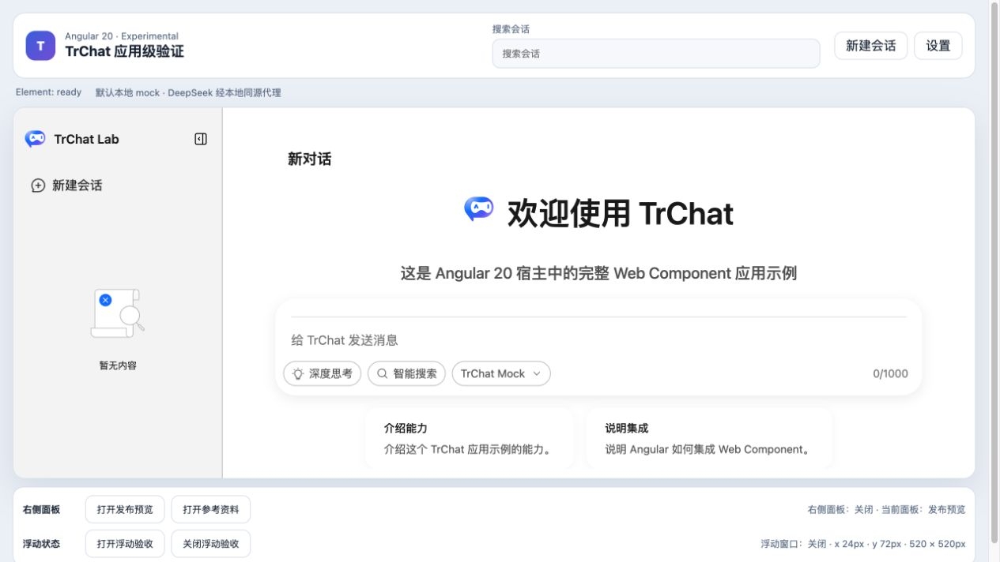

# Angular 右侧面板受控状态验证报告

- 验证日期：2026-10-28
- 浏览器：Chromium
- 截图视口：1265 × 835
- 原版 / Web Component 基线：[右侧业务面板验证报告](../right-aside-panel/report.md)
- Angular 消费者：`packages/angular20-chat-experimental`

## 结论

验收通过。Angular signal 可以通过 `rightAsideOpen` property 打开右侧面板；组件内“关闭详情”会派发 `right-aside-open-update`，Angular 从 `event.detail` 回写 signal，再把新值写回 property。宿主状态文案、右侧面板可见状态和元素公开 property 三者保持一致，无需 Angular 专用组件 fork。

## 浏览器业务对照

| 场景     | 原版 / 原生 Web Component           | Angular 20                                  | 结果 |
| -------- | ----------------------------------- | ------------------------------------------- | ---- |
| 初始状态 | 受控值为 `false`，右栏关闭          | 状态显示“右侧面板：关闭”                    | 一致 |
| 外部打开 | property 设为 `true` 后显示发布预览 | 点击“打开发布预览”后显示 `Angular 发布方案` | 一致 |
| 内部关闭 | 内置关闭按钮派发 update event       | Angular signal 与 property 回写为 `false`   | 一致 |
| 控制台   | 无相关 error / warning              | 无相关 error / warning                      | 一致 |

## 截图证据

### Angular 外部打开

### 组件内部关闭并回写 Angular

## 自动化覆盖

Playwright 用例 `keeps the controlled right-aside open state synchronized in both directions` 覆盖初始受控值、Angular 外部打开、Renderer 内容可见、公开 property 为 `true`、内置按钮关闭、signal 状态文案与 property 回写为 `false`。

## 范围边界

- 本报告只验证 Angular 消费者；原版与原生 JavaScript 的成对 UI 验收见基线报告。
- 右栏尺寸拖动属于布局能力，不在本专项重复验收。
