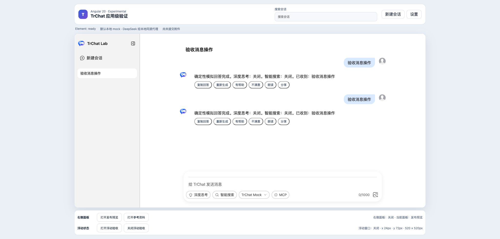
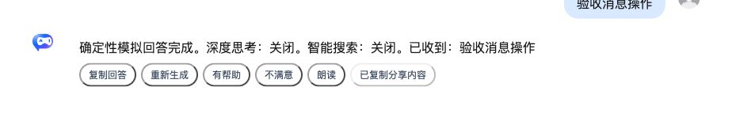

# Angular 回答分享验收报告

## 结论

**通过。** Angular 对单条 assistant 回答优先调用 Web Share；API 不存在或调用被权限拒绝时，回退到 Clipboard API 并复制精确回答。用户取消原生分享面板时恢复“分享”按钮，不报告应用错误。成功结果按消息键保存，Renderer 重建后仍显示“已分享”或“已复制分享内容”。

## 原版边界与实现方式

- 原版 Bubble / Feedback 负责动作栏承载，不内置远程分享、权限策略或渠道选择。
- Angular 使用 DOM Renderer 提供“分享”按钮；传给 Web Share 的只有当前 assistant 回答和固定标题，不包含用户问题、其他会话或附件。
- Web Share 成功显示“已分享”；不存在或非取消错误时尝试剪贴板回退；剪贴板成功显示“已复制分享内容”。
- 两层浏览器能力均失败才显示“分享失败”并暴露错误。没有伪造外部分享成功，也没有向第三方发送数据。

## Demo 与自动化

- Angular Demo：`packages/angular20-chat-experimental/src/app/app.ts`
- Playwright：`packages/angular20-chat-experimental/e2e/chat-experimental.spec.ts`
- 覆盖 Web Share 成功、API 不存在的剪贴板回退、Web Share 权限拒绝后的剪贴板回退、用户取消恢复，以及下一条消息触发 Renderer 重建后的成功状态保持。

## 浏览器业务核对

1. 桌面 Chrome 暴露 `navigator.share`，但本地页面调用返回 `NotAllowedError: Permission denied`。
2. 修复后同一路径自动回退剪贴板，按钮显示“已复制分享内容”。
3. 读取浏览器剪贴板确认内容精确等于选中回答：`确定性模拟回答完成。深度思考：关闭。智能搜索：关闭。已收到：验收消息操作`。
4. 人工验收还发现 Renderer 重建会丢失临时按钮文案；最终用 Angular 消息键状态保存并增加跨消息重渲染回归测试。

## 截图

## 限制

- Playwright 的 Web Share 成功分支是确定性浏览器边界验证，不等于真实社交渠道分享。
- 本轮没有打开或发送到任何外部应用；真实渠道、移动端 share sheet 和企业策略仍需在目标设备验收。
