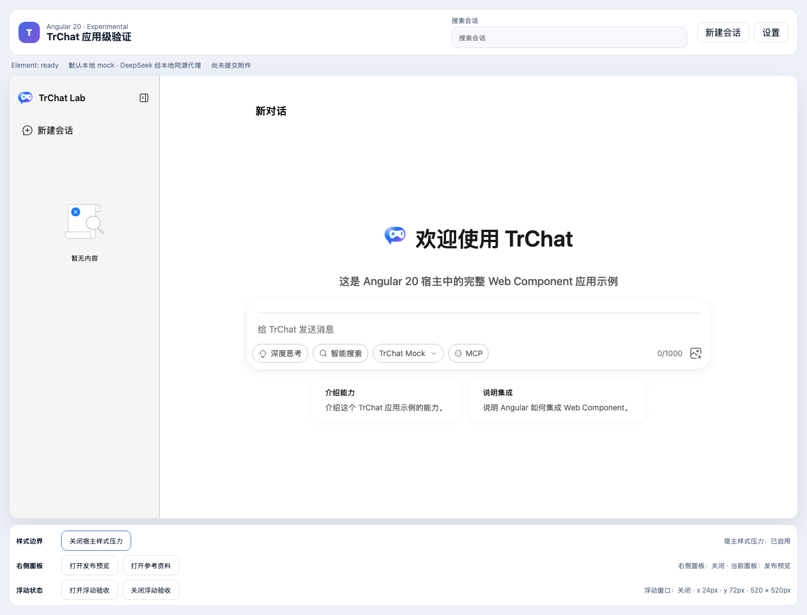

# Angular Light DOM 样式边界验收报告

- 验收日期：2026-10-28
- 最终宿主：Angular 20
- 浏览器：Chromium
- Demo：`packages/angular20-chat-experimental`
- 结论：通过

## 验收范围

Angular Demo 提供“启用宿主样式压力”控制，模拟应用常见的全局 reset 和品牌规则：通用 `button` 字体、最小高度、边框、内边距、背景色，标题 margin/字号以及通用盒模型。压力规则不使用 `!important`，也不直接依赖 TrChat 私有 class。

Web Component 保持 Light DOM，以便主题变量和业务 Renderer 样式可以由 Angular 宿主管理。边界通过 CSS cascade layer 明确为 `host < tr-chat`；Web Component 样式入口补齐 button 和 heading 的基础默认值，具体组件 class 继续以原有 specificity 覆盖这些默认值。

## RED / GREEN 证据

新增浏览器测试首先因压力控制不存在而失败。加入 Demo 后，测试暴露真实回归：宿主的 button `min-height`、font 和 padding 进入内部最小尺寸计算，使 TrChat 高度增加 34px。根因确认后使用 cascade layer 和缺失的基础控件默认值修复；相同测试通过，没有放宽几何断言。

## 浏览器视觉验收

| 状态             | 视觉结果                                                | 业务结果                   |
| ---------------- | ------------------------------------------------------- | -------------------------- |
| 干净宿主         | Angular 外壳、会话栏、欢迎区、Sender 和控制区布局正常   | ready，输入器可操作        |
| 宿主样式压力启用 | TrChat 内部按钮、标题、布局和 Sender 与干净状态保持一致 | 状态切换成功，输入仍可编辑 |
| 几何             | 压力前后 layout 宽高差均不超过 2px                      | 无横向溢出或重复布局       |
| 控制台           | 无 error                                                | 无运行时恢复动作           |

### 干净宿主

### 宿主样式压力启用后

人工检查确认两张截图中 TrChat 主体的排版、控件尺寸、欢迎区和输入器一致；变化只发生在宿主验收控制的按钮文案与状态文本。

## 支持边界

- 支持：使用 cascade layer 管理的通用宿主 reset、品牌字体、button/heading/box-sizing 规则。
- 支持：宿主通过公开 CSS 变量设置 TrChat 主题。
- 不承诺：宿主使用 `!important`，或直接选择 `.tr-*` 私有 class 强制覆盖内部样式。
- 不承诺：Shadow DOM 级完全隔离；当前架构有意保留 Light DOM 的主题和 Renderer 能力。

## 自动化

- Angular Chromium 样式边界专项：1 / 1 通过。
- 断言覆盖：压力开关、状态、layout/body/Sender display、关键控件可见性、布局宽高、button 指标、heading margin、box sizing、真实编辑输入和控制台错误。
