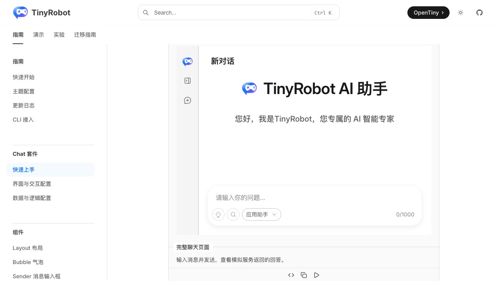
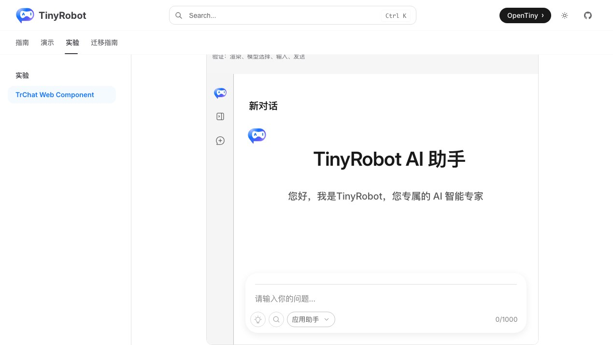
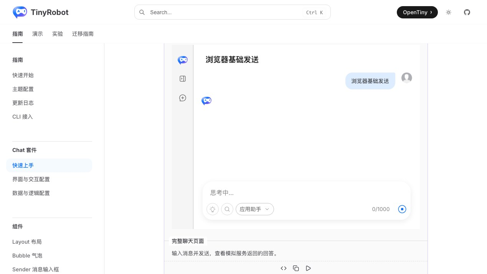
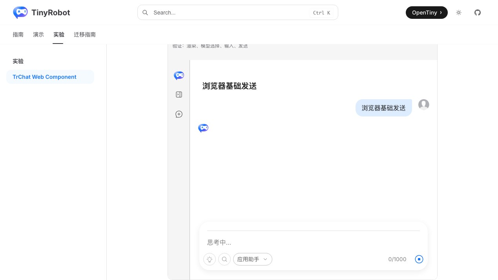

# TrChat Web Component 基础聊天验证报告

- 验证日期：2026-10-28
- 浏览器：Chromium
- 截图视口：1269 × 714
- 原版基线：`docs/demos/chat/basic.vue`，`/suites/quick-start` 中“完整聊天页面”
- Web Component：`docs/demos/chat-experimental/shared/examples.ts` 中的 `basic`，`/experiments/chat-web-component`

## 结论

验收通过，协议判定为 adapted。Web Component 通过 `runtimeOptions.modelProviders` 创建 owned Runtime，保留原版默认左侧 rail、“应用助手”模型选择、空会话欢迎区、输入发送和模型回复。组件主体均来自原生 `TrChat`；差异只在 Vue prop 改为 DOM property，以及两者所在文档容器的外层留白。

## 浏览器业务对照

| 场景     | 原版 TrChat                         | Web Component                 | 结果 |
| -------- | ----------------------------------- | ----------------------------- | ---- |
| 初始布局 | 默认左侧 rail、标题、欢迎区和输入器 | 同样使用默认 `TrChat` 布局    | 一致 |
| 模型选择 | 显示“应用助手”                      | `modelProviders` 显示同一模型 | 一致 |
| 输入发送 | 输入文本后追加用户消息              | 相同                          | 一致 |
| 模型回复 | 文档模拟服务返回回答                | 复用同一 `/api` 模拟服务      | 一致 |
| 控制台   | 无相关 error                        | 无相关 error                  | 一致 |

## 截图证据

### 初始状态

### 完成回答

## 自动化覆盖

Chromium 场景直接断言默认左侧栏、欢迎区、“应用助手”模型按钮、真实输入、用户消息和模拟服务回答，并检查控制台 error。

- 完整 Chromium experimental suite：28 passed，2 skipped；跳过项为凭据门控的真实 streaming 与真实 MCP。
- `pnpm -F tiny-robot-test type-check:experimental`：通过。
- `pnpm -F @opentiny/tiny-robot-chat type-check`：通过。
- `pnpm -F docs build`：通过；仅有既有 bundle、Vite browser externalization 和 Zod 注释 warning。

## 范围边界

- 使用文档本地模拟服务，不代表真实 DeepSeek 的超时、网络中断和鉴权已经验收。
- 截图用于人工 UI 对照，尚未建立像素差异阈值。
