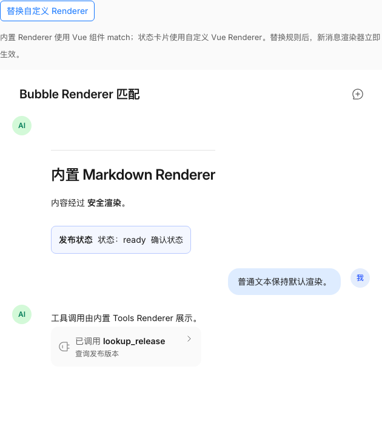
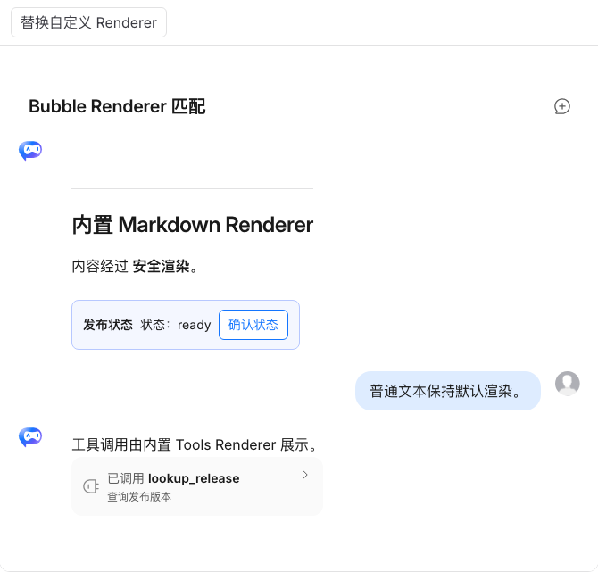
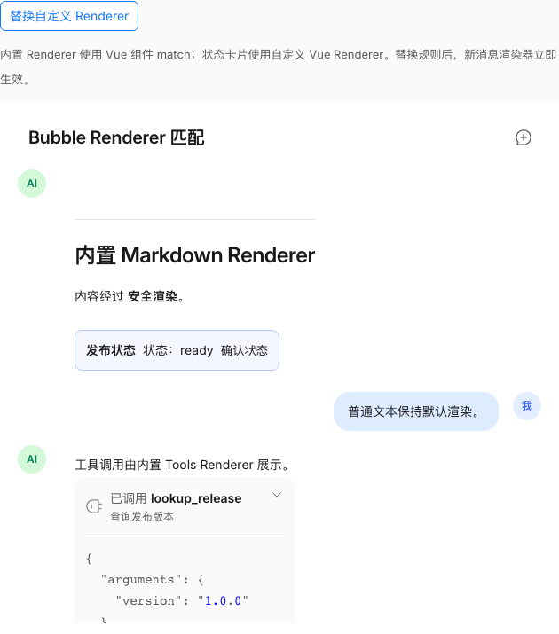
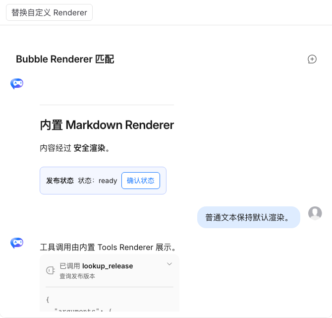
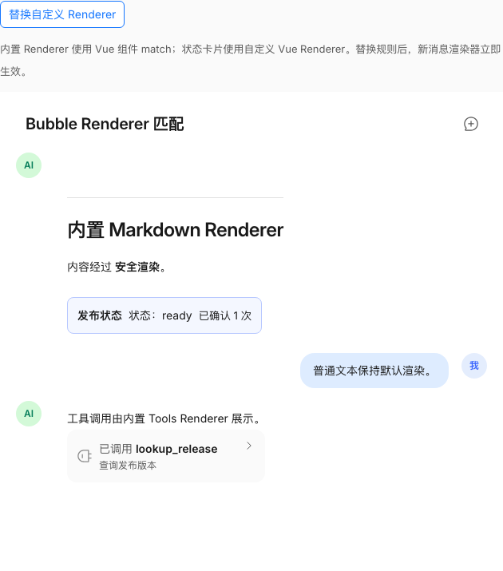
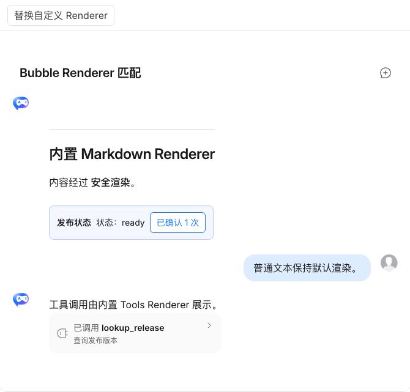

# TrChat Web Component Bubble Renderers 验证报告

- 验证日期：2026-10-27
- 浏览器：Chromium
- 视口：1440 × 1000
- 原版基线：`docs/demos/chat/bubble-options.vue`，`/suites/chat#消息外观`
- Web Component：`docs/demos/chat-experimental/shared/examples.ts` 中的 `bubble-options`，`/experiments/chat-web-component`

## 结论

本轮验证通过。原生 `TrChat` / `TrChatUI` 新增独立的 `bubbleRenderers` property 后，Web Component 宿主无需导入 Vue Component，即可用内置 Renderer ID、原生 DOM Renderer 和同构 match 数组复现原版 BubbleProvider 的主要行为。

已经确认的能力包括：内置 Markdown 与 Tools Renderer、多段内容的 `content` / `contentIndex`、自定义 DOM content/box Renderer、默认未匹配内容、priority 与同优先级顺序、match 替换、消息内容更新、异常恢复，以及 `AbortSignal` 生命周期清理。

## Web Component API 示例

`bubbleRenderers` 是 property，不提供 JSON attribute。内置 content ID 为 `text`、`markdown`、`image`、`loading`、`reasoning`、`tools`、`tool-role`，内置 box ID 为 `box`。消息级工具调用使用 `tools`；需要 `toolCallIndex` 的单个 `Tool` 不作为通用 match ID 暴露。

```ts
chat.bubbleRenderers = {
  contentRendererMatches: [
    {
      find: (message) => Boolean(message.tool_calls?.length),
      renderer: 'tools',
      priority: -2,
    },
    {
      find: (message, content, contentIndex) =>
        message.role === 'assistant' && content.type === 'text' && contentIndex === 0 && !message.tool_calls?.length,
      renderer: 'markdown',
      priority: -2,
    },
    {
      find: (_message, content) => content.type === 'status-card',
      renderer: (context, lifecycle) => {
        const card = document.createElement('article')
        const button = document.createElement('button')
        button.textContent = `${context.content.title}：${context.content.status}`
        const onClick = () => (button.textContent = '已确认')
        button.addEventListener('click', onClick)
        lifecycle.signal.addEventListener('abort', () => button.removeEventListener('click', onClick), {
          once: true,
        })
        card.append(button)
        return card
      },
      priority: 10,
    },
  ],
}
```

`find` 按 priority 从小到大匹配，同优先级取先出现的规则。框架中立 matches 会排在已有 `ui.bubble.bubbleProvider` Vue matches 之前，但不会修改调用方数组。

## 原版能力映射

| 原版 TrChat / BubbleProvider                | Web Component `bubbleRenderers`                  | 结果 |
| ------------------------------------------- | ------------------------------------------------ | ---- |
| `BubbleRenderers.Markdown`                  | `renderer: 'markdown'`                           | 一致 |
| `BubbleRenderers.Tools`                     | `renderer: 'tools'`                              | 一致 |
| Vue content Renderer                        | `ChatRenderer<ChatBubbleContentRendererContext>` | 一致 |
| Vue box Renderer                            | `ChatRenderer<ChatBubbleBoxRendererContext>`     | 一致 |
| `find(message, content, contentIndex)`      | 同签名的 `find`                                  | 一致 |
| priority 升序、首个匹配                     | 同一 BubbleProvider 选择链                       | 一致 |
| Renderer 随消息和规则更新                   | property/消息更新重渲染并 abort 旧 DOM Renderer  | 一致 |
| Renderer 抛错或未知配置由应用处理并继续渲染 | `renderer-error` / `experimental-error` 后可恢复 | 一致 |

自定义 box Renderer 额外收到 `contentRoot`。返回的 box 节点必须插入该节点，TrChat 才能把内部 Vue 渲染的 Bubble 内容 Teleport 到自定义 DOM 容器中。

## 浏览器业务对照

| 场景           | 原版 TrChat                                           | Web Component                        | 结果             |
| -------------- | ----------------------------------------------------- | ------------------------------------ | ---------------- |
| 初始内容       | Markdown 标题与粗体、状态卡、默认文本、Tools 卡片可见 | 相同内容、顺序与左右 placement       | 一致             |
| 展开 Tools     | 显示 `lookup_release` 的 `version: 1.0.0` 参数        | 显示相同参数，内置状态链未丢失       | 一致             |
| 点击“确认状态” | 按钮变为“已确认 1 次”                                 | DOM Renderer 按钮变为相同状态        | 一致             |
| 替换 match     | 状态卡立即变为“备用状态：ready”                       | 同样替换，并确认旧 Renderer 已 abort | 一致             |
| 未匹配文本     | 继续走默认文本 Renderer                               | 同样保持默认渲染                     | 一致             |
| 控制台         | 基线文档页另有两个无关 MCP Demo 404                   | Bubble Gallery 场景无 error          | 本任务无相关错误 |

原版页面的两个 404 来自 `/api/mcp/project-knowledge` 和 `/api/mcp/release-calendar`，属于同页其他 MCP Demo，不属于 Bubble Renderer 场景。实验 Gallery 的 `bubble-options` 自动化检查未出现控制台错误。

原版 Demo 使用自定义 Vue 头像，Web Component Demo 保留默认头像；这属于 `roleConfigs.avatar` 的 Vue VNode 边界，不影响本报告验证的 Renderer 内容、布局方向、状态和交互。文档容器宽度也分别约为 630px 与 670px。

## 截图证据

### 初始状态

原版 TrChat：



Web Component：



### Tools 展开

原版 TrChat：



Web Component：



### 自定义 Renderer 交互

原版 TrChat：



Web Component：



## 自动化验证

- `pnpm -F tiny-robot-test exec playwright test -c playwright-ct.config.ts component/chat/ChatBubbleRenderers.spec.ts component/chat/ChatRenderers.spec.ts component/chat-experimental/Elements.spec.ts`：33 passed。覆盖内置 ID、DOM content/box、精确 `contentIndex`、Vue match 共存、规则替换、消息更新、abort、未知 ID、`find` 异常、元素 property 转发与恢复。
- `pnpm -F tiny-robot-test exec playwright test -c playwright.experimental.config.ts experimental/chat-web-component.examples.spec.ts --project=chromium`：20 passed。`bubble-options` 覆盖 Markdown、Tools 展开、自定义交互、placement、match 替换、abort 证据与零相关控制台错误。
- `pnpm -F @opentiny/tiny-robot-chat type-check`：通过。
- `pnpm -F tiny-robot-test type-check:experimental`：通过。
- `pnpm -F docs build`：通过；只有既有的 bundle size、第三方包注释和 browser externalization warning。
- `pnpm exec prettier --check <本任务文件>` 与 `git diff --check`：通过。
- 六张 PNG 均已使用 `file` / `stat` 检查为非空，并逐张人工检查。

## 范围边界

- 复杂 match/function 只能通过 property 传入，不能序列化为 HTML attribute。
- Web Component 宿主返回 DOM Node，不直接跨边界传入 Vue VNode 或 Vue Component。
- `tools` 是消息级 Renderer；单个 `Tool` 仍依赖内部 `toolCallIndex`，不提供通用 ID。
- 自定义 box Renderer 必须插入 `context.contentRoot`。
- 本报告只将 Bubble Renderers 协议标记为完成；双向绑定 TODO 保持不变。
