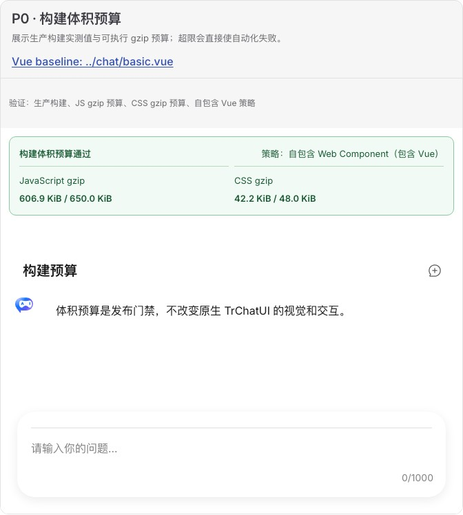

# 构建体积预算验收报告

## 结论

**通过。** 本阶段继续采用“自包含 Web Component”策略，浏览器入口包含 Vue，避免把 Vue 版本和加载顺序转嫁给 Angular 等宿主。生产门禁固定为 JavaScript gzip **650 KiB**、CSS gzip **48 KiB**；当前实测分别为 **621,452 B（606.9 KiB）** 和 **43,164 B（42.2 KiB）**。

## Demo 与原版对照

- Web Component Demo：[`bundle-budget.ts`](../../../demos/chat-experimental/bundle-budget.ts)
- 原版 UI 基线：[`basic.vue`](../../../demos/chat/basic.vue)
- 预算为发布增强，不改变原版 TrChatUI；基础视觉对照见[基础聊天验证报告](../basic-chat/report.md)。

人工浏览器检查确认预算卡的实测值、上限和策略文字可辨识，原生 TrChatUI 的标题、消息与输入区布局保持一致，无横向溢出。

## 自动化证据

- 预算配置：[`tr-chat-web-component-build-budget.json`](../../tr-chat-web-component-build-budget.json)
- `scripts/measure-chat-experimental.test.js` 同时验证当前构建通过和模拟超限必定失败。
- 测量递归统计浏览器入口的可达 JS chunk，并独立 gzip CSS；Node 条件入口不计入浏览器下载预算。
- Gallery 数量从 manifest 派生，报告完成数从矩阵派生，已移除历史 18 项硬编码。

## 优化触发条件

预算超限时按“样式裁剪 → 功能拆包 → 更细 tree-shaking → external Vue”顺序评估。只有宿主能够统一 Vue 版本、加载顺序和单例约束时才考虑 external Vue。
