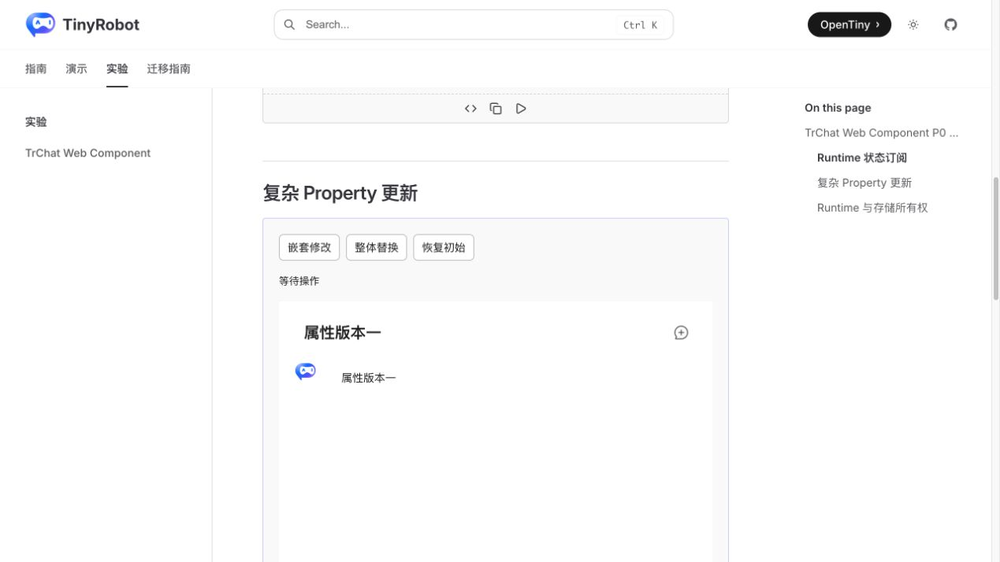
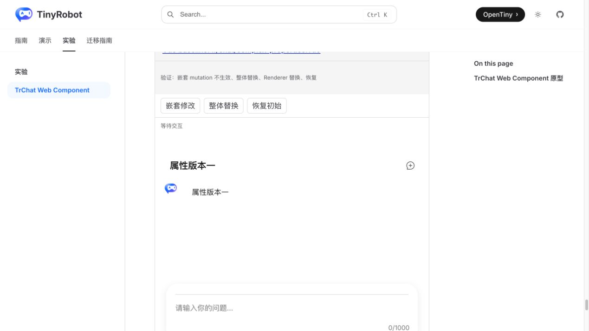
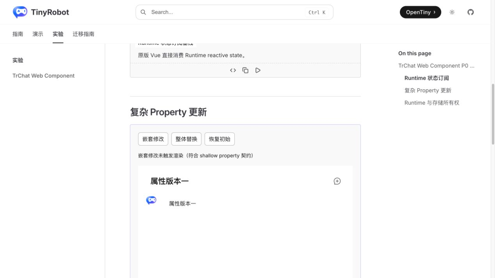
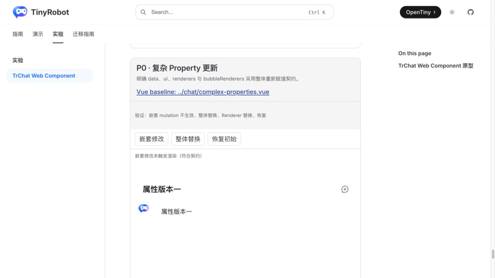
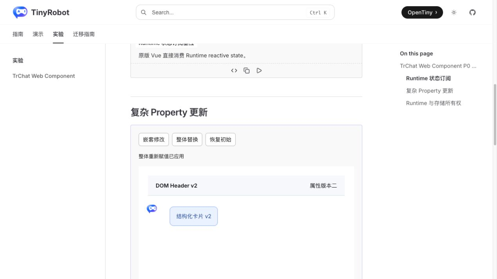
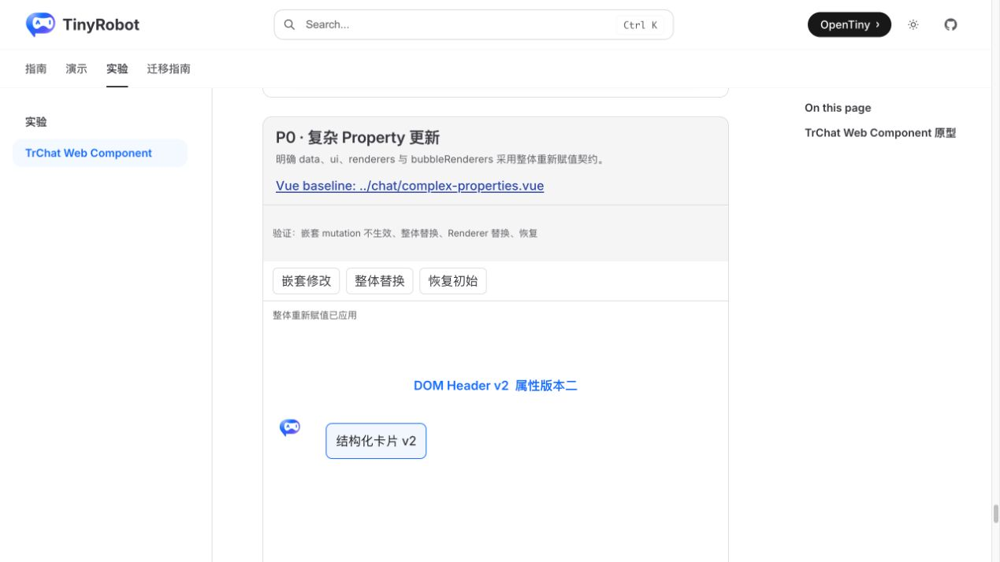

# TrChat Web Component 复杂 Property 更新验证报告

- 验证日期：2026-10-27
- 浏览器：Chromium
- 截图视口：1269 × 714
- 原版基线：`docs/demos/chat/complex-properties.vue`，`/experiments/chat-web-component-p0-baselines`
- Web Component：`docs/demos/chat-experimental/shared/examples.ts` 中的 `complex-properties`，`/experiments/chat-web-component`

## 结论

验收通过，协议判定为 adapted。`data`、`ui`、`runtimeOptions`、`renderers` 和 `bubbleRenderers` 采用 shallow property 契约：嵌套修改不承诺触发更新，宿主必须整体重新赋值。原版与 Web Component 都验证了嵌套修改保持版本一、整体替换后同时更新数据、Header renderer 和 Bubble renderer，因此当前不需要增加 `setData()` 或 `updateOptions()`。

## 浏览器业务对照

| 场景     | 原版 TrChat               | Web Component                                  | 结果 |
| -------- | ------------------------- | ---------------------------------------------- | ---- |
| 初始     | 显示属性版本一            | 显示属性版本一                                 | 一致 |
| 嵌套修改 | UI 保持版本一并提示未渲染 | UI 保持版本一并提示符合契约                    | 一致 |
| 整体替换 | 显示属性版本二            | 显示“属性版本二”“DOM Header v2”“结构化卡片 v2” | 一致 |
| 恢复     | 可整体赋回版本一          | 可整体赋回版本一                               | 一致 |
| 控制台   | 无相关 error              | 无相关 error                                   | 一致 |

## 截图证据

### 初始

### 嵌套修改

### 整体替换

## 自动化覆盖

Chromium 场景直接断言嵌套修改不会改变可见版本；整体重新赋值后，data 文案、UI Header renderer 与 Bubble renderer 都切换到版本二；恢复后重新显示版本一。

- Playwright 组件回归：273 / 273 通过。
- 实验 Chromium 套件：26 通过、2 个真实服务用例按凭据守卫跳过。
- Chat 与实验测试类型检查：通过。
- 文档 production build：通过，仅有既有依赖 warning。

## 范围边界

- 该契约与浏览器 Custom Element 的 property 语义一致，也便于 Angular/React 用不可变对象更新。
- 宿主若原地修改对象，需要随后把一个新对象重新赋给元素；仅把同一引用再次赋值也不应作为稳定更新机制。
- `runtimeOptions` 整体替换会重建 owned Runtime，其生命周期由 Runtime 所有权协议覆盖。
