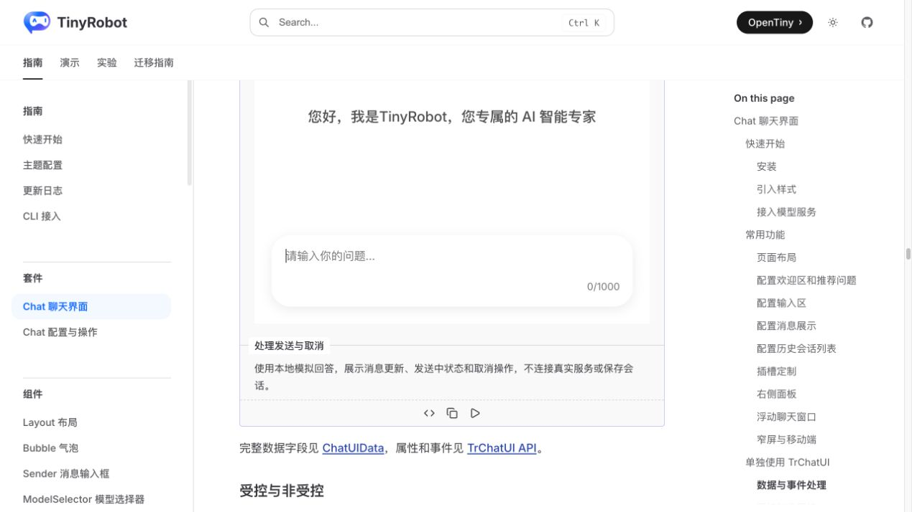
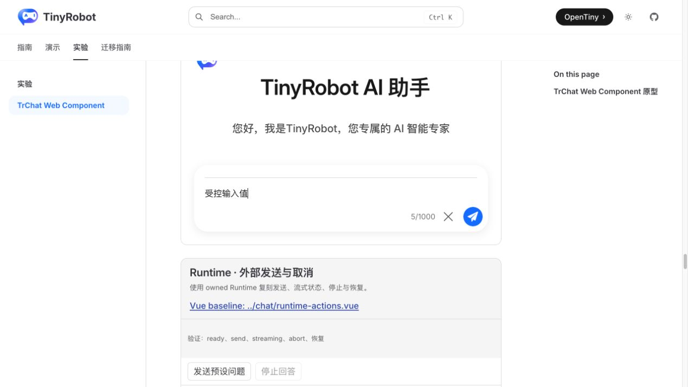
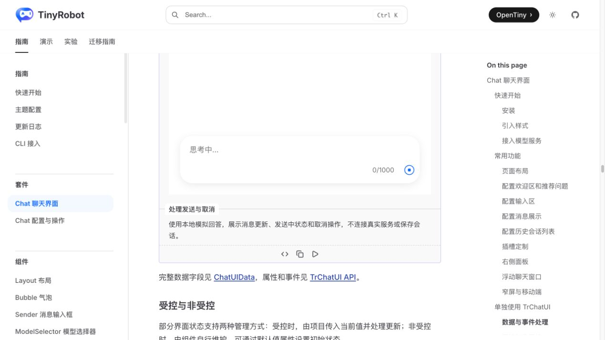
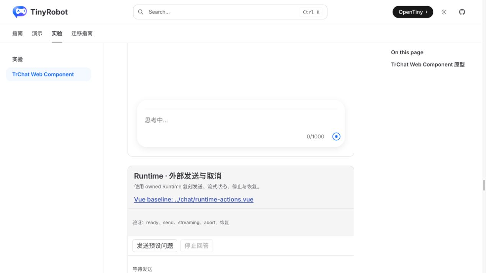
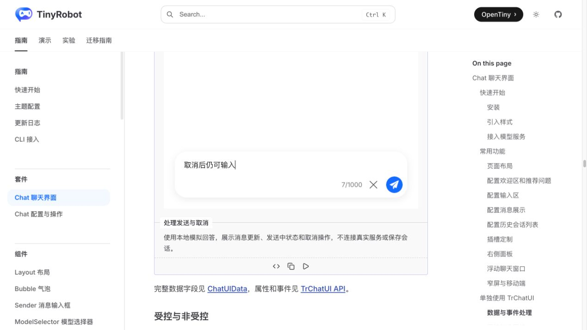
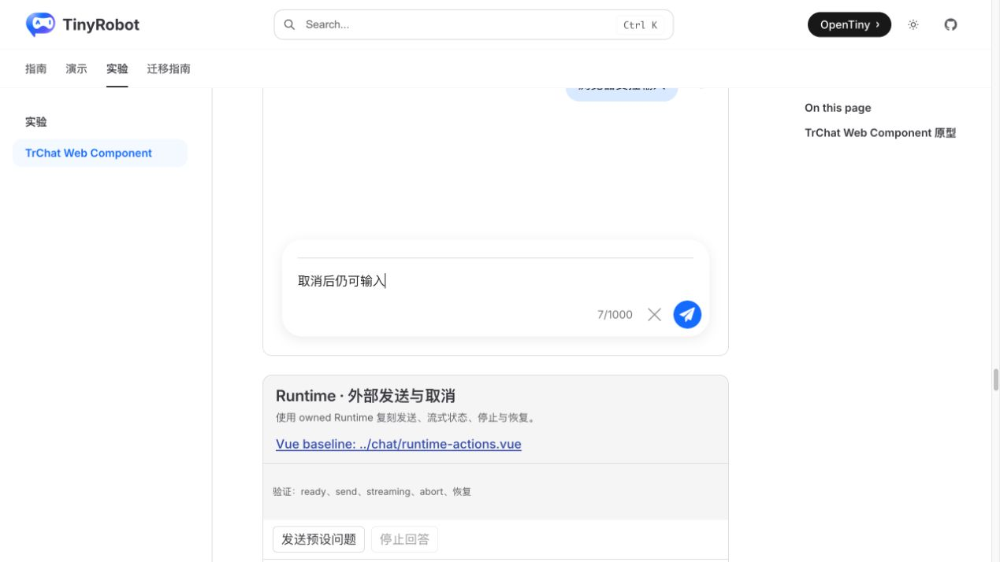

# TrChat Web Component Controlled UI 验证报告

- 验证日期：2026-10-27
- 浏览器：Chromium
- 截图视口：1269 × 714
- 原版基线：`docs/demos/chat/controlled-ui.vue`，`/suites/chat` 中“处理发送与取消”
- Web Component：`docs/demos/chat-experimental/shared/examples.ts` 中的 `controlled-ui`，`/experiments/chat-web-component`

## 结论

本轮验证通过。`tr-chat-ui` 现有的 complex property 与 DOM CustomEvent 已能复刻原版 Vue `v-model:input-value` 场景：宿主负责受控值回写，并在 `submit` / `cancel` 后整体重赋值 `data`，原生 TrChatUI 继续负责消息、loading 与发送区 UI。

无需为该流程新增核心组件 API。Vue 的响应式引用改为 Web Component 宿主的显式 property reassignment，这是跨框架边界的必要适配，不是业务能力降级。

## 浏览器业务对照

| 场景         | 原版 TrChat                                | Web Component                            | 结果 |
| ------------ | ------------------------------------------ | ---------------------------------------- | ---- |
| 初始受控值   | 输入区显示宿主值                           | 输入区显示同一类宿主值                   | 一致 |
| 用户输入回写 | `v-model` 更新 Vue ref                     | `input-value-update` 后宿主回写 property | 一致 |
| 提交         | 追加用户消息、清空输入、进入 loading       | 同样追加、清空并进入 loading             | 一致 |
| 取消         | 停止计时回答，保留用户消息，不追加助手回答 | 相同行为                                 | 一致 |
| 取消后恢复   | 输入区恢复，可再次发送并收到回答           | 相同行为                                 | 一致 |
| 控制台       | 场景无相关 error                           | 场景无 error                             | 一致 |

## 截图证据

### 初始状态

### 提交与 loading

### 取消后恢复输入

## 自动化覆盖

Chromium 场景直接断言：外部 property 更新、用户输入回写、submit 消息追加、输入清空、loading、cancel、助手回答不再追加，以及取消后的再次发送和完成。

- 完整 Gallery：20 passed。
- `pnpm -F tiny-robot-test type-check:experimental`：通过。
- `pnpm -F @opentiny/tiny-robot-chat type-check`：通过。
- `pnpm -F docs build`：通过；只有既有的 bundle size、第三方注释和 browser externalization warning。

## 范围边界

- `data` 是复杂 property；当前契约要求宿主整体重新赋值，不依赖嵌套对象 mutation。
- 本报告验证原生 JavaScript 宿主。Angular 与 React 的 property/event wrapper 仍需独立验收，因此项目级“双向绑定”总项仍保持部分完成。
