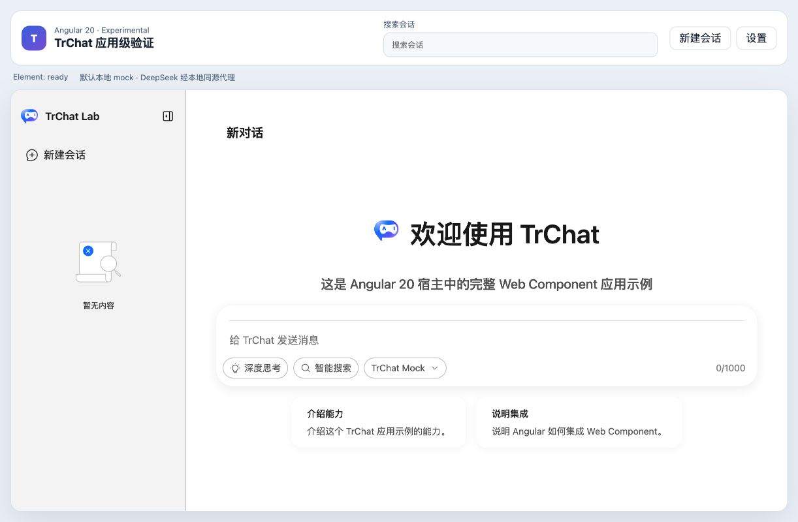
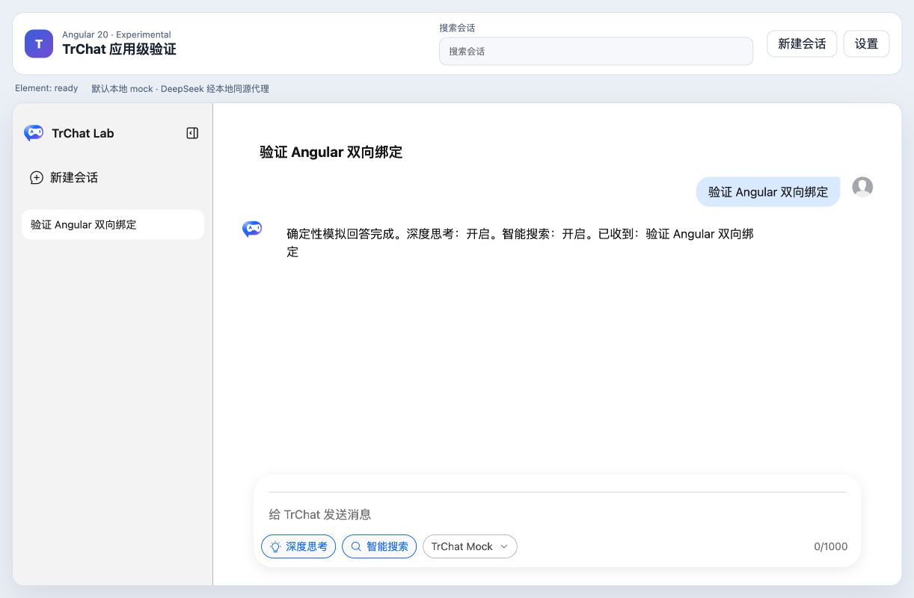

# TrChat Web Component 跨框架双向绑定验证报告

- 验证日期：2026-10-28
- 浏览器：Chromium
- 原生 JavaScript 基线：`controlled-ui` 验证报告与 Gallery 场景
- Angular 消费者：`packages/angular20-chat-experimental`
- React 兼容性探针：`packages/react-chat-experimental`

## 结论

原生 JavaScript、Angular 20 主应用和最薄 React 19 兼容性探针均已完成验收，项目级“双向绑定”判定为完成。Angular 是最终产品应用；React 只用于证明标准 Custom Element property、CustomEvent、ref 和 effect cleanup 不依赖 Angular 专用实现。

原生 JavaScript 已验证 `inputValue` 外部赋值、`input-value-update` 宿主回写、`submit`、`cancel`、loading、消息追加与取消后恢复。Angular 20 与 React 19 均专项验证 `rightAsideOpen`、`activeRightAsidePanelId` 和 `floatingState` 三组 property / update event 受控契约。两个框架都直接消费同一组 Custom Elements，不复制 Vue 组件。

## 契约映射

| Vue 契约                              | Custom Element 契约                           | 宿主责任                      |
| ------------------------------------- | --------------------------------------------- | ----------------------------- |
| `v-model:input-value`                 | `inputValue` + `input-value-update`           | 收到事件后将新值写回 property |
| `v-model:right-aside-open`            | `rightAsideOpen` + `right-aside-open-update`  | 受控模式下回写 boolean        |
| `v-model:active-right-aside-panel-id` | `activeRightAsidePanelId` + 对应 update event | 回写 panel id                 |
| `v-model:floating-state`              | `floatingState` + `floating-state-update`     | 整体重赋值 rect 对象          |
| `update:modelValue` 类事件            | kebab-case `*-update` CustomEvent             | 从 `event.detail` 取 payload  |

## 浏览器业务对照

| 消费者          | 验收结果 | 说明                                                                                                  |
| --------------- | -------- | ----------------------------------------------------------------------------------------------------- |
| 原生 JavaScript | 通过     | `controlled-ui` 已有成对截图和 submit/cancel/recovery 自动化                                          |
| Angular 20      | 通过     | 应用主流程以及 right aside、active panel、floating state 三组受控状态均通过；应用级 E2E 覆盖 9 个场景 |
| React 19        | 通过     | 最薄协议探针覆盖 right aside、active panel、floating state；不承担产品应用业务                        |

## 截图证据

原生 JavaScript 的 Vue/Web Component 对照见 [Controlled UI 验证报告](../controlled-ui/report.md)。

Angular 三组专项证据见 [右侧面板开关](../angular-right-aside/report.md)、[活动面板选择](../angular-active-panel/report.md) 和 [浮动窗口状态](../angular-floating-state/report.md)。

React 三组专项证据见 [右侧面板开关](../react-right-aside/report.md)、[活动面板选择](../react-active-panel/report.md) 和 [浮动窗口状态](../react-floating-state/report.md)。

### Angular 初始绑定

### Angular 发送完成与状态回写

## 自动化覆盖

- Angular 单元测试：3 个场景，验证 runtime options、模型能力与当前 DeepSeek 模型配置。
- Angular Playwright：9 个应用级场景，覆盖布局、发送/停止、模型功能、会话、代理、持久化、宿主设置以及三组受控状态。
- 原生 JavaScript：`controlled-ui` 场景覆盖外部值、用户回写、提交、取消、loading、消息和恢复。
- Angular 生产构建与 `@opentiny/tiny-robot-chat` 类型检查通过；生产构建保留 1.8 MB warning，附件能力进入主应用后 2.1 MB error budget 未触发。
- React Playwright：3 / 3 通过；React type-check 与 production build 通过。React 探针使用本地确定性 provider，不访问外部服务。

## 后续缺口

双向绑定当前验收范围内无阻塞缺口。后续可评估是否提供框架类型辅助层，但不应为每个框架复制业务组件或把 React 探针扩展成第二套产品应用。
