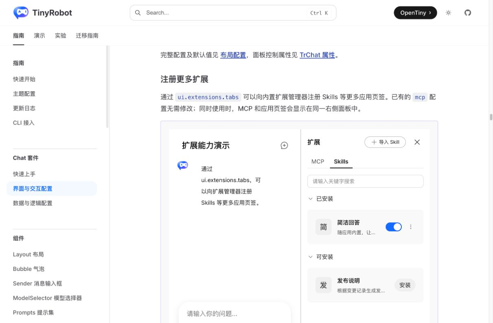
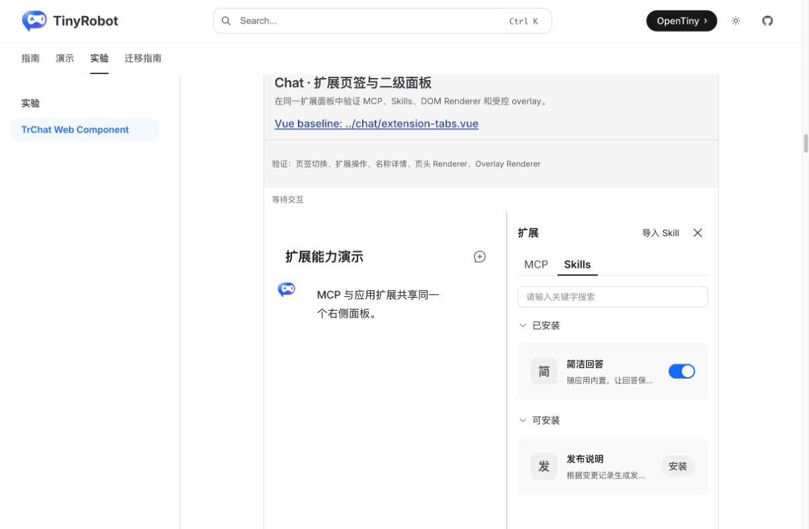
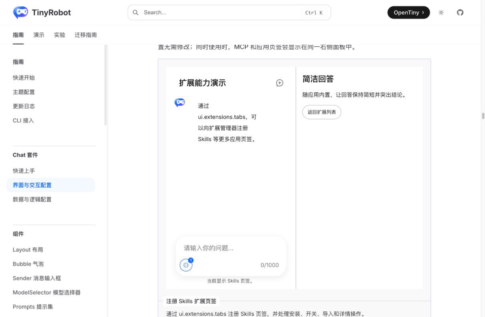
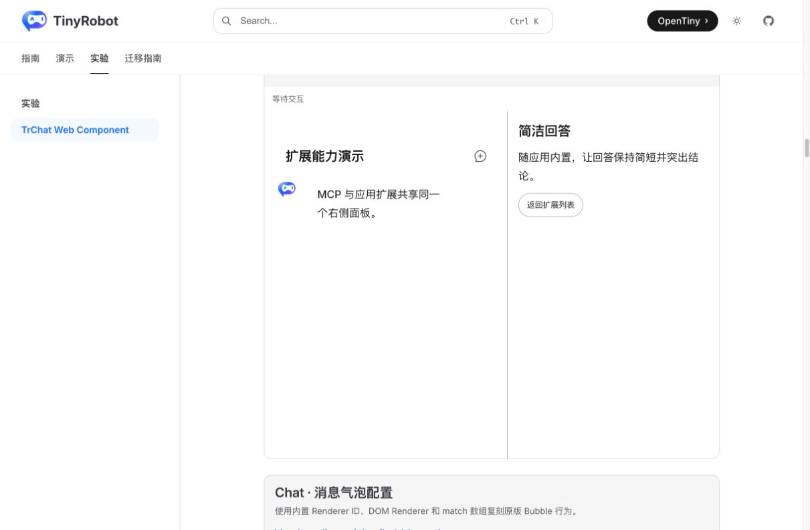

# TrChat Web Component Extension Tabs 验证报告

- 验证日期：2026-10-28
- 浏览器：Chromium
- 原版基线：`docs/demos/chat/extension-tabs.vue`，`/suites/chat#注册更多扩展`
- Web Component：`docs/demos/chat-experimental/shared/examples.ts` 中的 `extension-tabs`，`/experiments/chat-web-component`

## 结论

本轮验证通过。原版 `ui.extensions.tabs`、`extension-action`、`extension-name-click` 与 `extension-tab-change` 可直接沿用；原版 `extension-header-actions` 和 `extension-overlay` scoped slots 通过已有 DOM Renderer 协议映射后，仍可完成导入入口、详情面板、受控关闭和列表恢复。

Web Component 没有复制 ExtensionManager，也没有把 Vue VNode 跨边界传递。扩展列表、页签、开关和安装动作仍由原生 TrChatUI 渲染，宿主仅用 DOM Renderer 承接需要应用上下文的页头与二级面板。

## 浏览器业务对照

| 场景        | 原版 TrChat                          | Web Component                    | 结果 |
| ----------- | ------------------------------------ | -------------------------------- | ---- |
| Skills 页签 | 已安装/可安装分组、搜索和条目一致    | 同样由原生 ExtensionManager 渲染 | 一致 |
| 开关回写    | `extension-action` 后业务更新 `tabs` | CustomEvent 后整体重赋值 `ui`    | 一致 |
| 名称详情    | 点击“简洁回答”进入二级面板           | DOM Renderer 显示相同标题和说明  | 一致 |
| 返回列表    | 点击“返回扩展列表”恢复 Skills        | 同样关闭 overlay 并恢复列表      | 一致 |
| 导入入口    | 页头显示“导入 Skill”                 | header renderer 显示同一入口     | 一致 |
| MCP 切换    | 返回内置 MCP 页签并显示服务          | 同样保留内置 MCP 页签与服务      | 一致 |

## 截图证据

### Skills 列表

### 详情二级面板

## 自动化覆盖

Chromium 场景覆盖页签切换、开关动作与业务回写、名称详情、页头导入动作、overlay 关闭、列表恢复和 MCP 页签恢复，并检查控制台无相关错误。

## 范围边界

- 本报告验证扩展页签与应用二级面板，不替代 MCP 创建、编辑、删除、工具开关等完整管理流程的独立验收。
- Vue scoped slot 必须映射为 DOM Renderer；任意 Vue VNode 仍不能直接跨 Web Component 边界。
