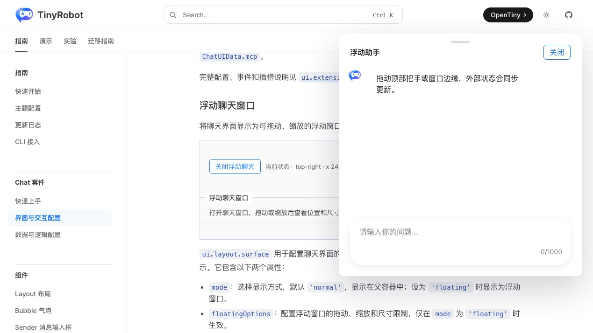
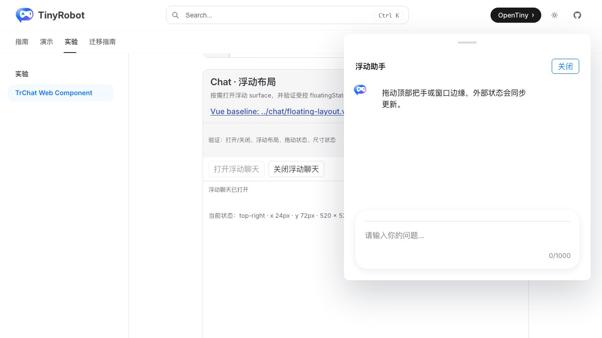
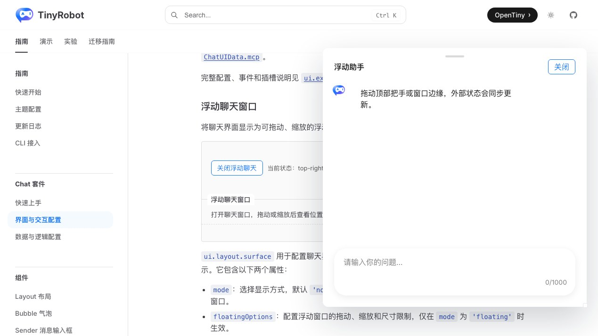

# TrChat Web Component 浮动布局验证报告

- 验证日期：2026-10-28
- 浏览器：Chromium
- 截图视口：1269 × 714
- 原版基线：`docs/demos/chat/floating-layout.vue`，`/suites/chat` 中“浮动聊天窗口”
- Web Component：`docs/demos/chat-experimental/shared/examples.ts` 中的 `floating-layout`，`/experiments/chat-web-component`

## 结论

验收通过，协议判定为 adapted。原版 `layout-header` scoped slot 转换为 DOM Renderer；`v-model:floating-state` 转换为 `floatingState` property、`floating-state-update` 事件和 property 回写。浮动 surface、拖动、八向缩放约束、状态文案、页头关闭及外部关闭均由原生 `TrChatUI` / `Layout` 实现。

## 浏览器业务对照

| 场景     | 原版 TrChatUI                          | Web Component             | 结果 |
| -------- | -------------------------------------- | ------------------------- | ---- |
| 初始状态 | top-right，x 24px，y 72px，520 × 520px | 相同                      | 一致 |
| 打开窗口 | 标题“浮动助手”，显示原生浮动 surface   | 相同                      | 一致 |
| 页头定制 | scoped slot 输出标题和关闭按钮         | DOM Renderer 输出相同内容 | 一致 |
| 拖动     | 窗口位置和外部状态同步更新             | 相同                      | 一致 |
| 缩放     | 东南角缩放并受 360–760 / 420–720 约束  | 相同                      | 一致 |
| 关闭     | 页头关闭和外部关闭均卸载窗口           | 相同                      | 一致 |
| 控制台   | 无相关 error / warning                 | 无相关 error / warning    | 一致 |

## 截图证据

### 初始浮动窗口

### 拖动并缩放

## 自动化覆盖

Chromium 专项用例断言未打开状态、初始位置与尺寸、原生 grid surface、标题和页头关闭按钮、拖动后的坐标变化、`floating-state-update`、缩放后的宽高变化、页头关闭和外部关闭。

- 本批专项验收：3 / 3 通过。
- Chromium 全量实验套件：28 通过，2 跳过。
- 实验测试类型检查：通过。
- `@opentiny/tiny-robot-chat` 类型检查：通过。
- 文档生产构建：通过（仅保留既有依赖构建警告）。
- 原版与 Web Component 成对截图：通过。

## 范围边界

- 本轮使用鼠标拖动与缩放；触摸手势和跨屏窗口不在范围内。
- `floatingState` 是宿主受控值，事件后必须整体重新赋值，不能只修改嵌套字段。
- 截图用于人工 UI 对照，尚未建立自动像素差异阈值。
