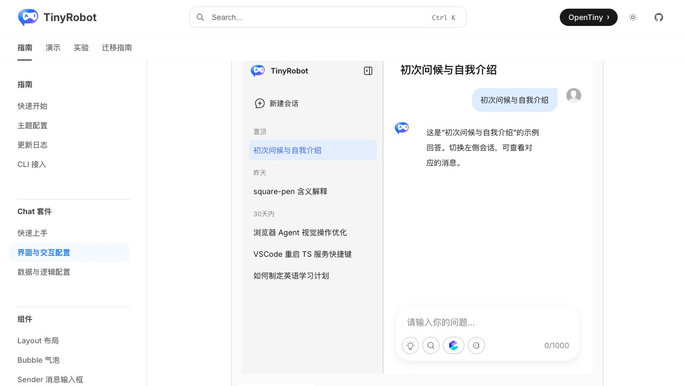
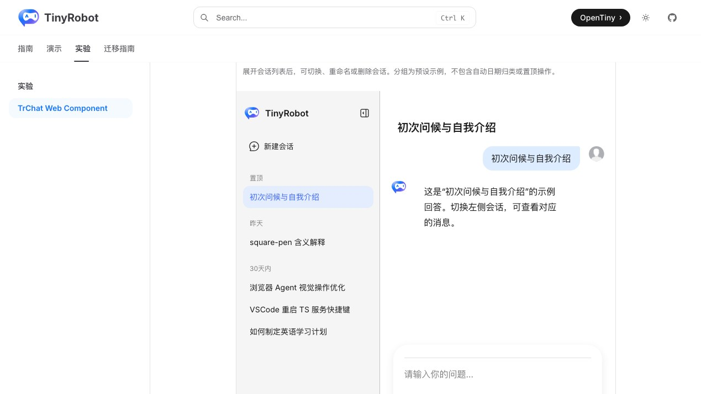
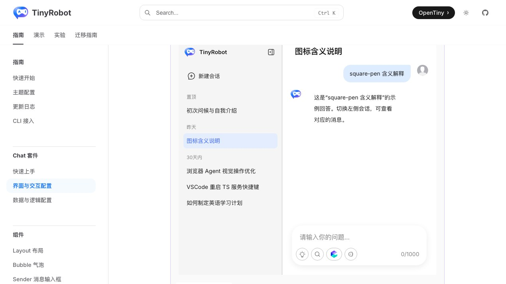
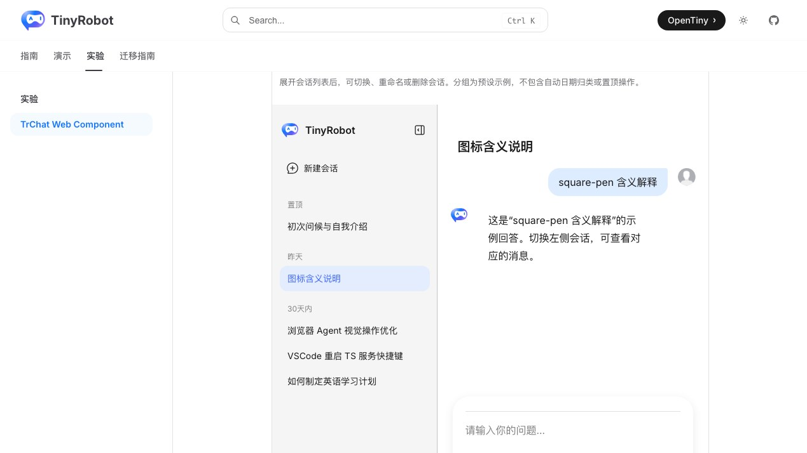

# TrChat Web Component 历史分组验证报告

- 验证日期：2026-10-28
- 浏览器：Chromium
- 截图视口：1269 × 714
- 原版基线：`docs/demos/chat/history-groups.vue`，`/suites/chat` 中“会话历史分组”
- Web Component：`docs/demos/chat-experimental/shared/examples.ts` 中的 `history-groups`，`/experiments/chat-web-component`

## 结论

验收通过，协议判定为 direct。Web Component 使用原生 `TrChat` Runtime 和 `data.history`，保留置顶、昨天、30 天内三个分组、五条会话、激活会话、消息恢复和重命名。宿主以 DOM property 重新赋值同步 Runtime 的最新会话数据，没有重写 History 组件。

## 浏览器业务对照

| 场景       | 原版 TrChat                               | Web Component          | 结果 |
| ---------- | ----------------------------------------- | ---------------------- | ---- |
| 分组与条目 | 置顶、昨天、30 天内，共五条               | 分组、顺序和条目数相同 | 一致 |
| 切换会话   | 选择 `square-pen 含义解释` 后恢复对应消息 | 相同                   | 一致 |
| 选中态     | 当前会话使用高亮背景                      | 相同                   | 一致 |
| 重命名     | 菜单内重命名为“图标含义说明”              | 相同                   | 一致 |
| 控制台     | 无相关 error / warning                    | 无相关 error / warning | 一致 |

## 截图证据

### 初始分组

### 切换并重命名

## 自动化覆盖

Chromium 专项用例断言三个分组、五条会话、会话切换后的回答、选中态和重命名结果，并检查控制台 error。

- 本批专项验收：3 / 3 通过。
- 成对截图流程：2 / 2 通过。
- 完整 Chromium experimental suite：28 passed，2 skipped；跳过项为凭据门控的真实 streaming 与真实 MCP。
- `pnpm -F tiny-robot-test type-check:experimental`：通过。
- `pnpm -F @opentiny/tiny-robot-chat type-check`：通过。
- `pnpm -F docs build`：通过；仅有既有 bundle、Vite browser externalization 和 Zod 注释 warning。

## 范围边界

- 分组由示例存储中的 metadata 计算，不涉及服务端分页和自动日期归档。
- 截图用于人工 UI 对照，尚未建立自动像素差异阈值。
