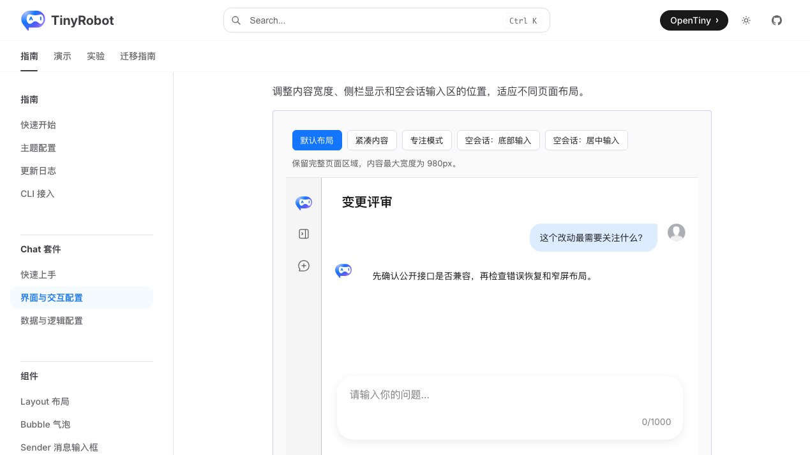
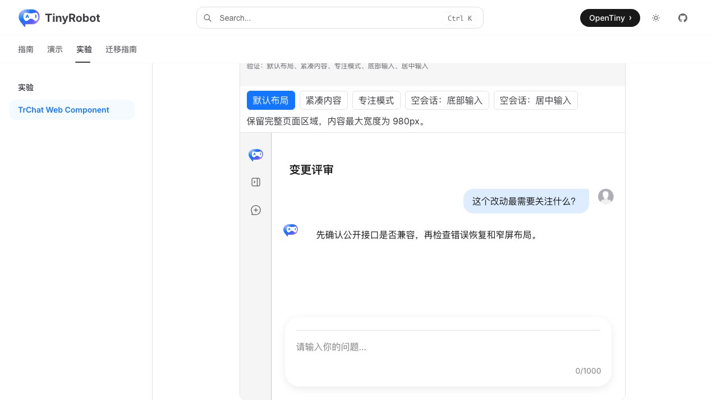
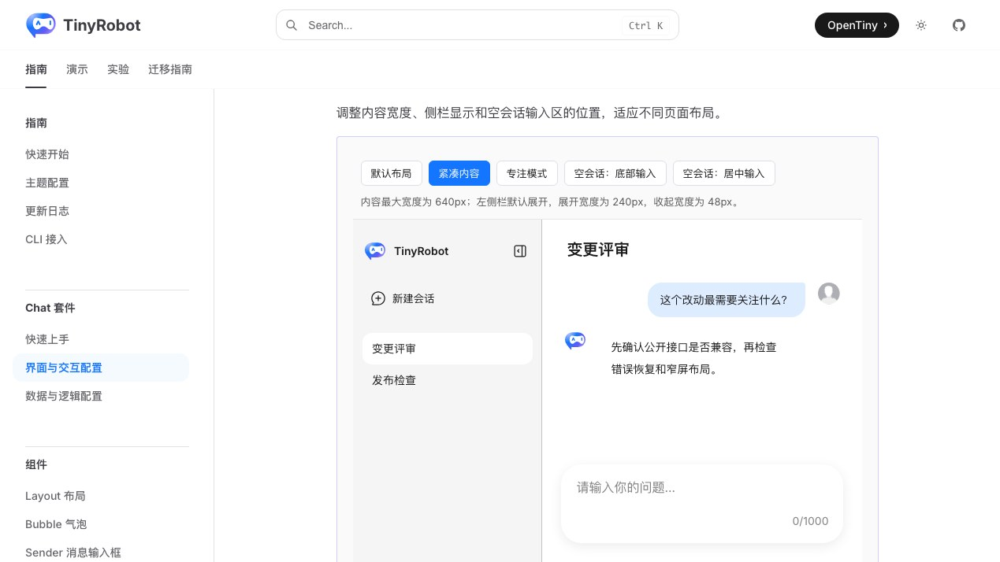
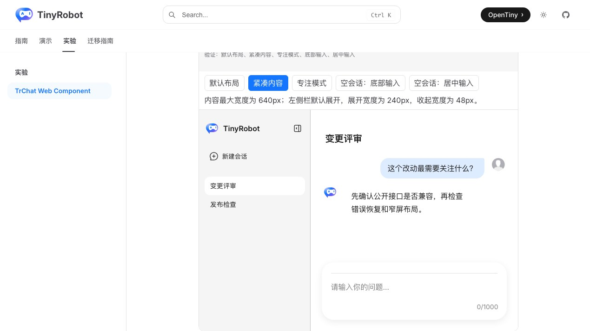
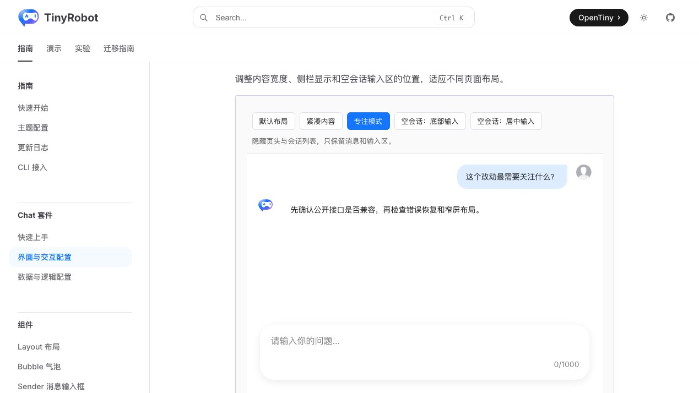
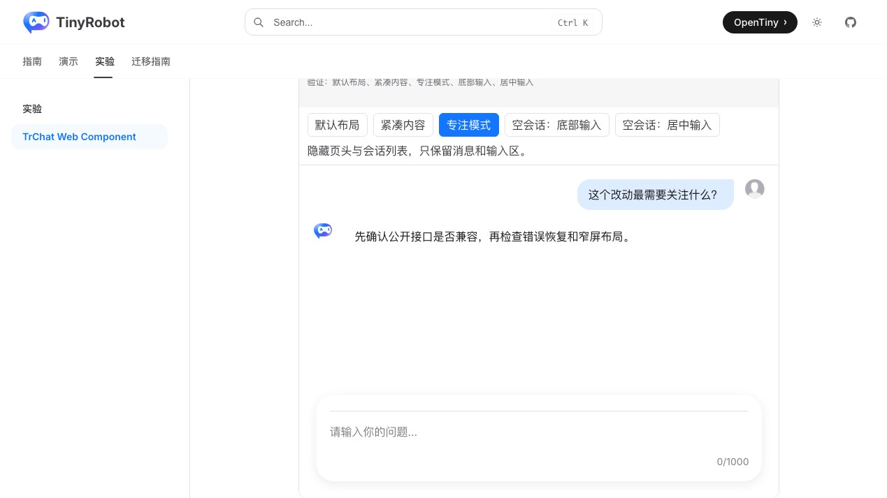
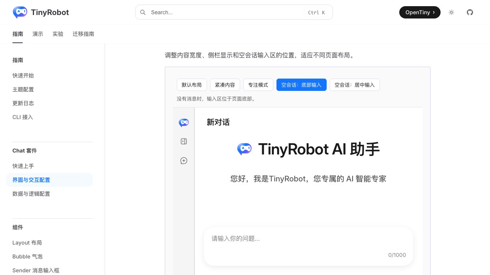
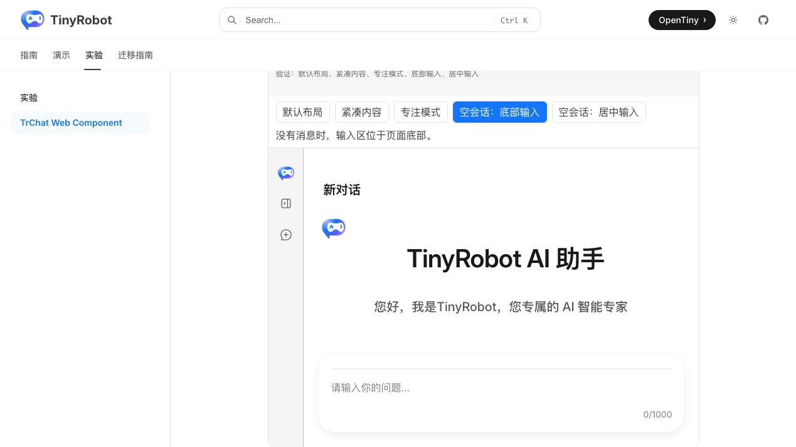
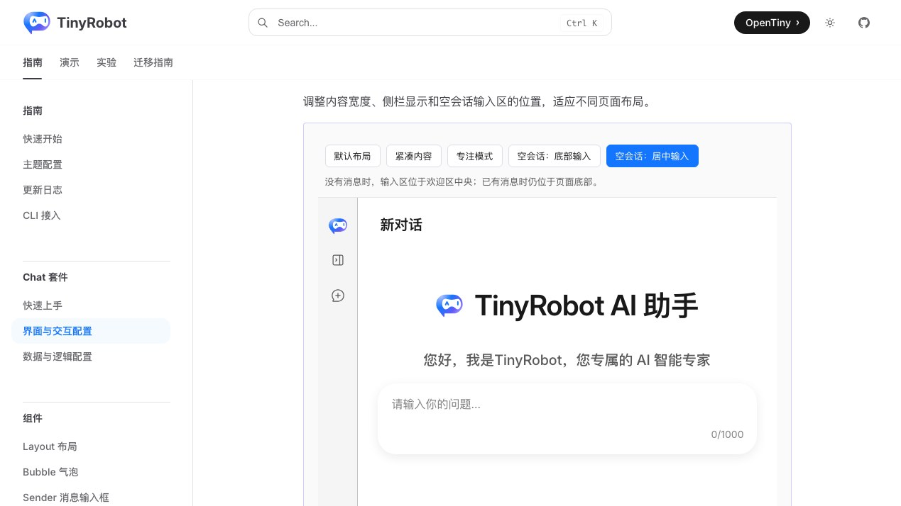
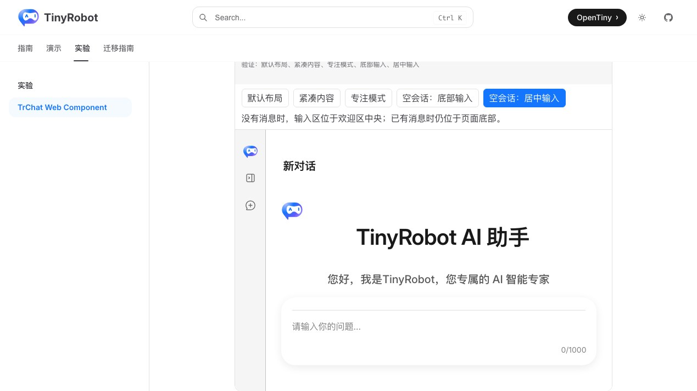

# TrChat Web Component 布局预设验证报告

- 验证日期：2026-10-28
- 浏览器：Chromium
- 截图视口：1269 × 714
- 原版基线：`docs/demos/chat/layout-presets.vue`，`/suites/chat` 中“页面布局预设”
- Web Component：`docs/demos/chat-experimental/shared/examples.ts` 中的 `layout-presets`，`/experiments/chat-web-component`

## 结论

验收通过，协议判定为 direct。Web Component 使用原生 `TrChatUI`，以 DOM property 传递相同的 `data` 和 `ui`；切换预设时重新挂载元素，对应原版 Vue `:key="preset"` 的状态重置语义。默认、紧凑、专注、空会话底部输入和空会话居中输入五种状态均与原版一致。

## 浏览器业务对照

| 场景           | 原版 TrChatUI                                      | Web Component          | 结果 |
| -------------- | -------------------------------------------------- | ---------------------- | ---- |
| 默认布局       | 980px 内容上限，页头和左侧栏可见                   | 相同                   | 一致 |
| 紧凑内容       | 640px 内容、20px padding、8px gap、240/48px 左侧栏 | 相同                   | 一致 |
| 专注模式       | 隐藏页头与左侧栏，保留消息和输入区                 | 相同                   | 一致 |
| 空会话底部输入 | Sender 位于布局 footer                             | 相同                   | 一致 |
| 空会话居中输入 | Sender 位于欢迎区中央                              | 相同                   | 一致 |
| 返回默认       | 消息、页头和左侧栏恢复                             | 相同                   | 一致 |
| 控制台         | 无相关 error / warning                             | 无相关 error / warning | 一致 |

## 截图证据

### 默认布局

### 紧凑内容

### 专注模式

### 空会话底部输入

### 空会话居中输入

## 自动化覆盖

Chromium 专项用例断言五个预设按钮、`aria-pressed`、关键 CSS 变量、页头/侧栏结构、footer Sender、欢迎区 Sender 和返回默认后的状态恢复。

- 本批专项验收：3 / 3 通过。
- Chromium 全量实验套件：28 通过，2 跳过。
- 实验测试类型检查：通过。
- `@opentiny/tiny-robot-chat` 类型检查：通过。
- 文档生产构建：通过（仅保留既有依赖构建警告）。
- 原版与 Web Component 成对截图：通过。

## 范围边界

- 预设只组合公开 `ChatUIOptions`，没有新增专用 Web Component API。
- 截图用于人工 UI 对照，尚未建立自动像素差异阈值。
