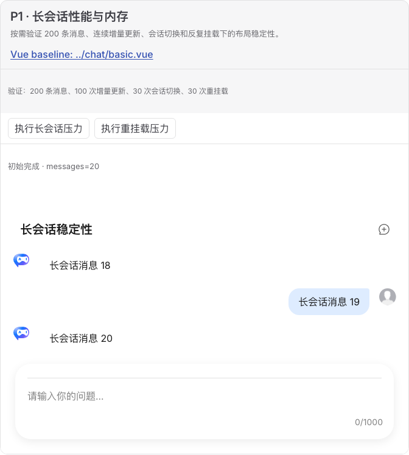
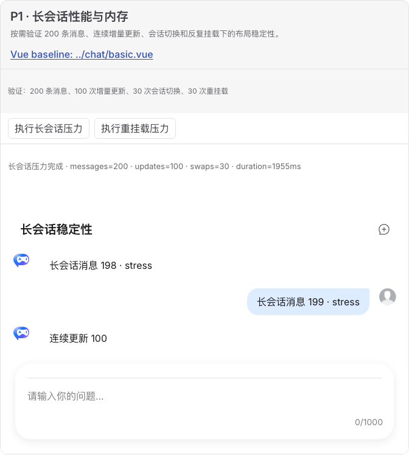
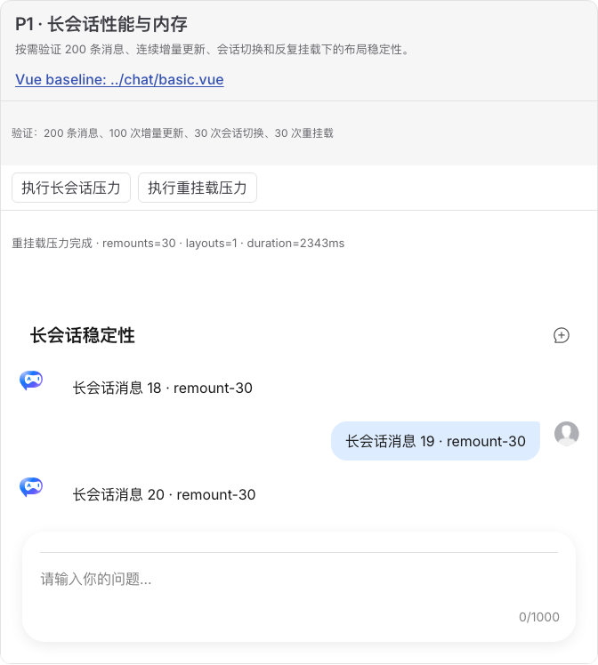

# 长会话性能与内存验收报告

- 验收日期：2026-10-28
- 浏览器：Chromium
- Demo：`docs/demos/chat-experimental/performance-stress.ts`
- Matrix ID：`performance-stress`
- 结论：通过

## 验收范围

本场景使用公开的 `tr-chat-ui` property 与生命周期，不引入内部 Vue API：

- 默认仅渲染 20 条消息，避免 Gallery 的每个访问者无条件承担压力成本；触发后加载 200 条确定性消息；
- 连续 100 次 whole-object 消息更新；
- 连续 30 次活动会话切换；
- 连续 30 次元素销毁和重新挂载；
- 每轮结束检查仅存在一个 Custom Element、一个 `.tr-layout`，Sender 仍可见且控制台无 error。

原版对照采用 `docs/demos/chat/basic.vue`。压力参数是宿主验证适配层耐久性的增强场景，不主张原版文档已有同名性能 Demo；最终 UI 仍由原生 `TrChatUI`、Bubble 和 Sender 渲染。

## 实际测量

专用 Chromium 用例在压力前后调用 `page.requestGC()`，再通过 DevTools Protocol 读取 JS heap 与 DOM counters。一次最终通过运行记录如下：

| 指标                   |       结果 |    保守预算 |
| ---------------------- | ---------: | ----------: |
| 100 次更新 + 30 次切换 |   2,077 ms |  < 5,000 ms |
| 30 次重挂载            |   2,420 ms | < 20,000 ms |
| GC 后 JS heap 变化     | -175,668 B |   < +16 MiB |
| Document 变化          |          0 |       <= +2 |
| DOM node 变化          |       -377 |   <= +1,000 |
| 事件监听器变化         |        -21 |     <= +300 |
| 控制台 error           |          0 |           0 |

默认和重挂载后的最终状态均保留 20 条消息；GC 后 heap、节点和监听器略有下降，关键结论是旧节点、Document 和监听器没有随 30 次重挂载累积。耗时是本机开发构建回归信号，不是产品 SLA 或跨机器基准。

## 浏览器视觉验收

浏览器人工检查确认：

- 默认 20 条消息时，标题、尾部消息和 Sender 完整可见；
- 触发 200 条消息及连续更新后，消息区保持定位在尾部；
- 长会话更新后，布局尺寸、气泡左右分布、头像和 Sender 未发生视觉退化；
- 重挂载后显示第 30 轮数据，状态为 `remounts=30 · layouts=1`，仍只有一个可用布局和一个 Sender；
- 三个状态均无横向溢出或重复布局。

### 默认轻量状态

### 连续更新与会话切换完成

### 30 次重挂载完成

## 自动化证据

- `chat-web-component.examples.spec.ts`：真实 Demo 的 200 条消息、100 次更新、30 次切换、30 次重挂载、单布局和 Sender 可用性。
- `chat-web-component.performance.spec.ts`：Chromium 耗时、GC 后 heap、Document、DOM node、listener 和控制台预算。
- `matrix.spec.ts` / 完整 gallery matrix：示例、报告与机器可读矩阵保持一致。

## 范围边界

- 本项验证确定性本地数据，不代表真实网络 streaming、超时、中断或供应商服务稳定性。
- Chromium 的 GC/CDP 指标不直接等同于 Firefox/WebKit；两者继续保留为 `not-run`。
- 大列表虚拟化和首屏 cold-start 尚未建立产品指标；如果产品要求数千条消息常驻，应另立容量目标。
