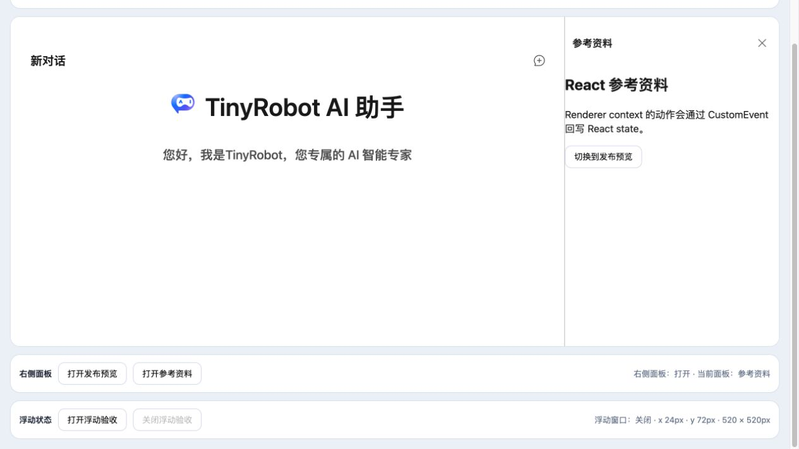
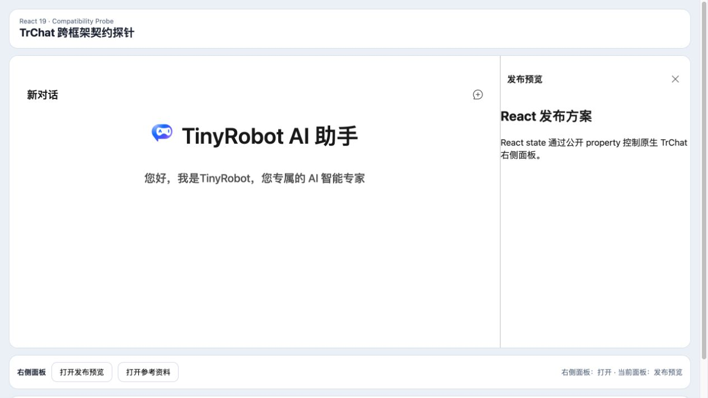

# React 右侧活动面板受控状态验证报告

- 验证日期：2026-10-28
- 浏览器：Chromium
- 截图视口：1265 × 835
- Angular 主应用对照：[Angular 活动面板受控状态报告](../angular-active-panel/report.md)
- React 兼容性探针：`packages/react-chat-experimental`

## 结论

验收通过。React state 通过 `activeRightAsidePanelId` property 选择 `preview` / `sources`；DOM Renderer 调用 `activateRightAsidePanel('preview')` 后，`active-right-aside-panel-id-update` 的 `event.detail` 回写 React state。面板标题、Renderer 内容、状态文案和公开 property 保持一致。

## 浏览器业务对照

| 场景            | Angular 主应用                     | React 探针                   | 结果 |
| --------------- | ---------------------------------- | ---------------------------- | ---- |
| 外部选择资料    | signal 设为 `sources`              | state 设为 `sources`         | 一致 |
| Renderer 内切换 | context 切回 `preview`             | context 切回 `preview`       | 一致 |
| 生命周期        | Renderer 监听由 `AbortSignal` 清理 | 使用相同 Renderer 生命周期   | 一致 |
| 控制台          | 无相关 error / warning             | 干净标签页无 error / warning | 一致 |

## 截图证据

### React 选择参考资料

### Renderer 内切换回发布预览

## 自动化覆盖

Playwright 用例 `writes active right-aside panel updates back into React state` 覆盖 React 外部选择资料、资料 Renderer、公开 property，以及 Renderer context 切换后 UI、React state 和 property 的一致性。

## 范围边界

- React 只验证公开 DOM Renderer 协议，不传递 React node 或 Vue VNode 穿过 Custom Element 边界。
- 更多 panel id 复用同一 string property / CustomEvent 契约。
