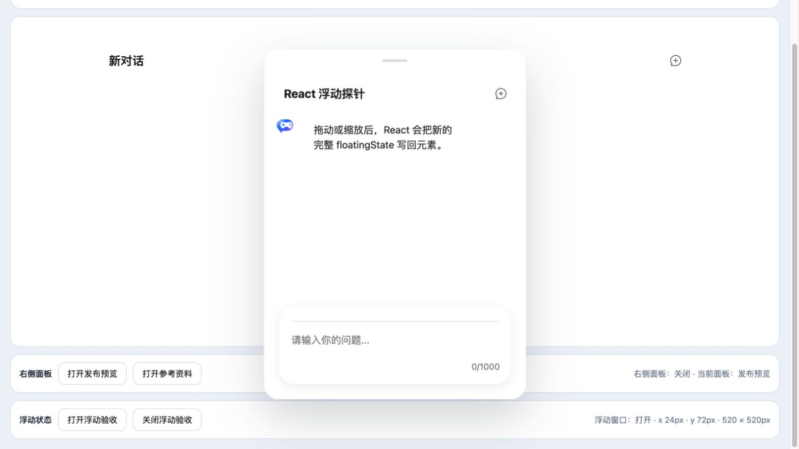
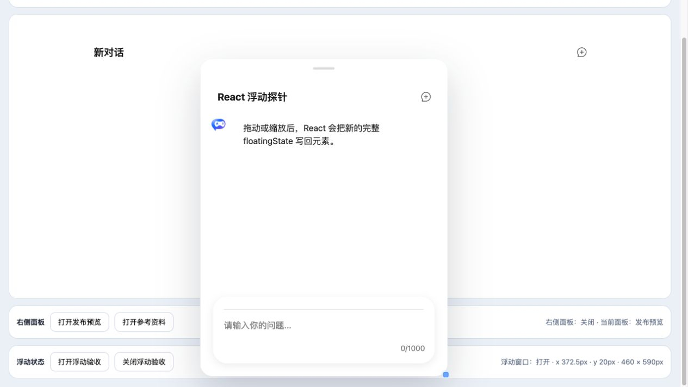

# React 浮动窗口受控状态验证报告

- 验证日期：2026-10-28
- 浏览器：Chromium
- 截图视口：1265 × 835
- Angular 主应用对照：[Angular 浮动状态受控报告](../angular-floating-state/report.md)
- React 兼容性探针：`packages/react-chat-experimental`

## 结论

验收通过。React 持有完整 `floatingState` 对象；`floating-state-update` 到达后，从 `event.detail` 创建新对象并整体写回 element property。拖动、缩放、状态文案和公开 property 的自动化断言均通过；按需卸载时 effect cleanup 移除事件监听。

## 浏览器业务对照

| 场景     | Angular 主应用              | React 探针                   | 结果 |
| -------- | --------------------------- | ---------------------------- | ---- |
| 初始几何 | x 24px、y 72px、520 × 520px | 相同                         | 一致 |
| 打开窗口 | `TrChatUI` 浮动 surface     | 相同，标题为“React 浮动探针” | 一致 |
| 拖动     | update event 回写新坐标     | 最终 x 372.5px、y 20px       | 一致 |
| 缩放     | 整体对象回写宽高            | 最终 460 × 590px             | 一致 |
| 控制台   | 无相关 error / warning      | 干净标签页无 error / warning | 一致 |

最终几何受当前视口边界约束。自动化以拖动后坐标有效变化、缩放后宽高相对拖动状态增加、React 状态文案与公开 property 一致作为通过标准。

## 截图证据

### 初始浮动窗口

### 拖动并缩放后

## 自动化覆盖

Playwright 用例 `writes floating drag and resize updates back into a React-owned state object` 覆盖初始完整对象、打开状态、拖动坐标、缩放宽高、公开 property 与 React 状态文案。

## 范围边界

- React 探针不提供产品级聊天业务；最终应用中的浮动能力仍由 Angular 决定是否使用。
- `floatingState` 必须整体重新赋值，嵌套原地修改不属于支持契约。
