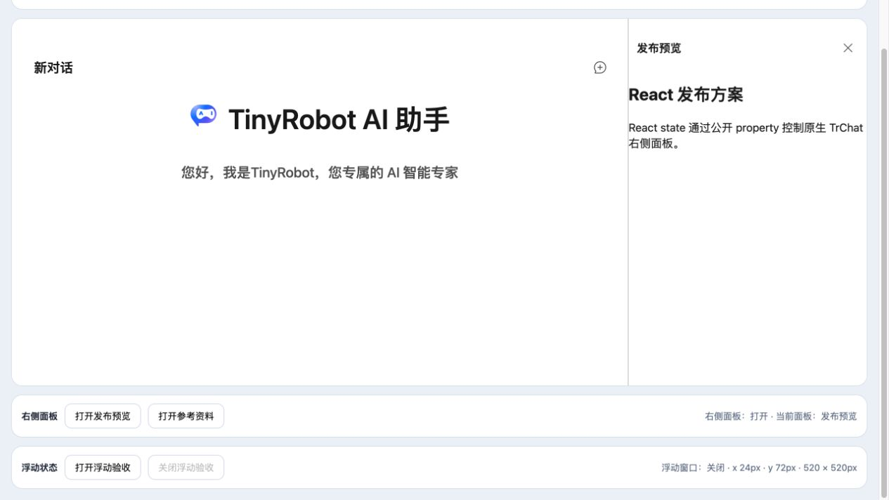
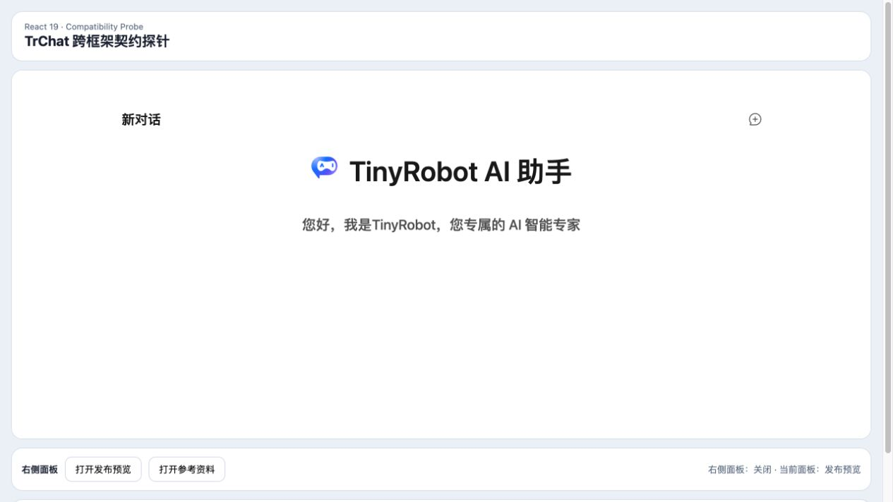

# React 右侧面板受控状态验证报告

- 验证日期：2026-10-28
- 浏览器：Chromium
- 截图视口：1265 × 835
- Angular 主应用对照：[Angular 右侧面板受控状态报告](../angular-right-aside/report.md)
- React 兼容性探针：`packages/react-chat-experimental`

## 结论

验收通过。React 19 通过 element ref 写入 `rightAsideOpen` property，并使用原生 `addEventListener` 接收 `right-aside-open-update`。外部按钮打开右栏、组件内“关闭详情”回写 React state、状态文案和公开 property 均由自动化验证。React 只承担协议兼容性探针，最终产品应用仍是 Angular。

## 浏览器业务对照

| 场景     | Angular 主应用              | React 探针                    | 结果 |
| -------- | --------------------------- | ----------------------------- | ---- |
| 初始状态 | signal 为 `false`，右栏关闭 | state 为 `false`，右栏关闭    | 一致 |
| 外部打开 | Angular property binding    | React ref property assignment | 一致 |
| 内部关闭 | update event 回写 signal    | update event 回写 state       | 一致 |
| 控制台   | 无相关 error / warning      | 干净标签页无 error / warning  | 一致 |

## 截图证据

### React 外部打开

### 组件内部关闭并回写

## 自动化覆盖

Playwright 用例 `synchronizes controlled right-aside open state between React and TrChat` 覆盖初始状态、React 外部打开、Renderer 内容、公开 property、组件内部关闭和 React state 回写。

## 范围边界

- 不复制 Angular 的产品外壳、模型配置、会话业务或设置能力。
- React `StrictMode` 会重复执行 effect setup / cleanup，本探针通过 effect cleanup 移除原生事件监听。
