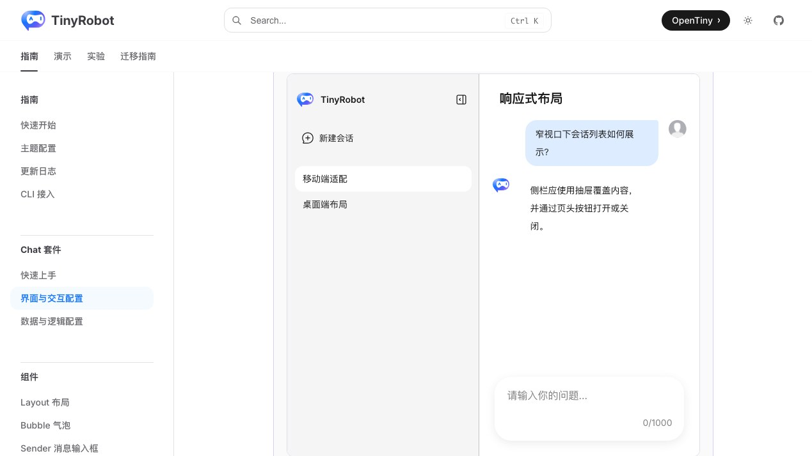
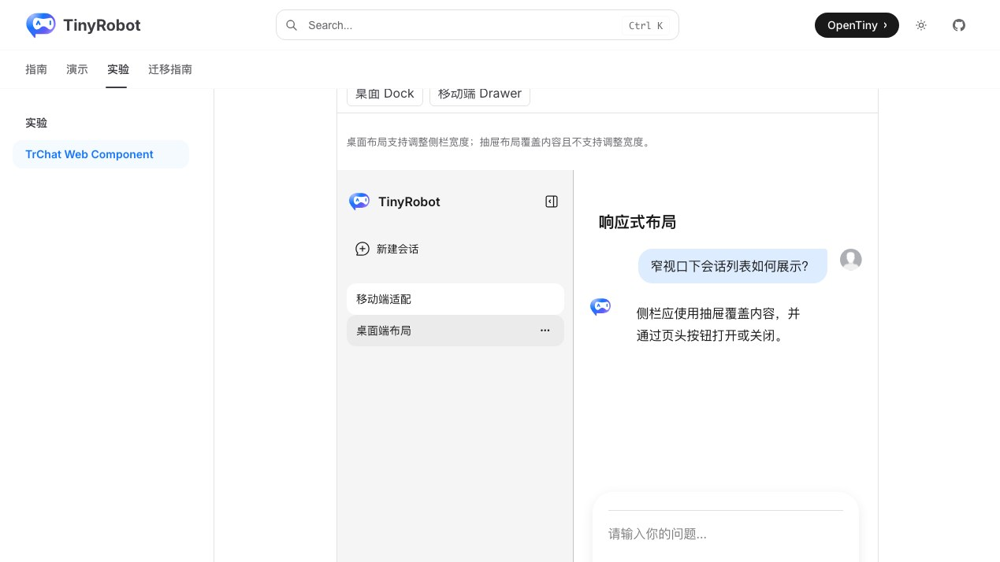
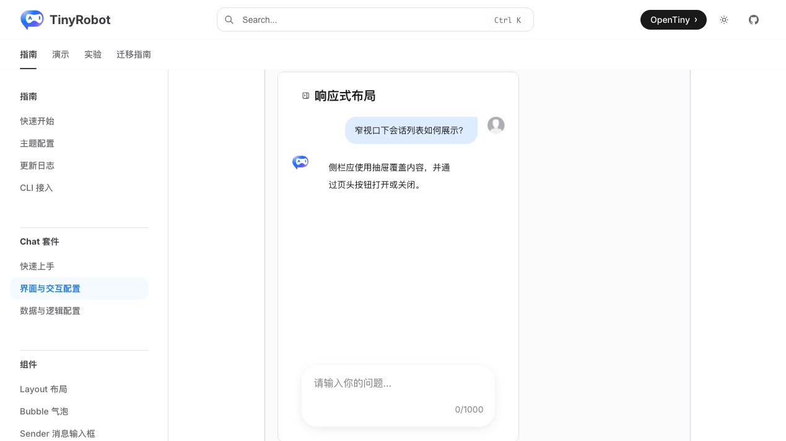
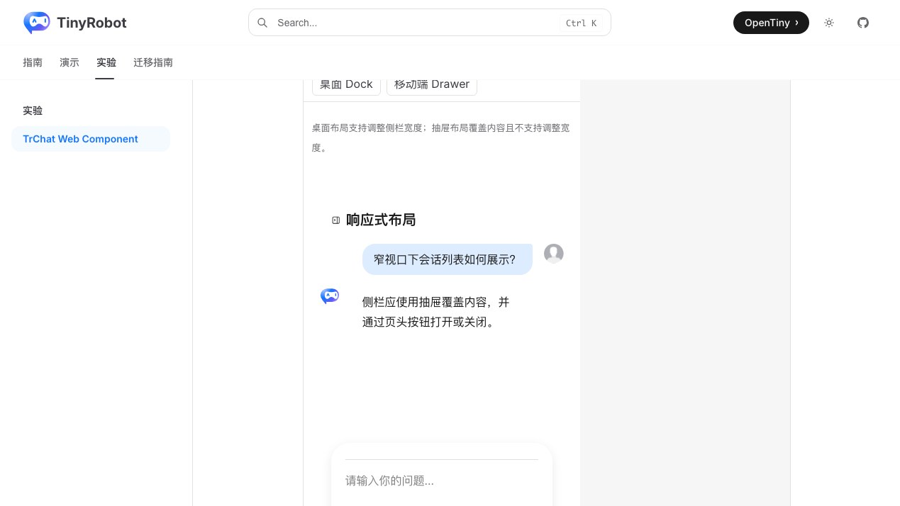

# TrChat Web Component 响应式布局验证报告

- 验证日期：2026-10-28
- 浏览器：Chromium
- 截图视口：1269 × 714
- 原版基线：`docs/demos/chat/responsive-layout.vue`，`/suites/chat` 中“响应式布局”
- Web Component：`docs/demos/chat-experimental/shared/examples.ts` 中的 `responsive-layout`，`/experiments/chat-web-component`

## 结论

验收通过，协议判定为 direct。Web Component 复用原生 `TrChatUI` 的 Dock / Drawer 布局，仅由宿主切换容器宽度和 `ui` property。760px 桌面模式与 390px 移动模式的消息、输入器、侧栏策略和横向溢出结果均与原版一致。

## 浏览器业务对照

| 场景          | 原版 TrChat                               | Web Component          | 结果 |
| ------------- | ----------------------------------------- | ---------------------- | ---- |
| 桌面 Dock     | 容器最大宽度 760px，侧栏使用 Dock         | 相同                   | 一致 |
| 移动端 Drawer | 容器最大宽度 390px，侧栏改为覆盖式 Drawer | 相同                   | 一致 |
| 状态按钮      | 当前模式使用 `aria-pressed=true`          | 相同                   | 一致 |
| 内容与输入器  | 窄宽度下消息和输入器保持可见              | 相同                   | 一致 |
| 横向溢出      | 两种模式均无内部横向溢出                  | 相同                   | 一致 |
| 控制台        | 无相关 error / warning                    | 无相关 error / warning | 一致 |

## 截图证据

### 桌面 Dock

### 移动端 Drawer

## 自动化覆盖

Chromium 专项用例断言初始 Dock、760px 容器、切换后的 Drawer、390px 容器、`aria-pressed`、布局 class、切回 Dock 以及两种模式的横向溢出。

- 本批专项验收：3 / 3 通过。
- 成对截图流程：2 / 2 通过。
- 完整 Chromium experimental suite：28 passed，2 skipped；跳过项为凭据门控的真实 streaming 与真实 MCP。
- `pnpm -F tiny-robot-test type-check:experimental`：通过。
- `pnpm -F @opentiny/tiny-robot-chat type-check`：通过。
- `pnpm -F docs build`：通过；仅有既有 bundle、Vite browser externalization 和 Zod 注释 warning。

## 范围边界

- 本报告验证容器响应式，不等同于完整移动设备触摸手势或所有浏览器视口组合。
- Firefox / WebKit 已保留核心 responsive smoke，本轮成对截图使用 Chromium。
- 截图用于人工 UI 对照，尚未建立自动像素差异阈值。
