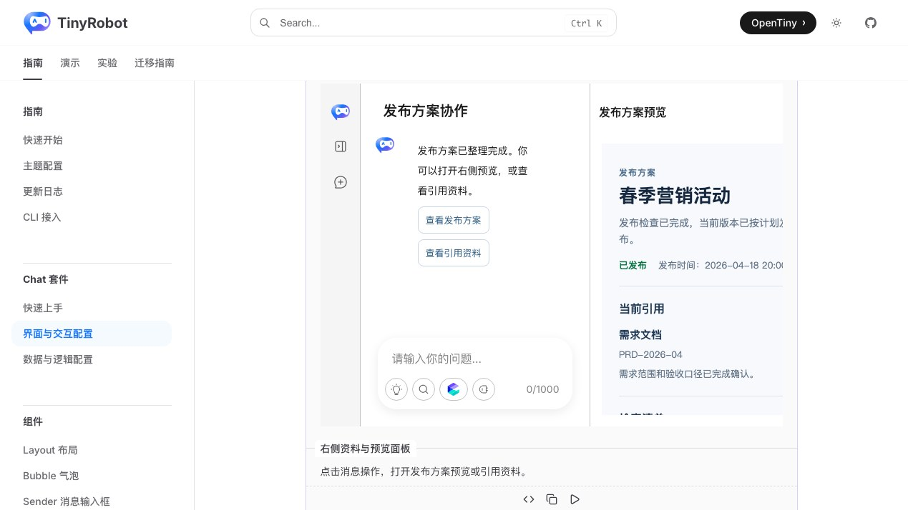
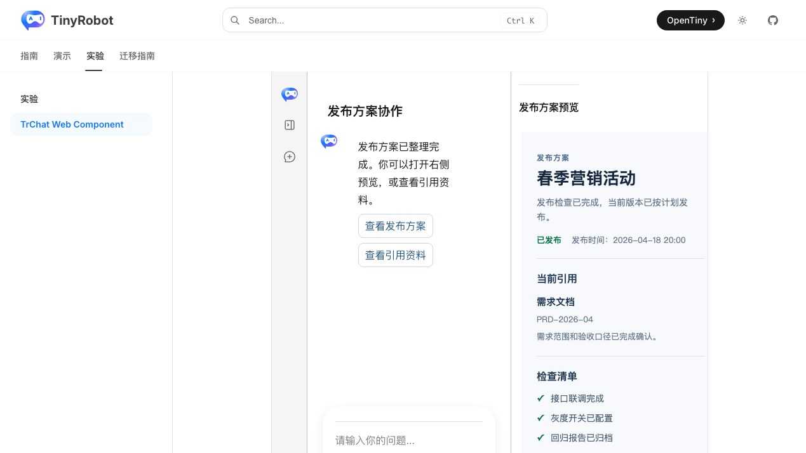
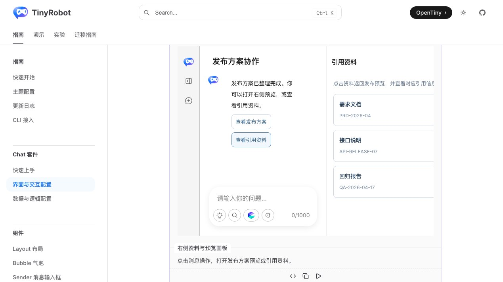
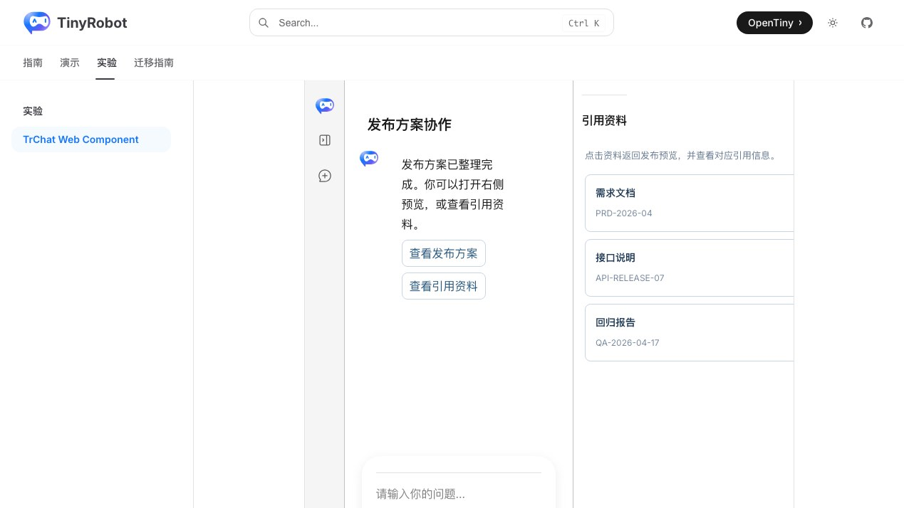

# TrChat Web Component 右侧业务面板验证报告

- 验证日期：2026-10-28
- 浏览器：Chromium
- 截图视口：1269 × 714
- 原版基线：`docs/demos/chat/right-aside-panel.vue` 与 `business-right-aside.vue`，`/suites/chat` 中“右侧资料与预览面板”
- Web Component：`docs/demos/chat-experimental/shared/examples.ts` 中的 `right-aside-panel`，`/experiments/chat-web-component`

## 结论

验收通过，协议判定为 adapted。原版 Vue scoped slots 转换为 `bubble-content-footer` 和 `layout-right-aside-panel` DOM Renderers；`v-model` 转换为 property 与 `*-update` 事件回写。面板主体仍由原生 `TrChat` 布局管理，发布预览、引用资料、资料选择、返回预览和关闭状态与原版一致。

## 浏览器业务对照

| 场景     | 原版 TrChat                      | Web Component                 | 结果 |
| -------- | -------------------------------- | ----------------------------- | ---- |
| 默认状态 | 右侧打开“发布方案预览”           | 相同，iframe 使用相同发布模板 | 一致 |
| 消息动作 | “查看发布方案”“查看引用资料”     | DOM Renderer 输出同样动作     | 一致 |
| 引用资料 | 三张两行资料卡片，显示标题与编号 | 结构、文案和交互相同          | 一致 |
| 面板切换 | 点击资料后返回预览并更新当前引用 | 相同                          | 一致 |
| 关闭状态 | 右侧栏收起并进入 inert 状态      | 相同                          | 一致 |
| 控制台   | 无相关 error / warning           | 无相关 error / warning        | 一致 |

## 截图证据

### 发布预览

### 引用资料

## 自动化覆盖

Chromium 专项用例断言默认预览 iframe、消息动作、引用资料、资料选择后返回预览，以及调用公开方法关闭面板后的 hidden / inert 状态；Renderer 事件监听使用 `AbortSignal` 释放。

- 本批专项验收：3 / 3 通过。
- 成对截图流程：2 / 2 通过。
- 完整 Chromium experimental suite：28 passed，2 skipped；跳过项为凭据门控的真实 streaming 与真实 MCP。
- `pnpm -F tiny-robot-test type-check:experimental`：通过。
- `pnpm -F @opentiny/tiny-robot-chat type-check`：通过。
- `pnpm -F docs build`：通过；仅有既有 bundle、Vite browser externalization 和 Zod 注释 warning。

## 范围边界

- 当前验证两个业务 panel；更多 panel 使用同一 renderer context，不在本报告重复枚举。
- 拖动调整右侧栏宽度已由布局能力覆盖，本报告聚焦业务内容和受控状态。
- 截图用于人工 UI 对照，尚未建立自动像素差异阈值。
