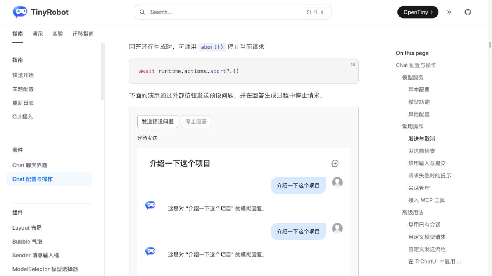
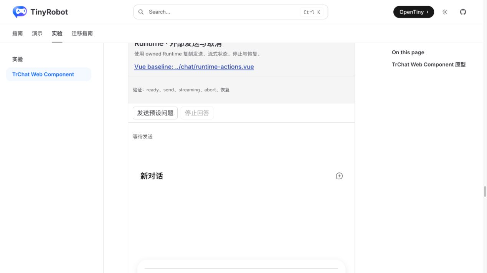
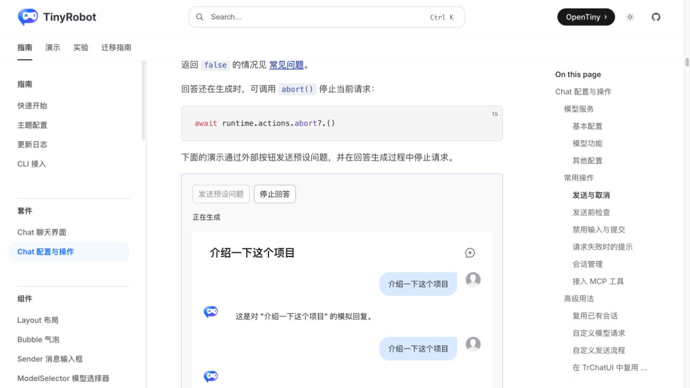
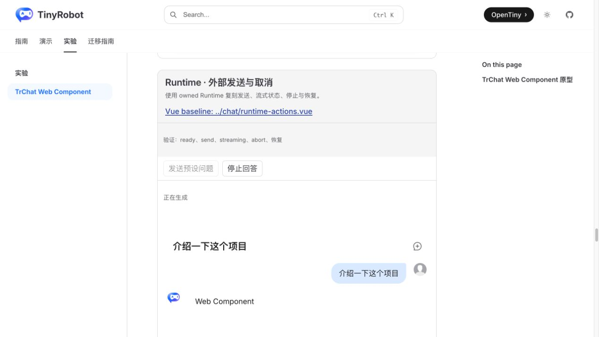
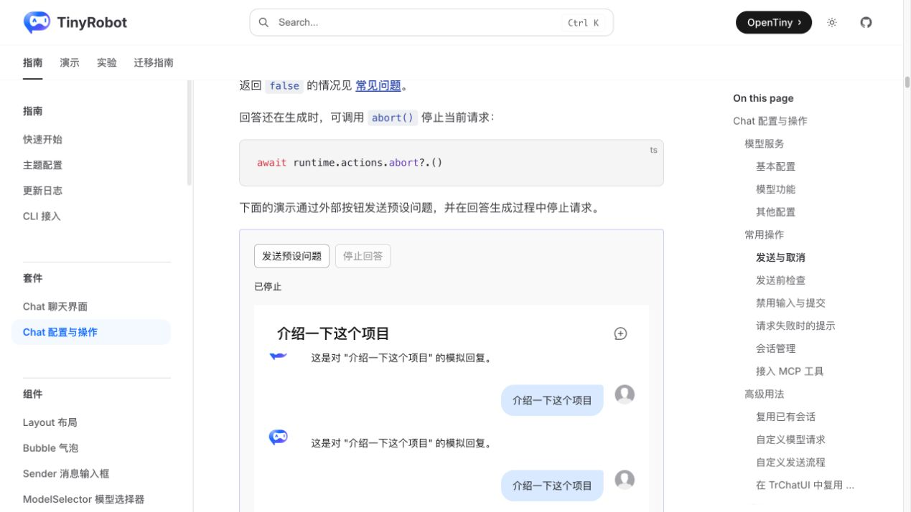
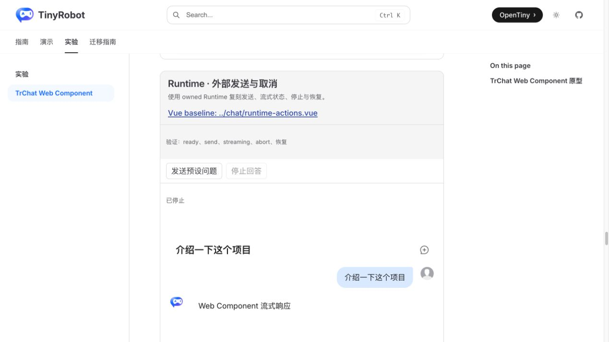

# TrChat Web Component Runtime Actions 验证报告

- 验证日期：2026-10-27
- 浏览器：Chromium
- 截图视口：1269 × 714
- 原版基线：`docs/demos/chat/runtime-actions.vue`，`/suites/chat-runtime` 中“通过外部按钮发送与取消”
- Web Component：`docs/demos/chat-experimental/shared/examples.ts` 中的 `runtime-actions`，`/experiments/chat-web-component`

## 结论

本轮业务验收通过，但集成协议判定为 adapted。`tr-chat` 的 owned Runtime、`send()` 与 `getRuntime().actions.abort()` 足以复刻原版外部控制流程。Web Component 宿主能读取 `activeConversation.value.requestState`，同步外部按钮可用性和“等待发送 / 正在生成 / 已停止 / 已完成”状态，并在取消后再次发送；纯 DOM 宿主目前缺少框架中立的 Runtime 状态订阅协议，Demo 使用短周期轮询完成外部状态同步。

## 浏览器业务对照

| 场景      | 原版 TrChat                          | Web Component                    | 结果 |
| --------- | ------------------------------------ | -------------------------------- | ---- |
| ready     | 加载完成后显示“等待发送”             | owned Runtime 加载完成后同样显示 | 一致 |
| 外部发送  | 追加预设用户消息，状态进入“正在生成” | `element.send()` 得到相同结果    | 一致 |
| streaming | 停止按钮启用，发送按钮禁用           | 同样的按钮与状态约束             | 一致 |
| abort     | 状态变为“已停止”，未出现完整回答     | `runtime.actions.abort()` 后相同 | 一致 |
| 恢复      | 取消后发送按钮恢复，可再次完成       | 相同行为，最终状态“已完成”       | 一致 |
| 控制台    | 场景无相关 error                     | 场景无 error                     | 一致 |

## 截图证据

### 等待发送

### 正在生成

### 已停止

## 自动化覆盖

Chromium 场景直接断言 ready 状态、预设消息、processing、停止按钮、abort 结果、完整回答未出现、取消后再次发送、完整流式回答和 completed 状态。

- 完整 Gallery：20 passed。
- `pnpm -F tiny-robot-test type-check:experimental`：通过。
- `pnpm -F @opentiny/tiny-robot-chat type-check`：通过。
- `pnpm -F docs build`：通过；只有既有 warning。

## 范围边界

- 状态同步使用 Runtime 的公开 Vue readable 值；纯 DOM、Angular 或 React 宿主不能直接获得框架中立通知。应新增 Runtime snapshot/event 或 subscribe/unsubscribe 协议，项目 TODO 已记录。
- 本报告使用本地 mock streaming provider。真实 DeepSeek 的超时、网络中断和服务错误仍属于“真实服务验证”TODO。
