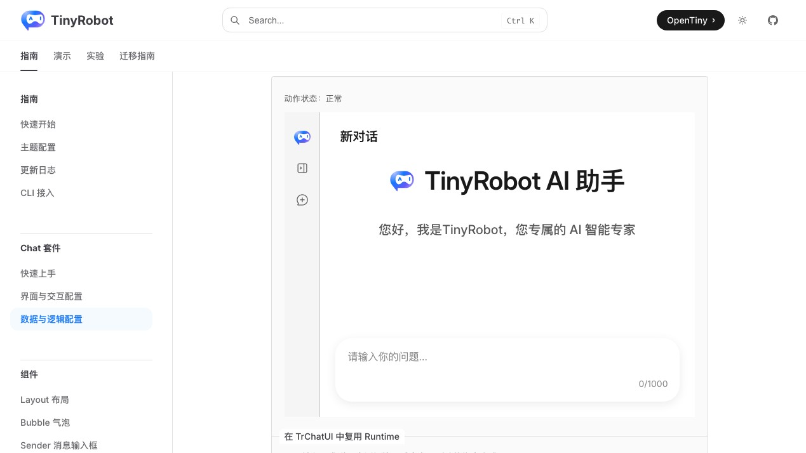
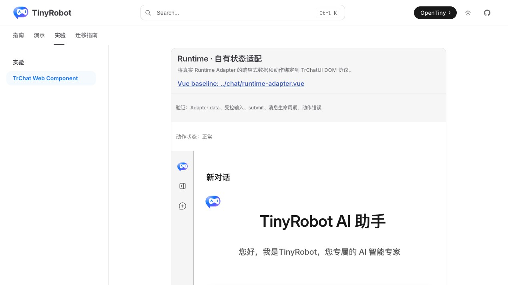
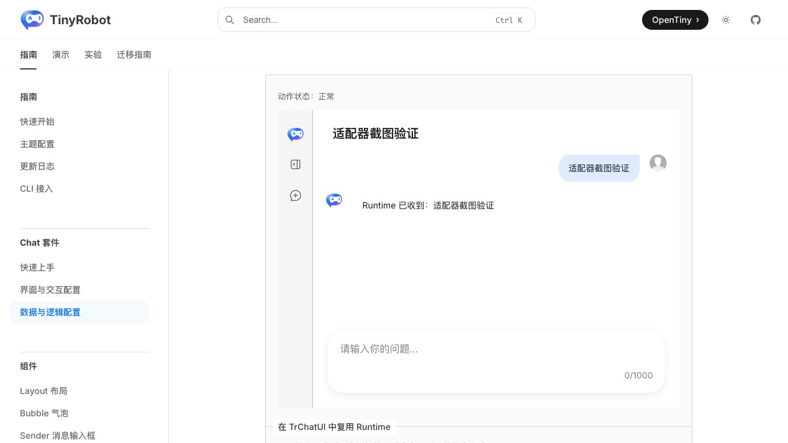
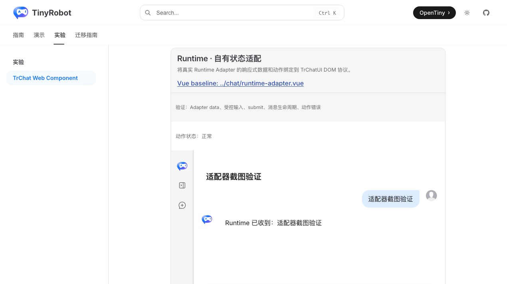

# TrChat Web Component Runtime Adapter 验证报告

- 验证日期：2026-10-28
- 浏览器：Chromium
- 截图视口：1269 × 714
- 原版基线：`docs/demos/chat/runtime-adapter.vue`，`/suites/chat-runtime` 中“在 TrChatUI 中复用 Runtime”
- Web Component：`docs/demos/chat-experimental/shared/examples.ts` 中的 `runtime-adapter`，`/experiments/chat-web-component`

## 结论

验收通过，协议判定为 adapted。示例不再手写消息回写，而是创建真实 Runtime Adapter；Adapter 的响应式 `data` 与 `inputValue` 通过 property 整体赋值同步到 `<tr-chat-ui>`，界面的 DOM CustomEvent 再映射到 Adapter 动作。输入、发送、自动创建会话、用户消息、助手回答和输入清空均与原版一致。

## 浏览器业务对照

| 场景         | 原版 TrChatUI + Adapter          | Web Component                        | 结果 |
| ------------ | -------------------------------- | ------------------------------------ | ---- |
| 初始状态     | 显示“动作状态：正常”和新对话     | 相同                                 | 一致 |
| 受控输入     | Adapter 持有输入并回写界面       | property + `input-value-update` 映射 | 一致 |
| 发送         | `submit` 调用 `adapter.send()`   | DOM CustomEvent 调用相同动作         | 一致 |
| 消息生命周期 | 自动创建会话并追加用户、助手消息 | 相同                                 | 一致 |
| 回答内容     | `Runtime 已收到：{text}`         | 相同                                 | 一致 |
| 发送完成     | 输入清空                         | 相同                                 | 一致 |
| 控制台       | 无相关 error                     | 无 error                             | 一致 |

## 截图证据

### 初始状态

### 完成发送

## 自动化覆盖

Chromium 专项用例通过真实 Sender 输入和提交，断言正常状态、用户消息、Runtime 回答与输入清空；独立浏览器检查再次确认消息内容及控制台状态。

- 本批专项验收：3 / 3 通过。
- Chromium 全量实验套件：28 通过，2 跳过。
- 实验测试与 `@opentiny/tiny-robot-chat` 类型检查：通过。
- 文档生产构建：通过（仅保留既有依赖与 bundle 体积警告）。
- 独立浏览器业务检查：通过，控制台无 error。
- 原版与 Web Component 成对截图：通过。

## 范围边界

- Adapter 本身仍是 Vue 响应式 composable；非 Vue 宿主通过 DOM property 与 CustomEvent 消费其输出和动作，不直接读取 Vue Ref。
- 截图用于人工 UI 对照，尚未建立自动像素差异阈值。
