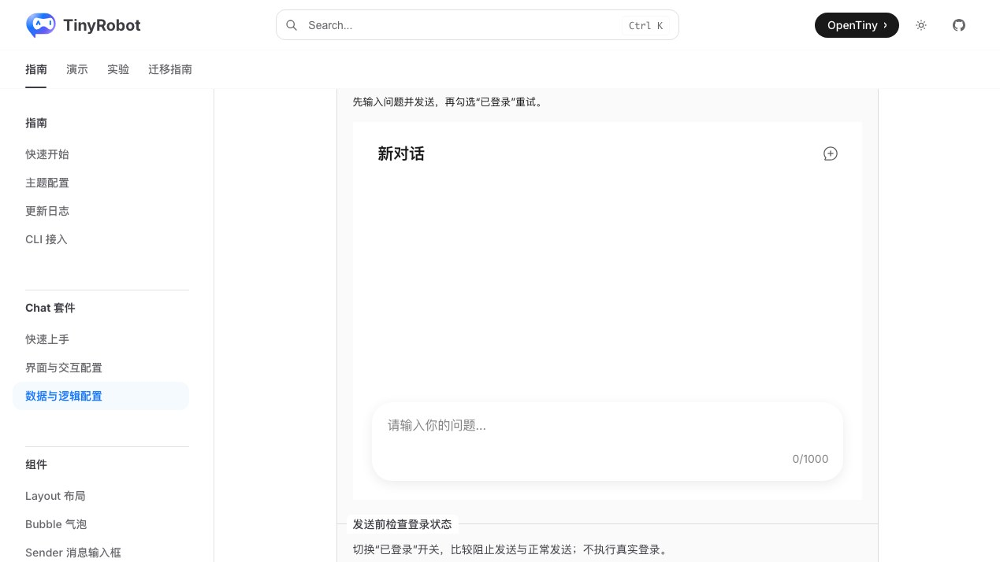
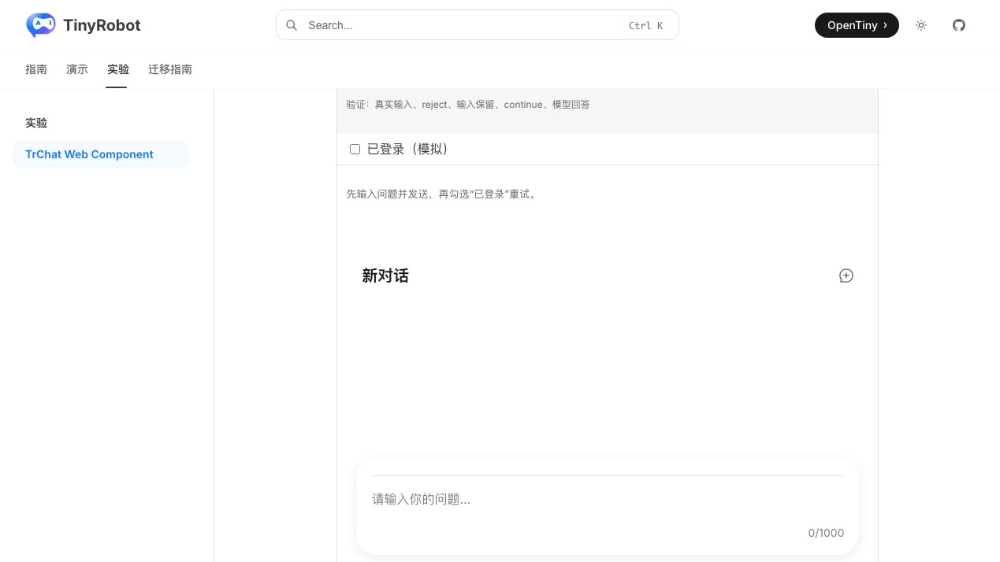
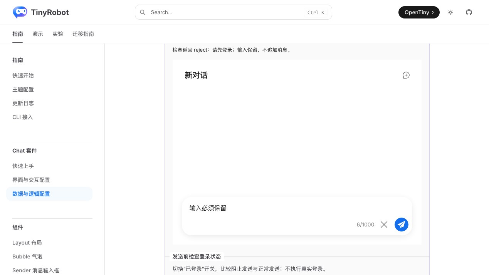
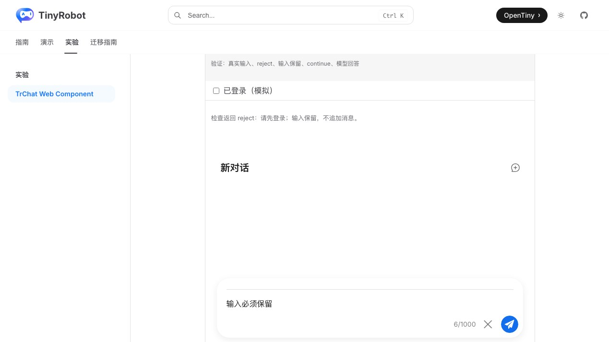
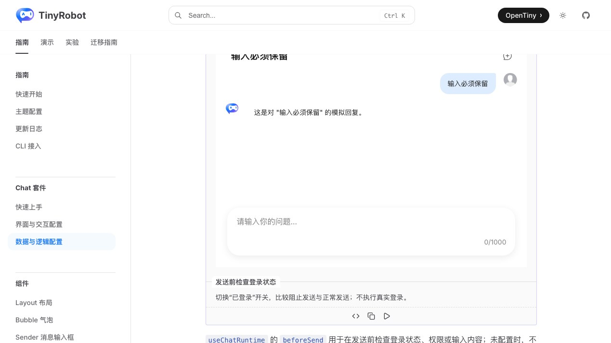
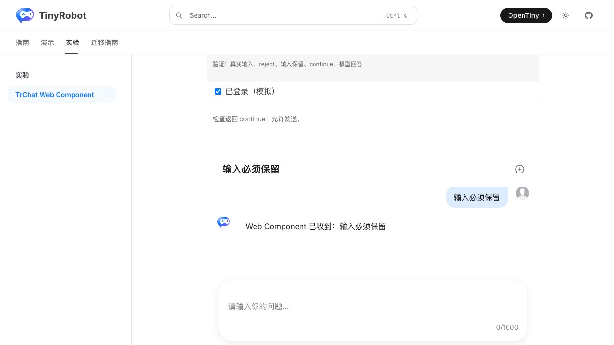

# TrChat Web Component 发送前拦截验证报告

- 验证日期：2026-10-28
- 浏览器：Chromium
- 截图视口：1269 × 714
- 原版基线：`docs/demos/chat/runtime-before-send.vue`，`/suites/chat-runtime` 中“发送前检查登录状态”
- Web Component：`docs/demos/chat-experimental/shared/examples.ts` 中的 `runtime-before-send`，`/experiments/chat-web-component`

## 结论

验收通过，协议判定为 direct。Web Component 的 owned Runtime 使用相同 `beforeSend` 契约：未登录返回 `reject`，保留 Sender 输入且不追加消息；登录后返回 `continue`，清空输入、追加用户消息并完成模型回答。验证通过真实 Sender 提交流程完成，不再使用外部按钮直接调用固定 payload。

## 浏览器业务对照

| 场景       | 原版 TrChat                       | Web Component                    | 结果 |
| ---------- | --------------------------------- | -------------------------------- | ---- |
| 初始状态   | 未登录，提示先输入并发送          | 相同                             | 一致 |
| 未登录提交 | 状态显示 reject                   | 相同                             | 一致 |
| 输入与消息 | 输入保留，不追加用户消息          | 相同                             | 一致 |
| 登录后重试 | 状态显示 continue                 | 相同                             | 一致 |
| 完成发送   | 输入清空，追加用户和助手消息      | 相同；回答文案来自各自本地模拟器 | 一致 |
| 错误通知   | Runtime action error 写入状态区域 | 相同                             | 一致 |
| 控制台     | 无相关 error / warning            | 无相关 error / warning           | 一致 |

## 截图证据

### 初始状态

### 拒绝并保留输入

### 登录后完成

## 自动化覆盖

Chromium 专项用例通过真实 Sender 输入和提交，断言初始状态、reject 状态、消息数量不变、输入保留、登录 checkbox、continue 状态、用户消息、助手回答和输入清空。

- 本批专项验收：3 / 3 通过。
- Chromium 全量实验套件：28 通过，2 跳过。
- 实验测试类型检查：通过。
- `@opentiny/tiny-robot-chat` 类型检查：通过。
- 文档生产构建：通过（仅保留既有依赖构建警告）。
- 原版与 Web Component 成对截图：通过。

## 范围边界

- 原版与 Web Component 分别使用既有文档模拟器和实验页本地模拟器，回答文案不同；发送前拦截、消息生命周期和最终 UI 状态一致。
- 真实鉴权服务、服务端权限失败和真实模型网络错误属于真实服务专项验收。
- 截图用于人工 UI 对照，尚未建立自动像素差异阈值。
