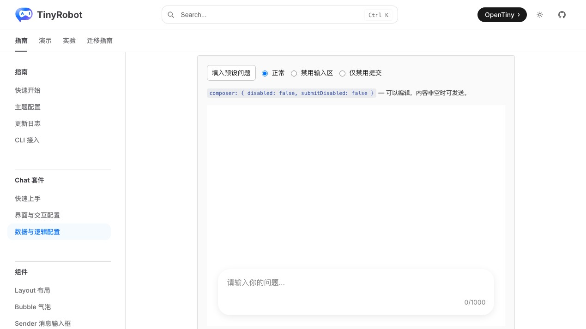
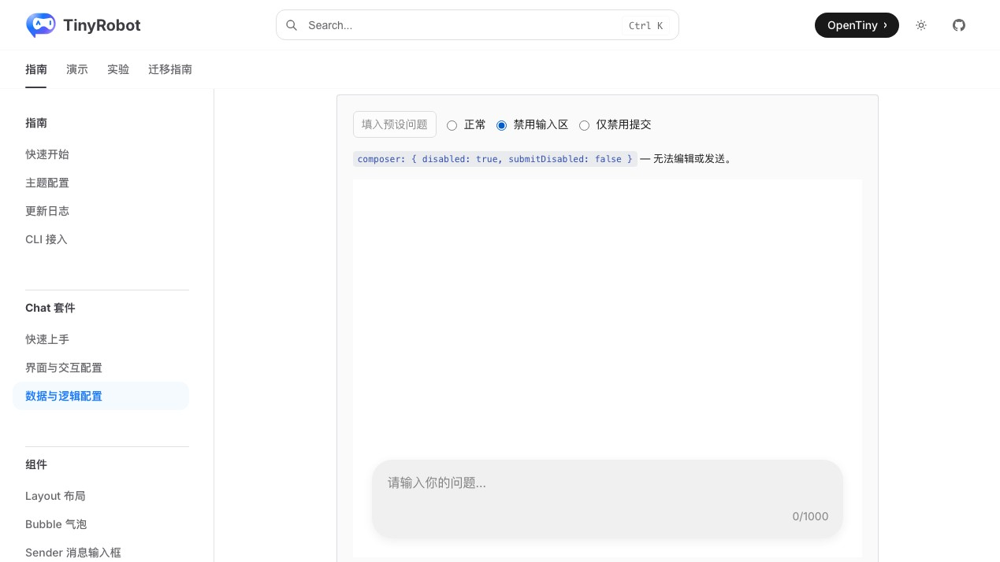
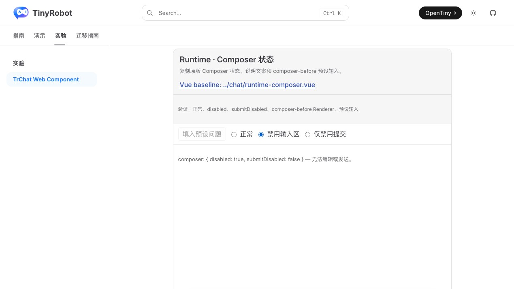
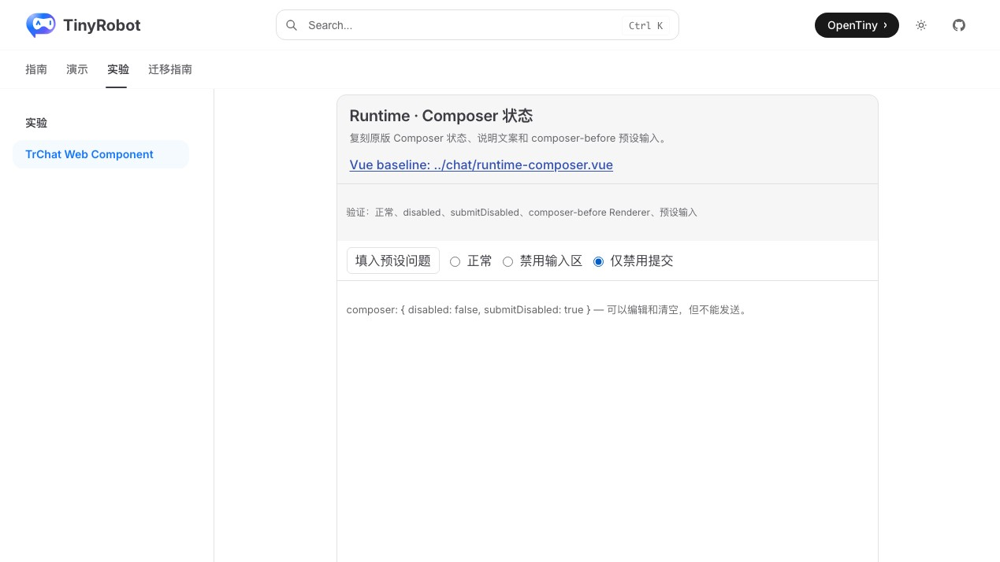

# TrChat Web Component Composer 状态验证报告

- 验证日期：2026-10-28
- 浏览器：Chromium
- 截图视口：1269 × 714
- 原版基线：`docs/demos/chat/runtime-composer.vue`，`/suites/chat-runtime` 中“禁用输入区与仅禁用提交”
- Web Component：`docs/demos/chat-experimental/shared/examples.ts` 中的 `runtime-composer`，`/experiments/chat-web-component`

## 结论

验收通过，协议判定为 adapted。原版响应式 Composer readable 继续由真实 Runtime 消费；Vue `composer-before` scoped slot 与 Teleport 转换为 DOM Renderer context 和宿主控制按钮。正常、禁用整个输入区、仅禁用提交、状态说明及预设问题写入均与原版一致。

## 浏览器业务对照

| 场景       | 原版 TrChat                              | Web Component                     | 结果 |
| ---------- | ---------------------------------------- | --------------------------------- | ---- |
| 正常状态   | 可编辑，内容非空时可提交                 | 相同                              | 一致 |
| 预设问题   | `composer-before` 调用 `setInputValue()` | DOM Renderer context 调用相同方法 | 一致 |
| 禁用输入区 | Sender 不可编辑或发送，预设按钮禁用      | 相同                              | 一致 |
| 仅禁用提交 | 输入仍可编辑，提交按钮禁用               | 相同                              | 一致 |
| 状态说明   | 显示两个 Composer 布尔值及业务说明       | 相同                              | 一致 |
| 控制台     | 无相关 error                             | 无 error                          | 一致 |

## 截图证据

### 正常状态

### 禁用输入区

### 仅禁用提交

## 自动化覆盖

Chromium 专项用例断言三个单选状态、状态文案、DOM Renderer 预设输入、Sender 禁用、提交禁用、编辑能力和恢复正常状态。

- 本批专项验收：3 / 3 通过。
- Chromium 全量实验套件：28 通过，2 跳过。
- 实验测试与 `@opentiny/tiny-robot-chat` 类型检查：通过。
- 文档生产构建：通过（仅保留既有依赖与 bundle 体积警告）。
- 独立浏览器业务检查：通过，控制台无 error。
- 原版与 Web Component 成对截图：通过。

## 范围边界

- Vue scoped slot 和 Teleport 不能按语法直接跨越 Web Component 边界，因此 Composer 预设操作属于 DOM Renderer 协议适配。
- 截图用于人工 UI 对照，尚未建立自动像素差异阈值。
