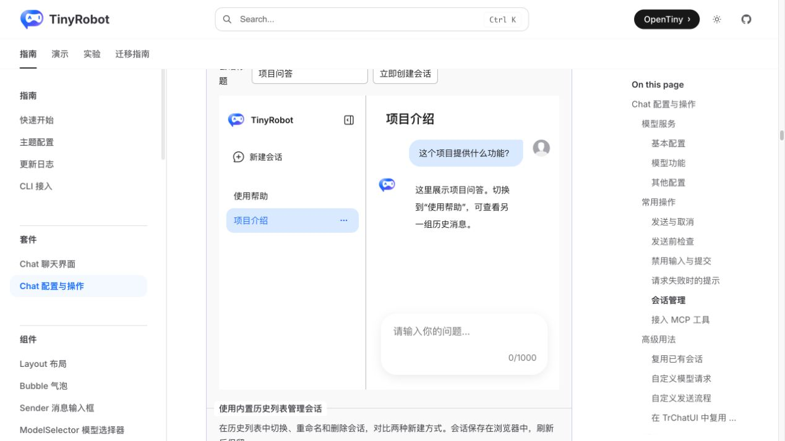
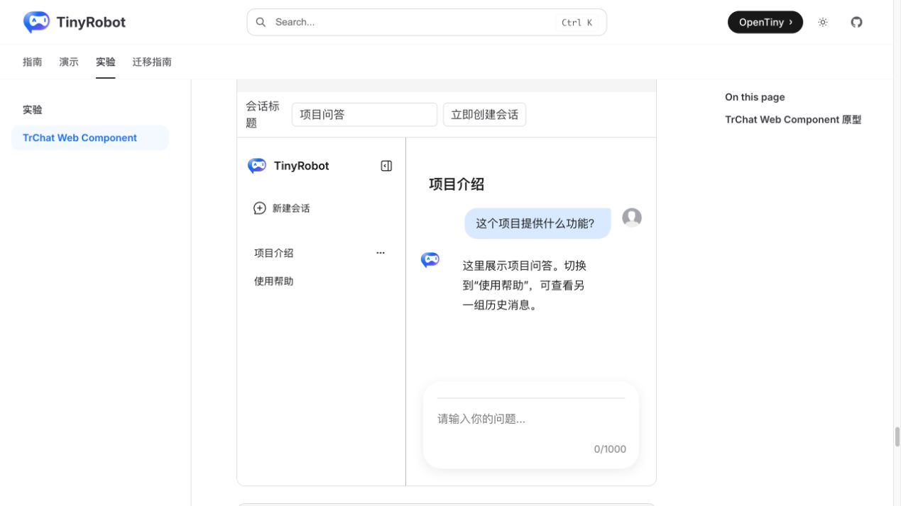
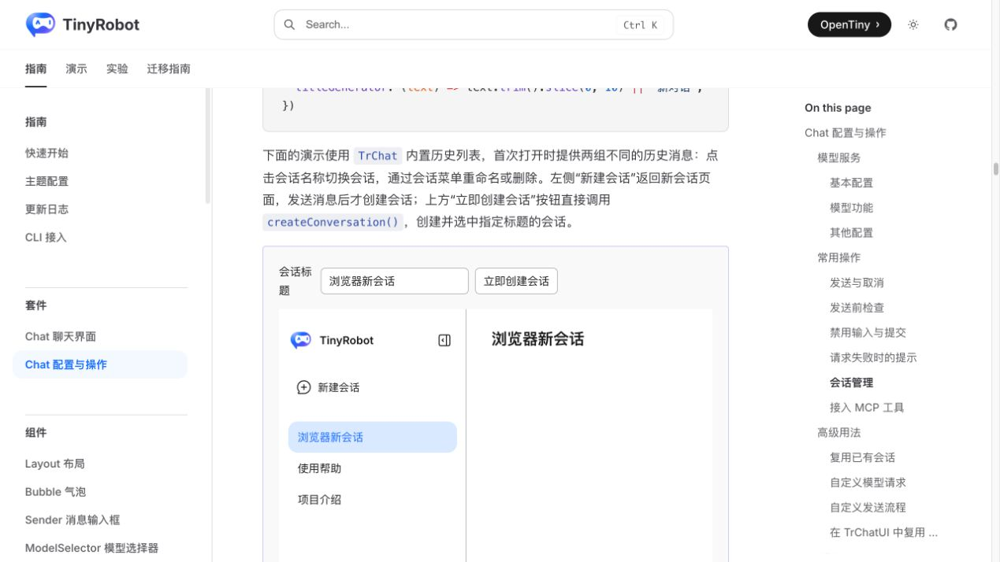
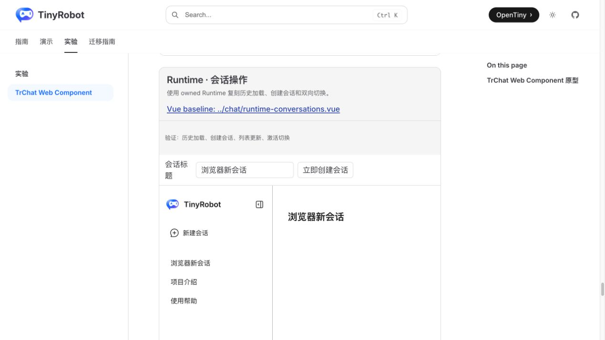
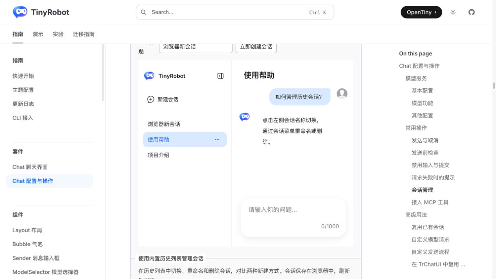
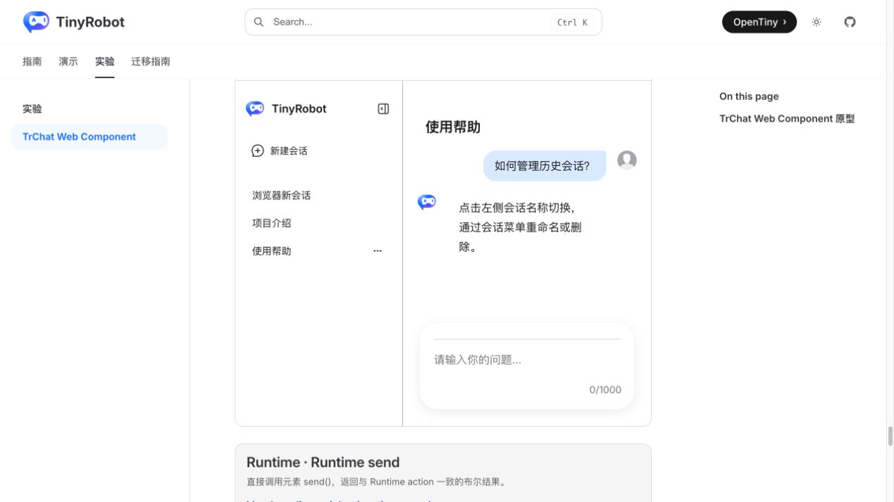

# TrChat Web Component Runtime Conversations 验证报告

- 验证日期：2026-10-27
- 浏览器：Chromium
- 截图视口：1269 × 714
- 原版基线：`docs/demos/chat/runtime-conversations.vue`，`/suites/chat-runtime` 中“使用内置历史列表管理会话”
- Web Component：`docs/demos/chat-experimental/shared/examples.ts` 中的 `runtime-conversations`，`/experiments/chat-web-component`

## 结论

本轮验证通过。Web Component 不再用整份静态 Runtime 替换模拟会话切换，而是使用 owned Runtime、带种子的 storage 和真实 `createConversation()` / `switchConversation()` actions。历史列表、激活态、消息区和外部创建控件均由同一 Runtime 驱动，与原版业务所有权一致。

## 浏览器业务对照

| 场景           | 原版 TrChat                            | Web Component          | 结果 |
| -------------- | -------------------------------------- | ---------------------- | ---- |
| 初始历史       | 显示“项目介绍”“使用帮助”并加载项目消息 | 相同列表、激活态和消息 | 一致 |
| 创建会话       | 指定标题后立即创建、选中并进入空会话   | 相同行为               | 一致 |
| 列表更新       | 新标题进入历史列表，旧会话保留         | 相同行为               | 一致 |
| 切换到使用帮助 | 激活态与消息区一起切换                 | 相同行为               | 一致 |
| 切回项目介绍   | 原历史消息恢复                         | 相同行为               | 一致 |
| 控制台         | 场景无相关 error                       | 场景无 error           | 一致 |

## 截图证据

### 初始历史与项目介绍

### 创建会话

### 切换到使用帮助

## 自动化覆盖

Chromium 场景直接断言两组种子历史、初始消息、指定标题创建、新会话激活、旧消息退出、点击历史项切换两次，以及相应消息恢复。

- 完整 Gallery：20 passed。
- `pnpm -F tiny-robot-test type-check:experimental`：通过。
- `pnpm -F @opentiny/tiny-robot-chat type-check`：通过。
- `pnpm -F docs build`：通过；只有既有 warning。

## 范围边界

- Web Component Demo 使用内存 storage，避免 Gallery 多实例和刷新残留影响验收；原版 Demo 使用 localStorage。两者的 Runtime conversation 协议与用户可见业务一致。
- 多实例 storage namespace、断开重连和销毁规则仍属于“Runtime 与存储所有权”总项，不能因本场景通过而提前标记完成。
