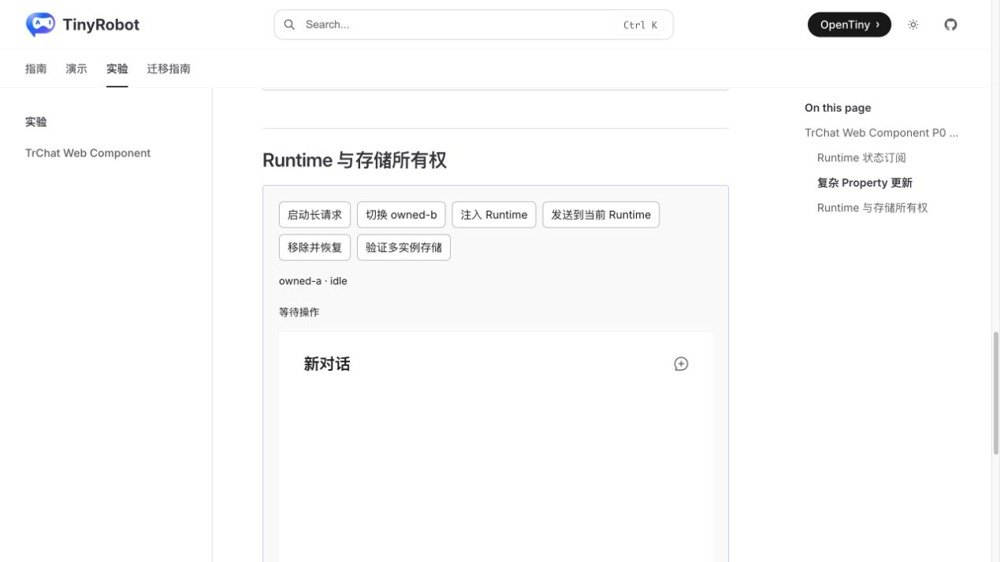
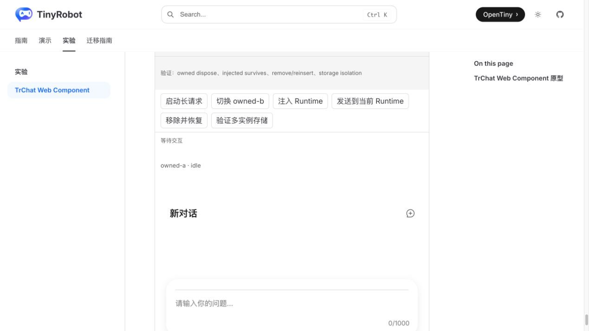
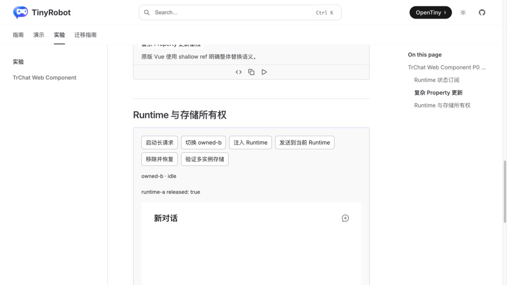
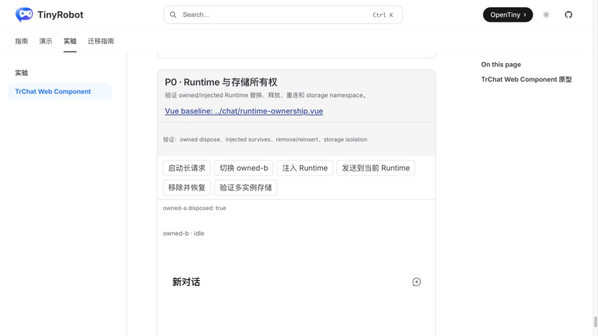
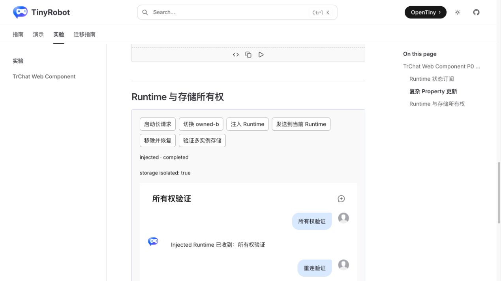
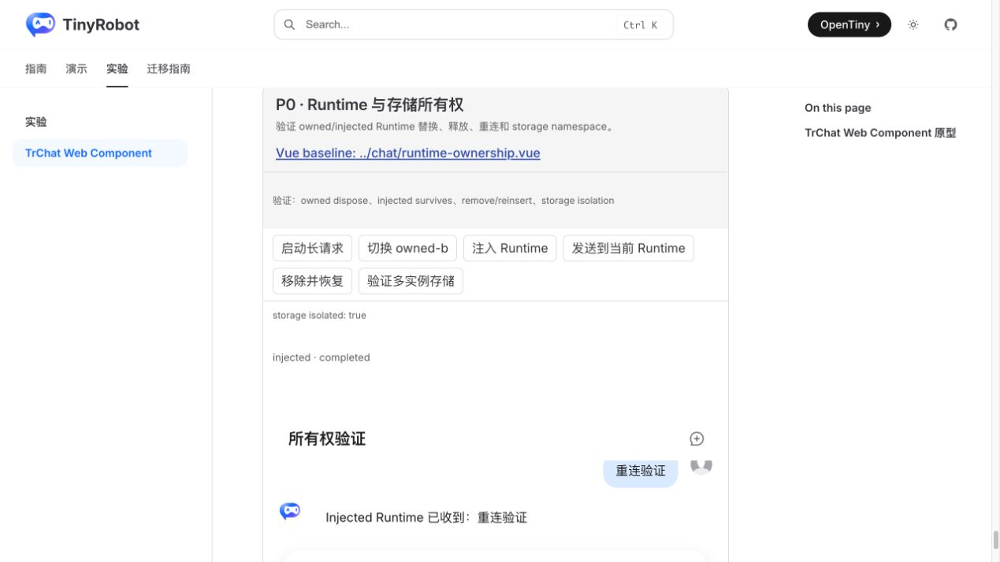

# TrChat Web Component Runtime 与存储所有权验证报告

- 验证日期：2026-10-27
- 浏览器：Chromium
- 截图视口：1269 × 714
- 原版基线：`docs/demos/chat/runtime-ownership.vue`，`/experiments/chat-web-component-p0-baselines`
- Web Component：`docs/demos/chat-experimental/shared/examples.ts` 中的 `runtime-ownership`，`/experiments/chat-web-component`

## 结论

验收通过，协议判定为 direct。`runtimeOptions` 创建的 owned Runtime 由元素持有：替换配置会释放旧 Runtime，真实断开会释放当前 Runtime；通过 `runtime` 注入的 Runtime 由宿主持有，元素替换、断开和重连都不会释放它。同一事件循环的 remove/reinsert 不被误判为销毁。多实例通过不同 `storageKey` 隔离持久化数据，元素销毁不会删除存储内容。

## 所有权规则

| 输入             | 创建者      | dispose 责任 | 重连行为           |
| ---------------- | ----------- | ------------ | ------------------ |
| `runtimeOptions` | `<tr-chat>` | `<tr-chat>`  | 真实断开后重建     |
| `runtime`        | 宿主        | 宿主         | 保留同一实例和状态 |

同一元素不应同时把 `runtime` 和 `runtimeOptions` 视为两个活动来源；注入 Runtime 优先表达宿主所有权，切回 owned 模式时应重新赋值 `runtimeOptions`。

## 浏览器业务对照

| 场景            | 原版 TrChat         | Web Component                                  | 结果 |
| --------------- | ------------------- | ---------------------------------------------- | ---- |
| owned 初始      | owned-a 可用        | owned-a 可用                                   | 一致 |
| owned 替换      | 旧 Runtime 已释放   | 日志 `owned-a disposed: true`                  | 一致 |
| injected        | 宿主 Runtime 可发送 | 注入后消息正常显示                             | 一致 |
| remove/reinsert | 注入实例保持可用    | 日志 `injected survives: true`，重连后继续发送 | 一致 |
| 存储隔离        | 两个 key 数据隔离   | 日志 `storage isolated: true`                  | 一致 |
| 控制台          | 无相关 error        | 无相关 error                                   | 一致 |

## 截图证据

### 初始 owned Runtime

### 替换 owned Runtime

### injected Runtime 与重连

## 自动化覆盖

Chromium 场景断言 owned-a 替换时被释放、owned-b 继续可用、injected Runtime 可发送且重连后存活、重连后继续发送成功，以及两个 storage key 互不读取对方会话。

- Playwright 组件回归：273 / 273 通过。
- 实验 Chromium 套件：26 通过、2 个真实服务用例按凭据守卫跳过。
- Chat 与实验测试类型检查：通过。
- 文档 production build：通过，仅有既有依赖 warning。

## 范围边界

- `storageKey` 是 namespace；多实例需要隔离时必须显式使用不同 key，共用 key 则有意共享持久化数据。
- 元素 dispose 只释放运行时资源，不删除持久化会话。
- 本轮验证同一文档中的替换与重连；跨页面恢复和异常关闭属于后续持久化耐久性测试。
