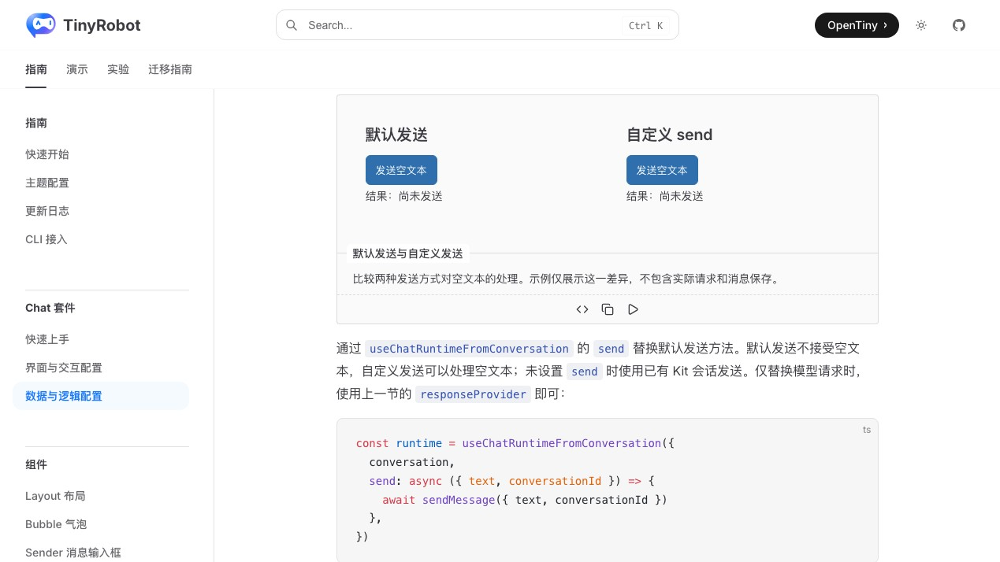
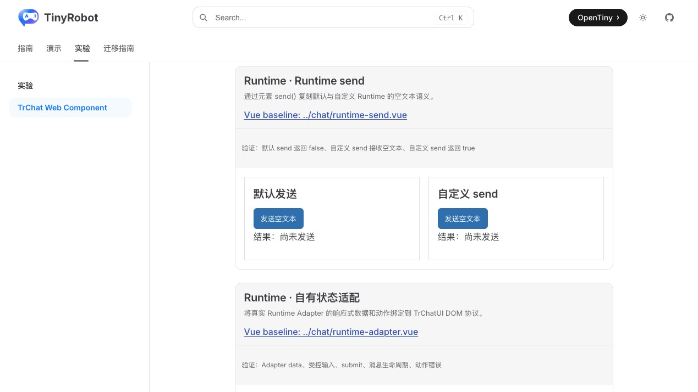
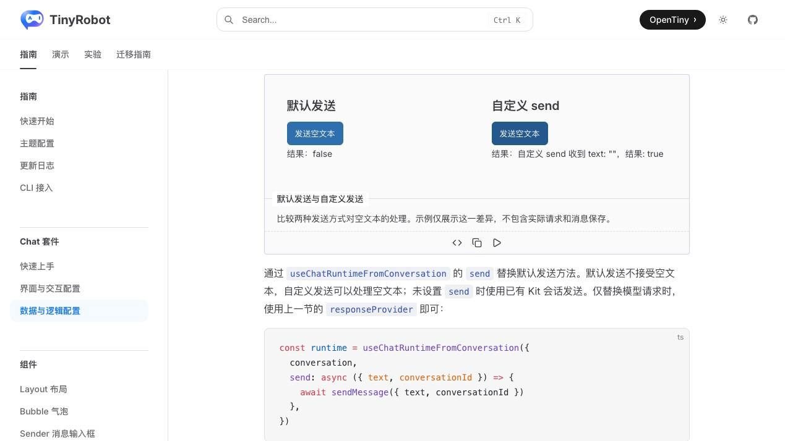
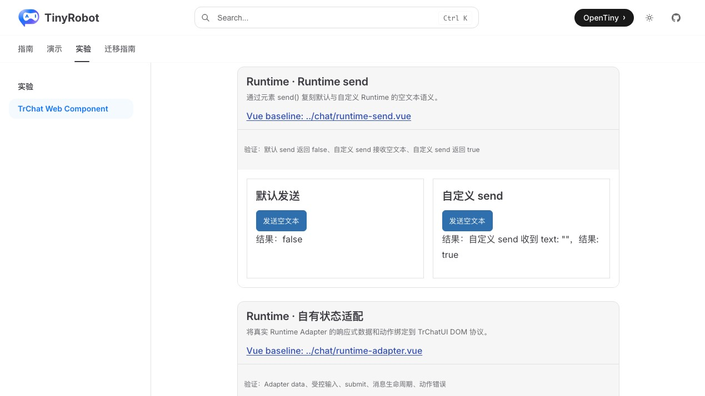

# TrChat Web Component Runtime send() 验证报告

- 验证日期：2026-10-28
- 浏览器：Chromium
- 截图视口：1269 × 714
- 原版基线：`docs/demos/chat/runtime-send.vue`，`/suites/chat-runtime` 中“默认发送与自定义发送”
- Web Component：`docs/demos/chat-experimental/shared/examples.ts` 中的 `runtime-send`，`/experiments/chat-web-component`

## 结论

验收通过，协议判定为 direct。`tr-chat.send()` 直接转发到注入 Runtime 的 `actions.send()`，保留布尔返回值与空文本 payload：默认 Runtime 拒绝空文本并返回 `false`；自定义 Runtime 收到空字符串并返回 `true`。示例与原版一样只展示方法语义，不渲染聊天界面或追加消息。

## 浏览器业务对照

| 场景               | 原版 TrChat                  | Web Component                             | 结果 |
| ------------------ | ---------------------------- | ----------------------------------------- | ---- |
| 初始状态           | 两个发送卡片均显示“尚未发送” | 相同                                      | 一致 |
| 默认发送           | 空文本返回 `false`           | `element.send({ text: '' })` 返回 `false` | 一致 |
| 自定义发送 payload | 自定义方法收到 `text: ""`    | 相同                                      | 一致 |
| 自定义发送结果     | 返回 `true`                  | 相同                                      | 一致 |
| 页面结构           | 纯方法示例，不展示聊天窗口   | 相同                                      | 一致 |
| 控制台             | 无相关 error                 | 无 error                                  | 一致 |

## 截图证据

### 初始状态

### 两种发送结果

## 自动化覆盖

Chromium 专项与核心 smoke 均通过真实元素方法验证默认与自定义 Runtime 的空文本返回值、payload 和结果文案。

- 本批专项验收：3 / 3 通过。
- Chromium 全量实验套件：28 通过，2 跳过。
- 实验测试与 `@opentiny/tiny-robot-chat` 类型检查：通过。
- 文档生产构建：通过（仅保留既有依赖与 bundle 体积警告）。
- 独立浏览器业务检查：默认 `false`、自定义 `true`，控制台无 error。
- 原版与 Web Component 成对截图：通过。

## 范围边界

- 本示例专门验证 send 方法契约，按照原版设计不执行真实模型请求和消息保存。
- 截图用于人工 UI 对照，尚未建立自动像素差异阈值。
