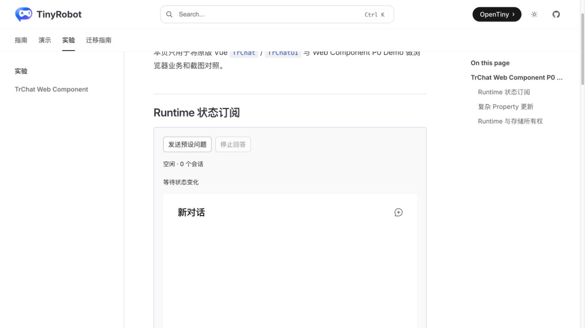
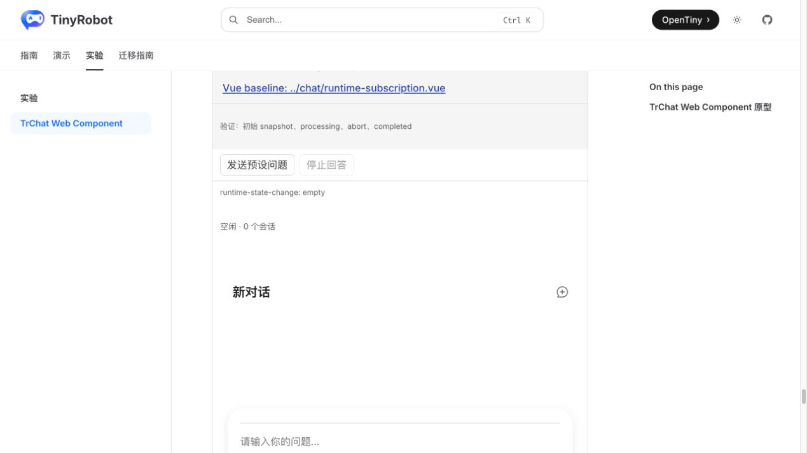
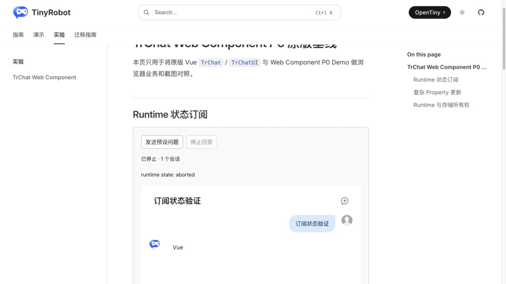
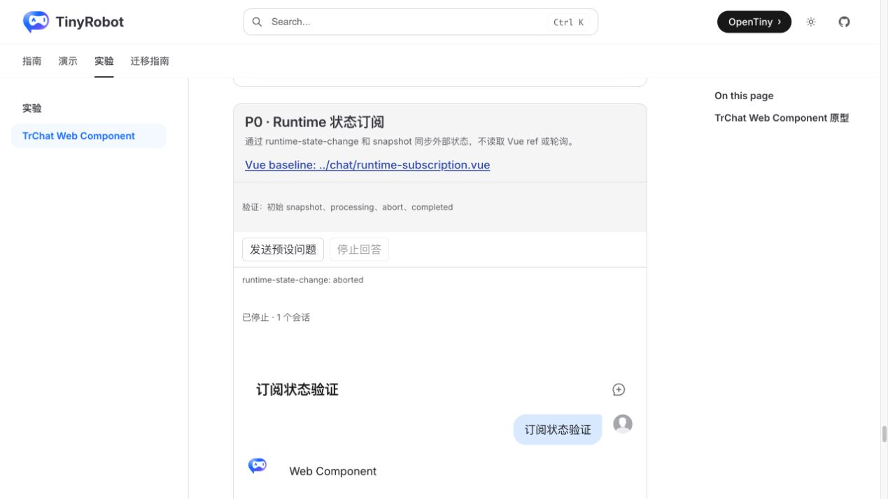
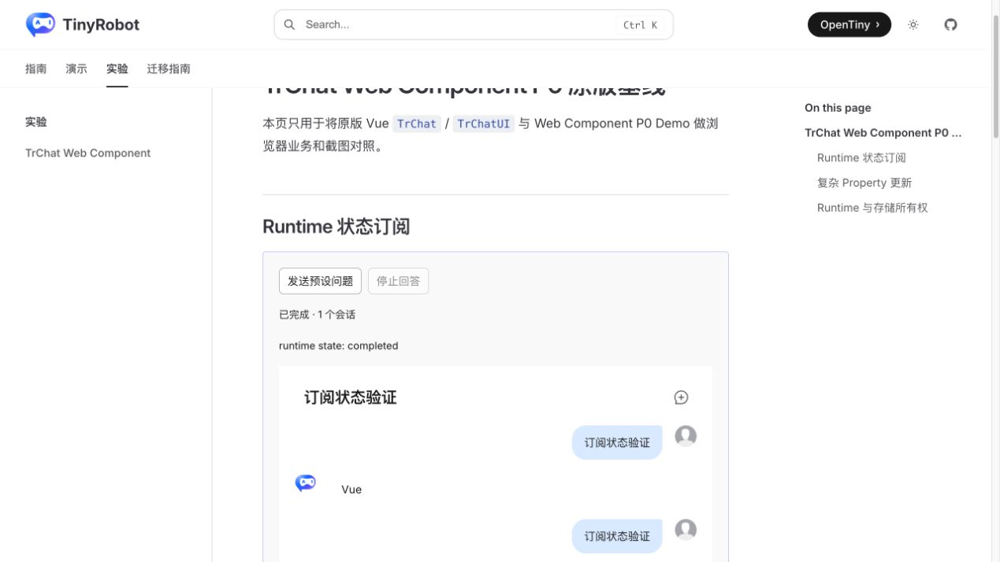
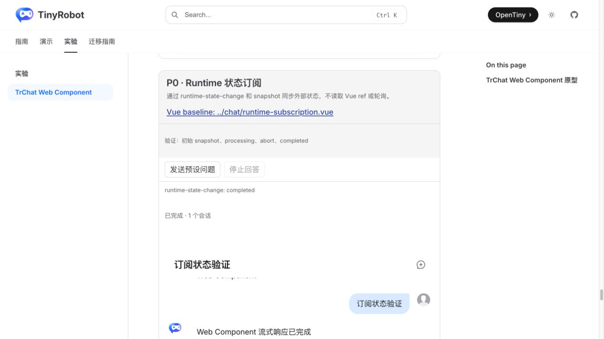

# TrChat Web Component Runtime 状态订阅验证报告

- 验证日期：2026-10-27
- 浏览器：Chromium
- 截图视口：1269 × 714
- 原版基线：`docs/demos/chat/runtime-subscription.vue`，`/experiments/chat-web-component-p0-baselines`
- Web Component：`docs/demos/chat-experimental/shared/examples.ts` 中的 `runtime-subscription`，`/experiments/chat-web-component`

## 结论

验收通过，协议判定为 adapted。`<tr-chat>` 现在提供框架中立的 `getRuntimeSnapshot()` 和 `runtime-state-change` DOM 事件；纯 DOM、Angular 或 React 宿主无需轮询 Vue readable，即可同步会话、活动会话、请求状态及 Composer 禁用状态。浏览器验证覆盖初始、生成中、取消和再次完成，结果与原版 TrChat 的 Vue watch 流程一致。

## 协议映射

| 原版 TrChat                | Web Component                                 |
| -------------------------- | --------------------------------------------- |
| watch Runtime Vue readable | 监听 `runtime-state-change`                   |
| 直接读取 `.value`          | 读取 `event.detail` 或 `getRuntimeSnapshot()` |
| Vue 响应式更新按钮         | 标准 DOM 事件更新宿主按钮                     |

snapshot 是面向宿主的只读时点数据；会话、活动会话和消息数组均创建新容器，宿主不应修改它来反向驱动 Runtime。

## 浏览器业务对照

| 场景   | 原版 TrChat         | Web Component      | 结果 |
| ------ | ------------------- | ------------------ | ---- |
| 初始   | “空闲 · 0 个会话”   | 同样状态           | 一致 |
| 发送   | “生成中 · 1 个会话” | 事件同步相同状态   | 一致 |
| 取消   | “已停止 · 1 个会话” | 事件同步相同状态   | 一致 |
| 恢复   | 再次发送后“已完成”  | 再次发送后“已完成” | 一致 |
| 控制台 | 无相关 error        | 无相关 error       | 一致 |

## 截图证据

### 初始

### 取消

### 再次完成

## 自动化覆盖

Chromium 场景断言初始 snapshot、发送后的 processing、abort 后 stopped、再次发送后的 completed，以及事件日志来自 `runtime-state-change` 而非轮询。组件契约测试还覆盖 Runtime 替换后 snapshot 继续来自新 Runtime。

- Playwright 组件回归：273 / 273 通过。
- 实验 Chromium 套件：26 通过、2 个真实服务用例按凭据守卫跳过。
- Chat 与实验测试类型检查：通过。
- 文档 production build：通过，仅有既有依赖 warning。

## 范围边界

- 本轮公开的是 snapshot/event，不额外引入 subscribe/unsubscribe 对象协议；标准 DOM 事件已经覆盖跨框架订阅与清理。
- streaming 时可能按消息增量多次派发事件，宿主应把事件视为状态通知，而不是固定次数的事务日志。
- 真实 DeepSeek 网络异常仍属于真实服务验证 TODO。
