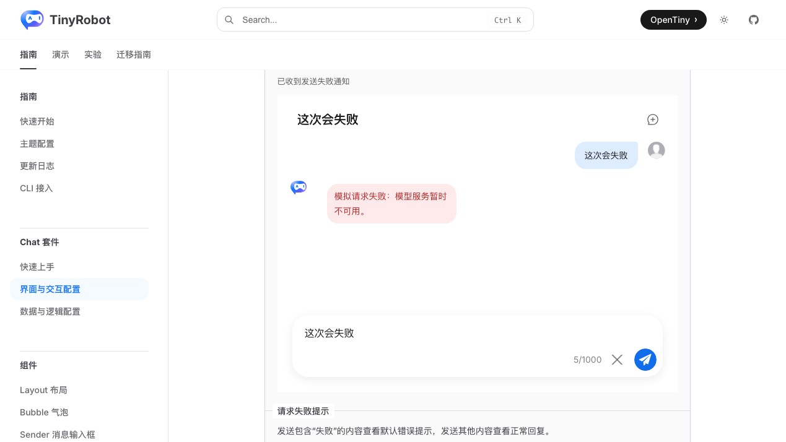
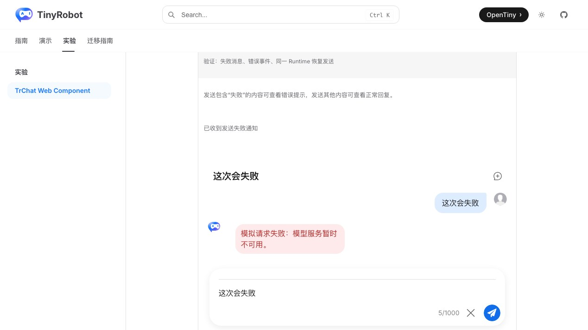
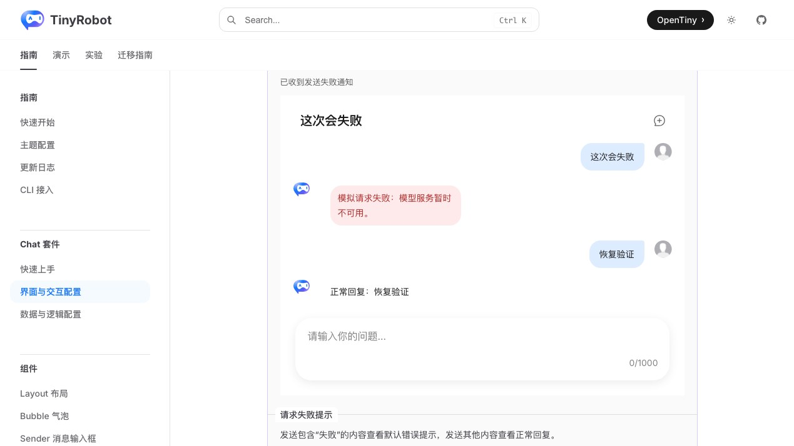
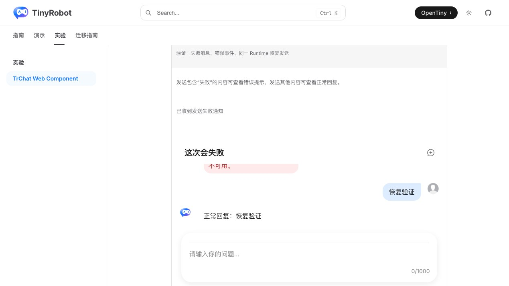

# TrChat Web Component 发送生命周期验证报告

- 验证日期：2026-10-28
- 浏览器：Chromium
- 截图视口：1269 × 714
- 原版基线：`docs/demos/chat/runtime-error.vue`，`/suites/chat` 中“请求失败时的提示”
- Web Component：`docs/demos/chat-experimental/shared/examples.ts` 中的 `runtime-error`，`/experiments/chat-web-component`
- 关联报告：[外部发送与取消](../runtime-actions/report.md)、[Runtime 状态订阅](../runtime-subscription/report.md)

## 结论

验收通过。本轮补齐发送生命周期中的失败与恢复分支：同一 Runtime 内发送包含“失败”的消息后，用户消息被保留、助手错误气泡可见、`runtime-action-error` 通知宿主；随后发送正常消息，无需替换 Runtime 即可得到回答。结合既有外部发送与取消、Runtime 状态订阅报告，当前本地模拟服务范围已覆盖 ready、processing、completed、aborted、error 和 error 后恢复。

## 浏览器业务对照

| 场景     | 原版 TrChat                        | Web Component                                     | 结果 |
| -------- | ---------------------------------- | ------------------------------------------------- | ---- |
| 失败触发 | 输入包含“失败”的内容               | 相同输入与 provider 规则                          | 一致 |
| 错误消息 | 助手气泡显示服务不可用             | 同一错误气泡                                      | 一致 |
| 宿主通知 | 状态变为“已收到发送失败通知”       | `runtime-action-error.detail.action` 驱动同一状态 | 一致 |
| 恢复发送 | 同一 Runtime 再次发送成功          | 无需替换 Runtime 即可恢复                         | 一致 |
| 控制台   | 业务错误被组件处理，无未处理 error | 相同                                              | 一致 |

## 截图证据

### 发送失败

### 同一 Runtime 恢复

## 自动化覆盖

Chromium 场景直接通过真实输入器触发失败，断言宿主通知、错误气泡，再在同一 Runtime 发送正常消息并断言恢复回答，同时检查控制台 error。

- 完整 Chromium experimental suite：28 passed，2 skipped；跳过项为凭据门控的真实 streaming 与真实 MCP。
- `pnpm -F tiny-robot-test type-check:experimental`：通过。
- `pnpm -F @opentiny/tiny-robot-chat type-check`：通过。
- `pnpm -F docs build`：通过；仅有既有 bundle、Vite browser externalization 和 Zod 注释 warning。

## 范围边界

- 本报告使用本地 `ResponseProvider`，真实 DeepSeek 的超时、断网、HTTP 错误、限流和重试仍属于“真实服务验证”TODO。
- 流式生成与取消证据复用已完成的 `runtime-actions` 和 `runtime-subscription` 专项验收。
