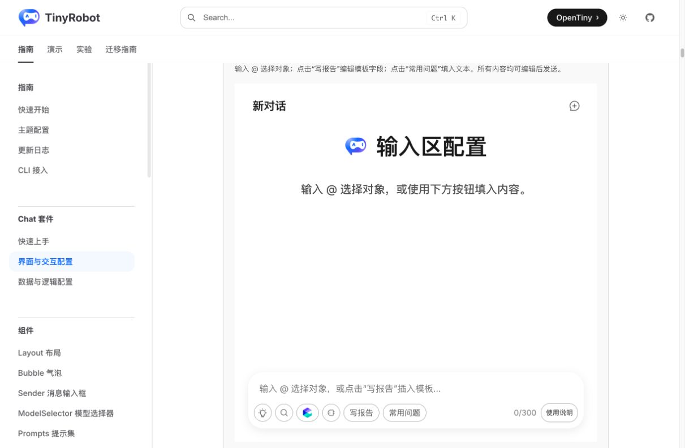
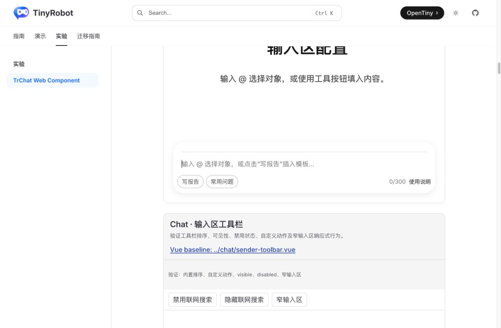
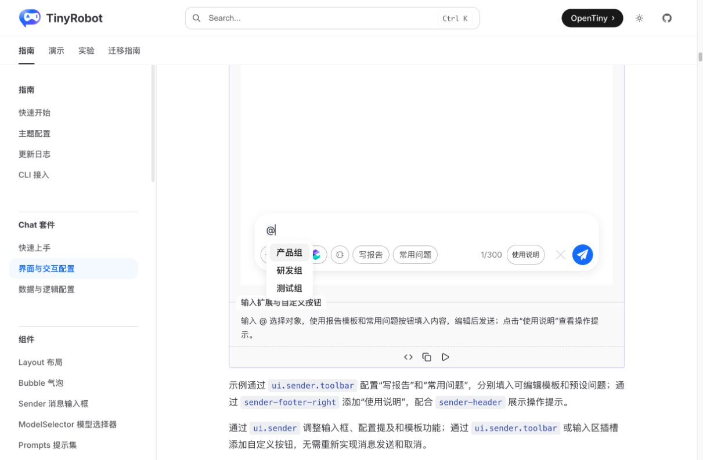
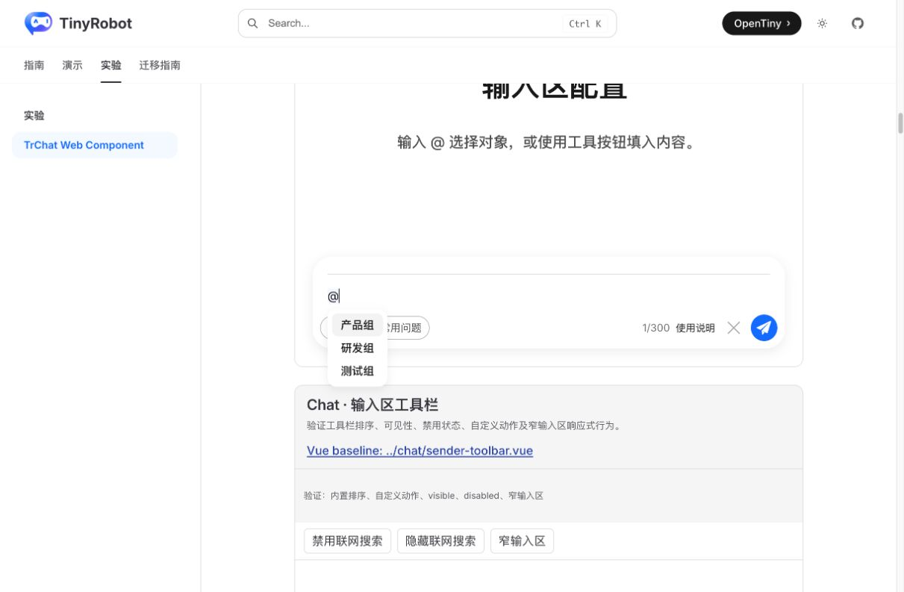
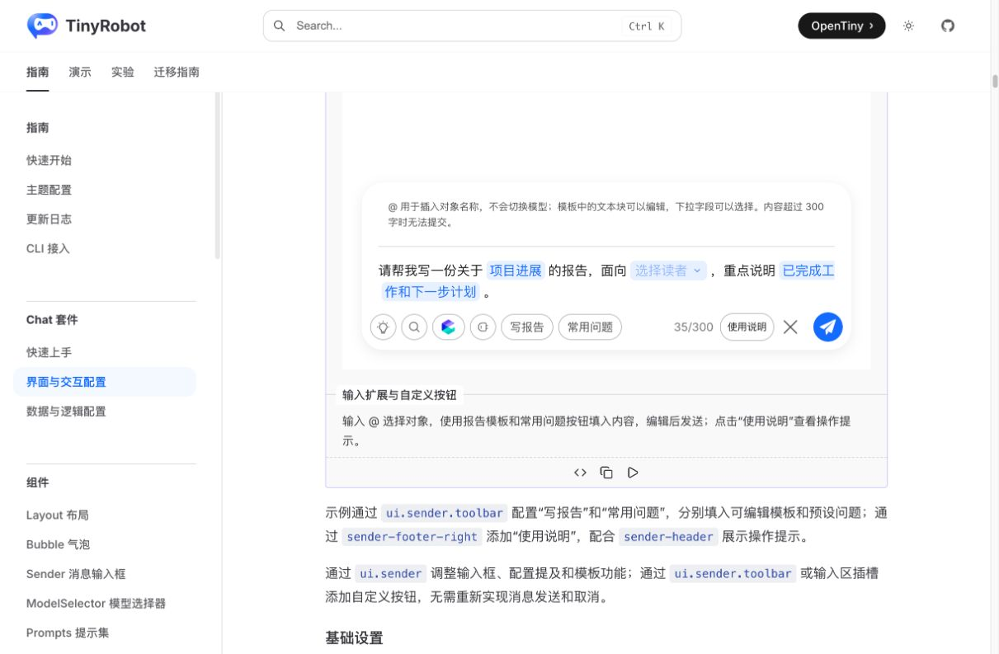
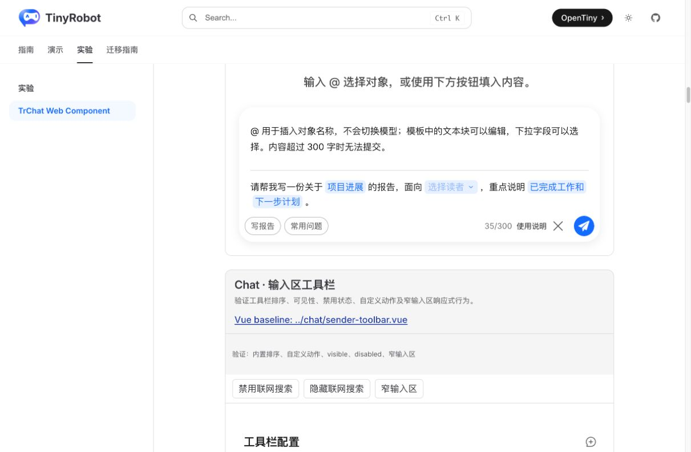
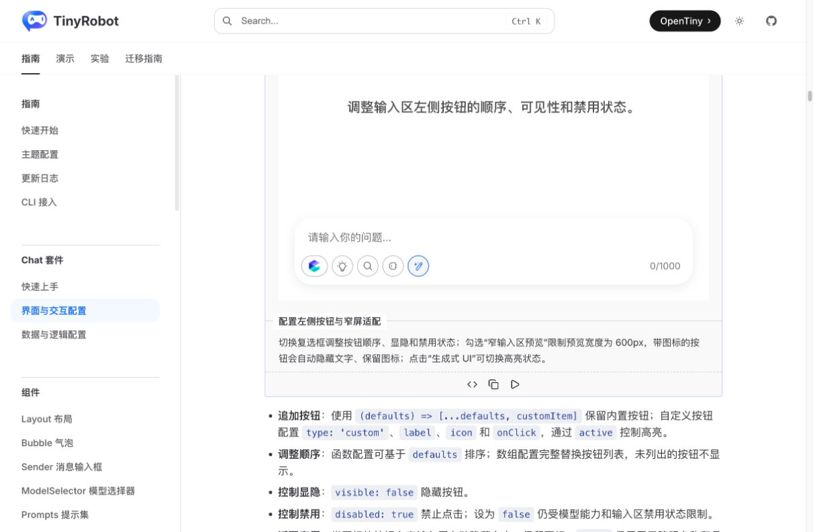
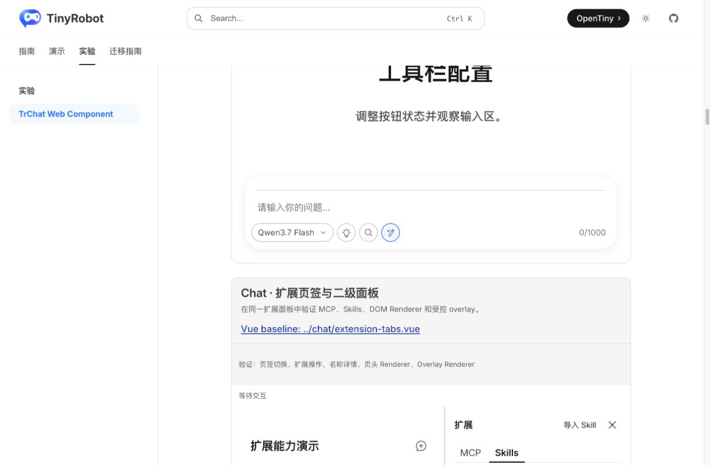
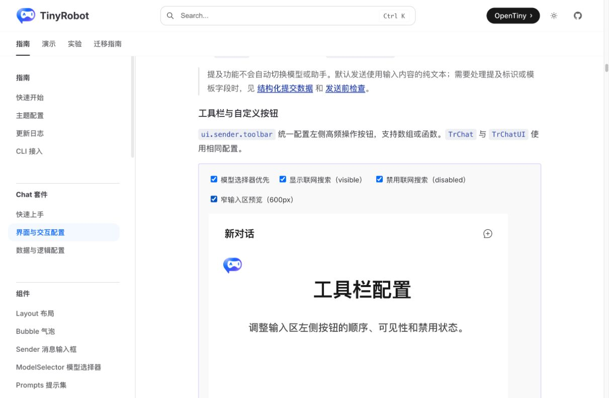
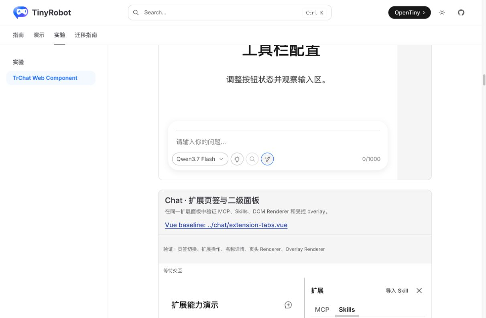

# TrChat Web Component Sender 高级能力验证报告

- 验证日期：2026-10-28
- 浏览器：Chromium
- 原版基线：`docs/demos/chat/sender-options.vue`、`docs/demos/chat/sender-toolbar.vue`
- Web Component：`sender-options`、`sender-toolbar`，页面 `/experiments/chat-web-component`

## 结论

本轮验证通过。Mention、结构化 Template、帮助 Light DOM slot、字数限制、清空、自定义按钮，以及 Toolbar 的排序、显隐、禁用、自定义激活状态和 600px 窄输入区均能在 Web Component 下复用原生 Sender/TrChat 行为。

浏览器对照期间发现 Web Component Demo 曾省略原版模板的“选择读者”字段；现已补齐为同一 `text + block + select` 结构，并增加自动化断言。Mention 验收使用真实逐键输入，避免 DOM `fill()` 绕过 ProseMirror 键盘事务。

## 浏览器业务对照

| 场景                    | 原版 TrChat                                         | Web Component                          | 结果 |
| ----------------------- | --------------------------------------------------- | -------------------------------------- | ---- |
| Mention                 | 输入 `@` 显示产品组、研发组、测试组                 | 相同列表，选择后写入 mention 节点      | 一致 |
| 报告模板                | 文本、项目进展 block、选择读者 select、下一步 block | 相同结构、内容与字数统计               | 一致 |
| 帮助区                  | `sender-header` 展示说明                            | Light DOM `sender-header` 展示相同说明 | 一致 |
| 常用问题                | 替换为可编辑预设文本                                | 相同行为                               | 一致 |
| Toolbar 顺序            | 模型、思考、搜索、自定义动作                        | 相同顺序与可访问名称                   | 一致 |
| active/disabled/visible | 自定义项高亮，搜索可禁用或隐藏                      | 相同行为                               | 一致 |
| 600px 窄输入区          | 带图标按钮隐藏文字保留图标                          | 相同行为                               | 一致 |

## 截图证据

### Sender 初始状态

### Mention 弹层

### 结构化 Template 与帮助区

### Toolbar 激活与窄布局

## 自动化覆盖

Chromium 场景覆盖 Mention 选择、Template 结构、帮助显示、预设问题、受控编辑、字数统计、清空、Toolbar 顺序、可访问名称、active、disabled、visible 与窄布局。

## 范围边界

- `TrSender.template()` 当前接收 Vue `Ref`，本 Demo 所在文档工程可直接复用；纯非 Vue 宿主若要动态替换 Template，仍应评估一个不暴露 Vue Ref 的公开宿主契约。
- 本报告证明 Web Component 能承载现有 Sender 高级能力；上述纯框架中立的 Template 更新 API 属于后续 API 稳定化议题，不影响当前原生组件复用结论。
