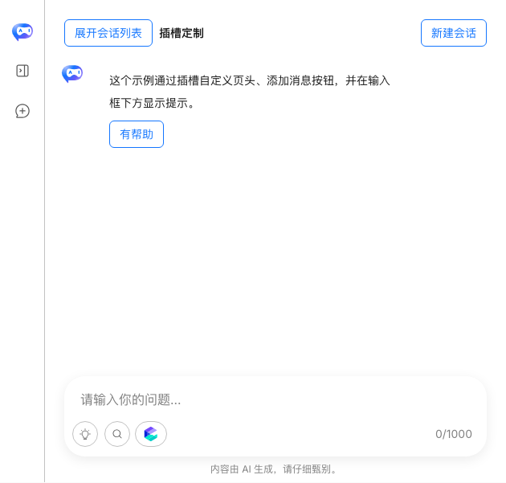
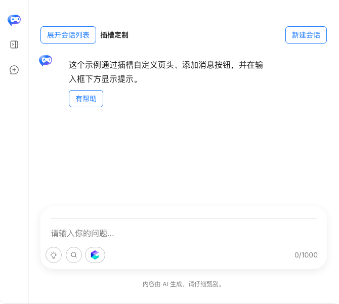
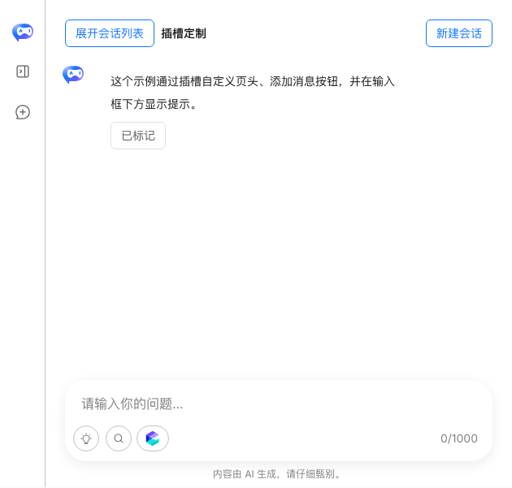
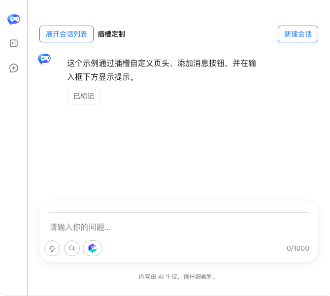
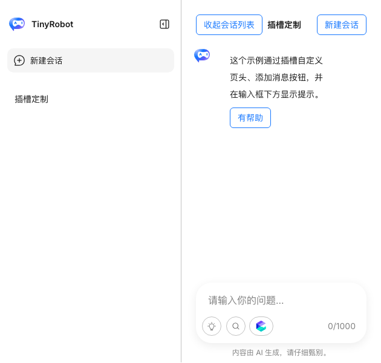
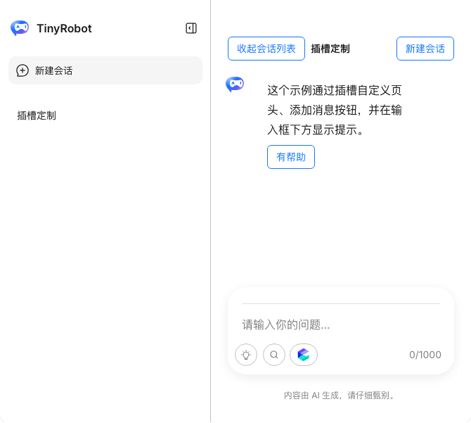

# TrChat Web Component Slot 验证报告

- 验证日期：2026-10-27
- 浏览器：Chromium
- 视口：1440 × 1000
- 原版基线：`docs/demos/chat/slots-basic.vue`，`/demos/chat/slots-basic`
- Web Component：`docs/demos/chat-experimental/shared/examples.ts` 中的 `slots-basic`，`/experiments/chat-web-component`

## 结论

本轮验证通过。将带上下文的 DOM Renderer 下沉到原生 `TrChat` 后，Web Component 的 `slots-basic` 已复现原版 TrChat 的自定义页头、助手消息反馈按钮和输入框下方提示，并保持会话侧栏、新建会话、模型能力入口和反馈状态等业务行为一致。

这证明原版的 scoped slot 能力可以通过 `TrChatRenderers` 暴露给 Web Component；它不是把 Vue VNode 或任意 Vue 组件直接跨边界传入。无上下文的静态 Light DOM slot 仍属于另一条能力路径。

## 能力映射

| 原版 TrChat scoped slot | Web Component renderer               | 验证内容                                         |
| ----------------------- | ------------------------------------ | ------------------------------------------------ |
| `layout-header`         | `renderers['layout-header']`         | 展开/收起会话列表、新建会话、实时标题、ARIA 状态 |
| `bubble-content-footer` | `renderers['bubble-content-footer']` | 仅助手消息显示反馈按钮、点击后禁用并保持状态     |
| `composer-after`        | `renderers['composer-after']`        | 始终显示 AI 内容提示                             |

Renderer 使用原生 DOM 创建内容，消费 TrChat 提供的 context，并通过 `AbortSignal` 清理事件监听。原生 TrChat 仍负责布局、Runtime、会话和消息状态。

## 浏览器业务对照

| 场景           | 原版 TrChat                                                       | Web Component                        | 结果                |
| -------------- | ----------------------------------------------------------------- | ------------------------------------ | ------------------- |
| 初始状态       | 自定义标题、侧栏按钮、新建按钮、助手反馈、composer 提示、模型入口 | 同样的内容和控件均可见               | 一致                |
| 点击“有帮助”   | 变为“已标记”并禁用                                                | 变为“已标记”并禁用                   | 一致                |
| 展开会话列表   | 左侧会话列表展开，按钮变为“收起会话列表”                          | 同样展开并更新 ARIA/按钮文本         | 一致                |
| 展开后反馈状态 | “已标记”继续保留                                                  | “已标记”继续保留                     | 一致                |
| 新建会话       | 标题变为“新对话”，显示欢迎空状态，无反馈按钮                      | 同样进入欢迎空状态，无反馈按钮       | 一致                |
| 控制台         | 基线页面另有两个无关 MCP Demo 的 404                              | 新鲜 Web Component 页面无 error/warn | Slot 场景无相关错误 |

原版页面的两个 404 分别来自 `/api/mcp/project-knowledge` 和 `/api/mcp/release-calendar`，不属于 Slot Demo。Web Component 页面最终浏览器检查的控制台问题列表为空。

## 截图证据

文档容器给原版 Demo 约 630px 宽、给实验 Gallery 约 670px 宽，因此发送区可用宽度存在约 40px 的页面外壳差异；组件高度、控件、状态和交互保持一致，此差异不代表 Slot 能力缺失。

### 初始状态

原版 TrChat：

Web Component：

### 反馈状态

原版 TrChat：

Web Component：

### 会话侧栏展开

原版 TrChat：

Web Component：

## 自动化验证

- `pnpm -F tiny-robot-test exec playwright test -c playwright.experimental.config.ts experimental/chat-web-component.examples.spec.ts --project=chromium`：20 passed。
- `pnpm -F tiny-robot-test exec playwright test -c playwright-ct.config.ts component/chat/ChatRenderers.spec.ts component/chat-experimental/Elements.spec.ts`：26 passed。
- `pnpm -F tiny-robot-test type-check:experimental`：通过。
- `pnpm -F @opentiny/tiny-robot-chat type-check`：通过。

自动化覆盖原版业务场景、renderer 分类、Vue scoped slot 优先级、消息/内容索引、renderer 替换、异常恢复以及卸载时的 `AbortSignal` 生命周期。

## 范围边界

- 本报告只将项目 TODO 中的 Slot 协议标记为完成。
- Bubble Renderers 的独立等价 Demo、截图和流式/多段业务验收仍需单独完成。
- 双向绑定的完整 submit、cancel、loading、消息追加和跨框架验收仍需单独完成。
- 当前验证说明 DOM Renderer 可以承接原版 scoped slot 场景，不代表任意 Vue 组件或 VNode 可以直接传入 Web Component。
