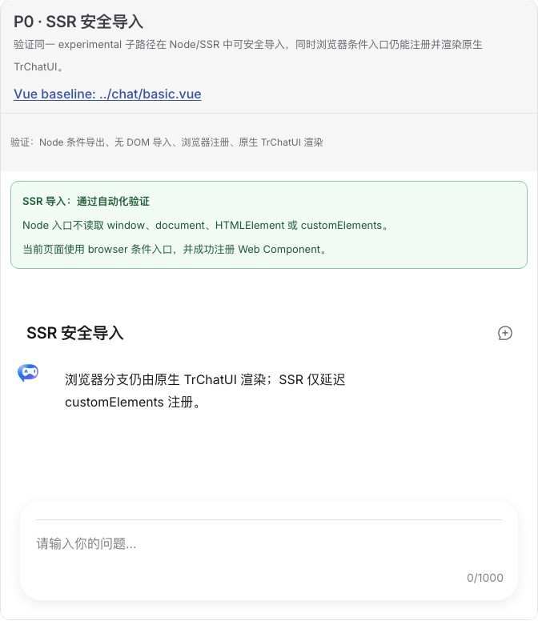

# SSR 安全导入验收报告

## 结论

**通过。** `@opentiny/tiny-robot-chat/experimental` 现在通过 package conditions 提供 browser 与 node 两个入口。Node 导入不访问 `window`、`document`、`HTMLElement` 或 `customElements`；只有在 Node 中调用 `defineTrChatElements()` 时才抛出可操作的 `TrChatBrowserOnlyError`。浏览器入口继续注册并渲染原生 `TrChatUI`。

## Demo 与原版对照

- Web Component Demo：[`ssr-safe-import.ts`](../../../demos/chat-experimental/ssr-safe-import.ts)
- 原版 UI 基线：[`basic.vue`](../../../demos/chat/basic.vue)
- 原版基础布局截图可复用[基础聊天验证报告](../basic-chat/report.md)中的 TrChat 截图；SSR 本身没有原版 UI 差异，新增卡只展示条件入口状态。

人工浏览器检查确认标题、消息气泡、输入区、间距与原生 TrChatUI 基线一致，状态提示未挤压或覆盖布局，控制台无 error。

## 自动化证据

- `node --test scripts/verify-chat-experimental-ssr.test.js`：Node 无 DOM 导入和注册保护通过。
- `scripts/verify-chat-experimental-exports.test.js`：browser/node 条件和构建产物存在性通过。
- Gallery Chromium 用例：状态卡、browser 条件入口和原生 UI 渲染通过。

## 边界

本项验证“安全导入”，不宣称 Web Component 支持服务端渲染或 hydration。注册与挂载仍必须在浏览器生命周期执行。
