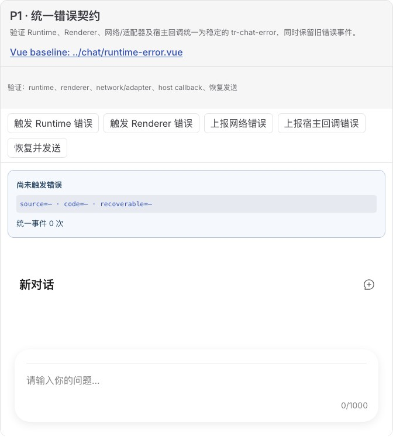
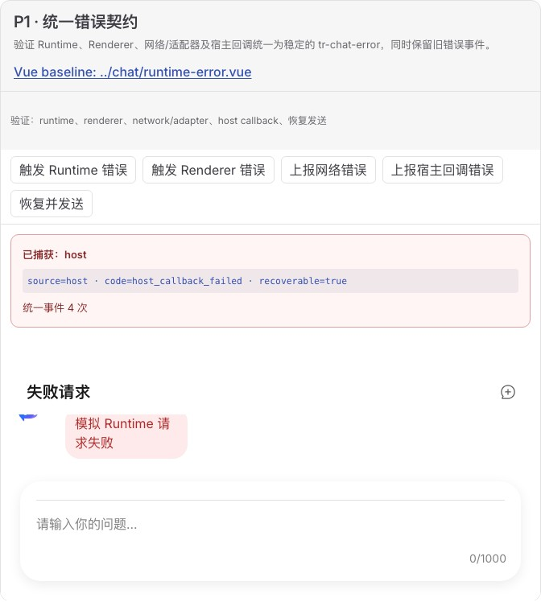
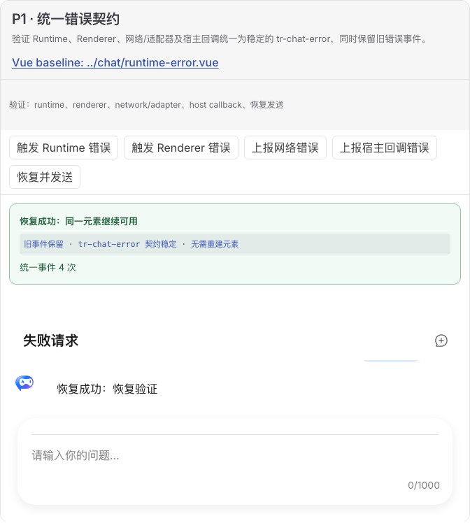

# 统一错误契约验收报告

## 结论

**通过。** 新增标准 DOM 事件 `tr-chat-error`，detail 固定包含 `source`、`code`、`cause` 和 `recoverable`，并可携带 `action` / `payload`。自动映射 Runtime、Renderer、Attachment 与 Element 错误，网络、Adapter 和宿主回调可通过公开 `dispatchTrChatError()` 上报。既有 `runtime-action-error`、`attachment-error` 和 `experimental-error` 保持不变。

## Demo 与原版对照

- Web Component Demo：[`unified-error-contract.ts`](../../../demos/chat-experimental/unified-error-contract.ts)
- 原版 UI 基线：[`runtime-error.vue`](../../../demos/chat/runtime-error.vue)
- 原版失败/恢复截图见[发送生命周期报告](../send-lifecycle/report.md)。本 Demo 在相同原生 TrChat 布局上增加宿主可见的错误协议状态。

| 初始                                             | 四类错误归一化                                  | 同一元素恢复                                       |
| ------------------------------------------------ | ----------------------------------------------- | -------------------------------------------------- |
|  |  |  |

人工浏览器依次触发 Runtime、Renderer、Network 和 Host 错误，状态累计为 4 次；错误状态层级清晰且布局未退化。恢复后状态转绿，原元素继续发送并显示助手回复，无需重建。

## 自动化证据

- Playwright CT：Renderer 同时派发旧事件与统一事件；Runtime action 统一映射；Attachment 保留旧事件并映射统一事件。
- 类型测试：原生/Angular 消费端可直接获得稳定的 `TrChatErrorDetail`。
- Angular 20：应用壳已改为监听 `tr-chat-error`，单元测试通过真实 DOM 事件验证错误原因进入宿主状态；不再分别绑定 Runtime 和附件错误事件。
- Gallery Chromium：四类来源、字段、累计次数和恢复行为全部通过。

## 兼容性

统一事件为新增能力，不移除旧事件。Angular 验证应用已迁移到 `tr-chat-error`；其他现有宿主可以渐进迁移，需要旧 payload 时仍可监听对应 legacy event。
