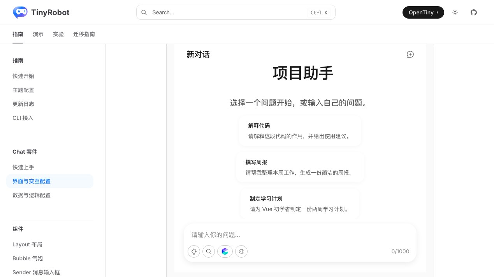
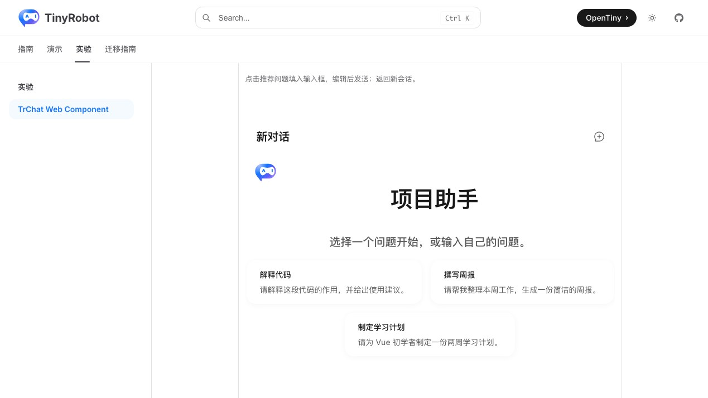
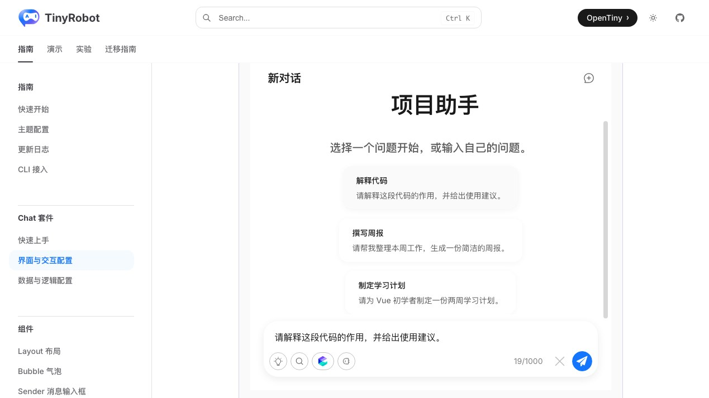
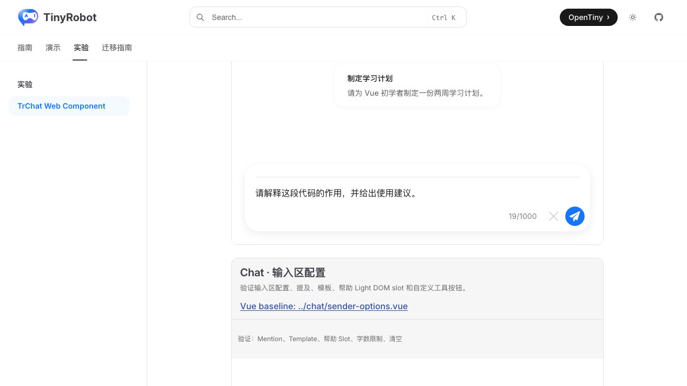

# TrChat Web Component 欢迎区与推荐问题验证报告

- 验证日期：2026-10-28
- 浏览器：Chromium
- 截图视口：1269 × 714
- 原版基线：`docs/demos/chat/welcome-prompts.vue`，`/suites/chat` 中“欢迎区和推荐问题”
- Web Component：`docs/demos/chat-experimental/shared/examples.ts` 中的 `welcome-prompts`，`/experiments/chat-web-component`

## 结论

验收通过，协议判定为 adapted。Web Component 复现了原版 `Welcome`、`Prompts`、`TrSender.template()` 和 `TrChat` 组合：三组推荐问题及描述一致，`prompt-click` 的 `CustomEvent.detail` 写入同一模板输入，欢迎区和推荐问题可独立隐藏，返回新会话会清空当前输入。原版与 Web Component 均使用原生组件；外层验收卡片宽度不同，推荐卡在截图中分别呈单列和换行排列，但内容、响应式规则和交互结果一致。

## 浏览器业务对照

| 场景       | 原版 TrChat                            | Web Component                       | 结果 |
| ---------- | -------------------------------------- | ----------------------------------- | ---- |
| 欢迎区     | “项目助手”及描述                       | 文案一致                            | 一致 |
| 推荐问题   | 解释代码、撰写周报、制定学习计划       | 标签和描述一致                      | 一致 |
| 点击问题   | description 写入模板输入               | DOM 事件 detail 写入同一模板        | 一致 |
| 显示开关   | 两个 checkbox 独立控制                 | property 整体重赋值后同样隐藏       | 一致 |
| 返回新会话 | abort、清空 active conversation 和模板 | 通过 owned Runtime 公开 action 完成 | 一致 |
| 控制台     | 无相关 error                           | 无相关 error                        | 一致 |

## 截图证据

### 初始状态

### 推荐问题写入输入框

## 自动化覆盖

Chromium 场景直接断言欢迎文案、三组推荐问题、description 写入、欢迎区隐藏、推荐问题隐藏、返回新会话清空输入和控制台 error。

- 完整 Chromium experimental suite：28 passed，2 skipped；跳过项为凭据门控的真实 streaming 与真实 MCP。
- `pnpm -F tiny-robot-test type-check:experimental`：通过。
- `pnpm -F @opentiny/tiny-robot-chat type-check`：通过。
- `pnpm -F docs build`：通过；仅有既有 bundle、Vite browser externalization 和 Zod 注释 warning。

## 范围边界

- 截图宽度触发了不同的 `Prompts` 换行结果；这是容器宽度造成的响应式排列，不是 Web Component 内部组件差异。
- 尚未建立像素差异阈值。
